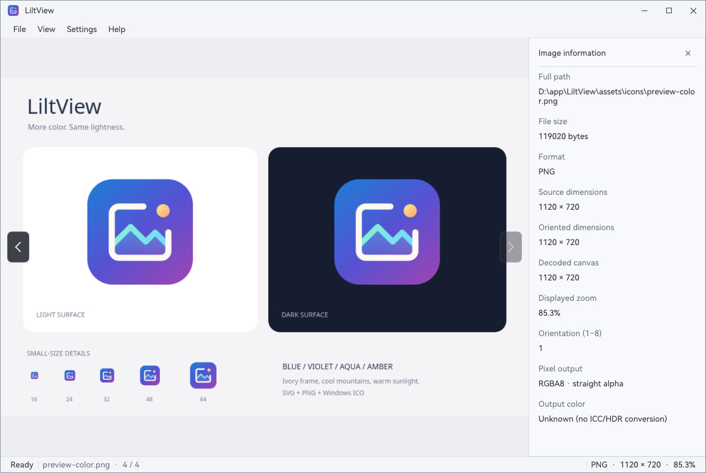
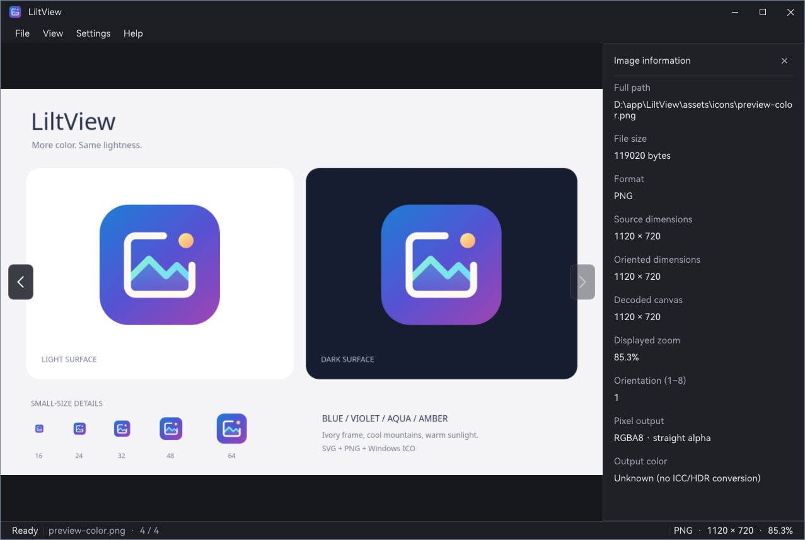

# LiltView

**English** | [简体中文](README.zh-CN.md)


A lightweight desktop image viewer for local images, original-pixel detail, everyday GIF playback, and large static images.

Validated on Windows 10, Arch Linux with a Wayland desktop, and Arch Linux in WSL2 on Windows 10. English and Simplified Chinese interfaces, with light and dark themes, keep the focus on your images.

## Screenshots

The image information panel, status bar, and both themes. Both screenshots display the same PNG; changing the theme only changes the interface colors.

| Light theme | Dark theme |
| --- | --- |
|  |  |

## Features

- **Open your way**: use the File menu, `Ctrl+O`, drag a single file into the window, or open an image from the command line.
- **Browse a folder**: images in the same directory use natural filename ordering. Navigate with `←` / `→`, the menu, or the buttons at the canvas edges. Navigation stops at the first and last image instead of wrapping around.
- **Inspect the details**: fit to window, view at 100% original-pixel scale, zoom with the mouse wheel, drag to pan, use keyboard zoom and viewport movement, or go fullscreen.
- **View large static images**: tiled display and detail restoration let you explore large images. Once a static image finishes loading, zooming and panning do not decode the source file again. Actual size limits depend on the format and available resources.
- **Play GIFs automatically**: ordinary-size GIFs follow their source frame durations and loop information, including transparency and frame compositing. Playback scheduling pauses when the window is hidden or minimized.
- **See image information**: the status bar shows the filename, folder position, original format, source dimensions, and zoom. Press `I` for more details.
- **Understand loading and failures**: the status bar distinguishes ready, loading, and restoring states. If loading fails, a central illustration and a reason below it explain the problem instead of presenting the old image as a successful load.
- **Use the canvas context menu**: after an image loads successfully, right-click the central viewing area for the same actions as the View menu.
- **Make it yours**: English or Simplified Chinese, light / dark / system theme, system or custom title bar, and optional rounded corners. Your preferences are saved.

## Image Formats and Scope

| Format | Supported today | Limits |
| --- | --- | --- |
| JPEG (`.jpg` / `.jpeg`) | Common 8-bit RGB and grayscale images, including progressive JPEG and EXIF orientation | No CMYK / YCCK, 12-bit JPEG, or progressive scan previews |
| PNG (`.png`) | Color, grayscale, indexed color, transparency, and Adam7 interlacing | 16-bit input is converted to 8-bit display; APNG is not supported |
| WebP (`.webp`) | Static lossy / lossless images and transparency | Animated WebP is not supported |
| BMP (`.bmp`) | Palettes, common true-color layouts, bitfields, and RLE4 / RLE8 | No embedded JPEG / PNG or some extended compression variants |
| SVG (`.svg`) | Basic static paths, geometry, gradients, transforms, and transparency | Complex SVG is not supported; zooming reuses rasterized pixels rather than providing unlimited vector sharpness |
| GIF (`.gif`) | Automatic playback of ordinary-size GIFs, including transparency, compositing, and loops | No oversized animations, manual pause, frame stepping, or seeking |
| TIFF (`.tif` / `.tiff`) | First page of Classic TIFF / BigTIFF, with common compression, orientation, and transparency | First page only; no page selection, floating-point, or CMYK images |

**Supporting a format does not mean supporting every encoding variant.** Files are identified by their contents; folder browsing filters by the extensions listed above. See the [format compatibility table](docs/图片格式兼容表.md) for bit depths, transparency, orientation, and resource limits.

- **SVG scope**: text / fonts, CSS stylesheets / classes, clipping, masks, filters, `use` / `symbol`, and embedded images are outside the supported subset. Scripts are not executed, and external resources are not loaded. Export complex files to PNG before viewing them; see the [SVG compatibility notes](docs/图片格式兼容表.md#4-svg-静态-profile).
- **Color scope**: display output is currently 8-bit RGBA, without full ICC color management or HDR output. Reading a high-bit-depth image does not mean preserving high precision for display.
- **File scope**: LiltView opens local images, not specialized design source files such as CAD, PSD / PSB, AI, CDR, or Sketch. Standard images exported from those tools are handled according to their actual format.
- **Product scope**: browsing, not image editing, a photo-library database, tag management, or batch processing.

## Getting Started

1. Launch LiltView and choose an image from the File menu or with `Ctrl+O`. You can also drag a single file into the window.
2. Use `←` / `→` to browse the same folder, or use the buttons that appear at the left and right edges of the canvas.
3. Scroll to zoom and drag with the left mouse button to inspect static-image details. Press `F` to fit to the window or `Ctrl+1` for original-pixel scale.
4. Press `I` for image information or `F11` to toggle fullscreen. Once an image loads successfully, you can also right-click for the View menu actions.

You can also open an image directly from the command line:

```bash
liltview "path/to/photo.png"
```

The status bar shows only the filename, not the full path. Open the image information panel when you need the full path.

Application shortcuts are temporarily disabled during loading and image restoration, then become available again when the operation finishes. The system window-close button remains available. The canvas context menu does not open with no image, during loading, or after a load failure. After a failure, you can still open or navigate to another image.

## Controls

| Action | Shortcut / mouse |
| --- | --- |
| Open an image | `Ctrl+O` / drag a single file into the window |
| Previous / next image | `←` / `→` |
| Fit to window | `F` |
| 100% original-pixel scale | `Ctrl+1`, when available |
| Zoom a static image | Mouse wheel |
| Zoom in / out | `Ctrl+↑` / `Ctrl+↓` |
| Rotate left / right 90° | `Ctrl+←` / `Ctrl+→` |
| Pan a static image | Drag with the left mouse button |
| Move the viewport | `Shift+↑` / `Shift+↓` / `Shift+←` / `Shift+→` |
| Show / hide image information | `I` |
| Toggle fullscreen | `F11` |
| Close image information / leave fullscreen | `Esc`; closes the information panel first |
| View actions | Right-click the central viewing area after an image loads successfully |
| Quit | `Ctrl+Q` / window-close button |

Moving the viewport moves the image in the opposite direction. Panning stops at image bounds and is unavailable when the image fits inside the canvas. GIFs play using fit-to-window frames, without the same free zooming and dragging as static images.

## Appearance and Language

Choose from the Settings menu:

- **Language**: system, English, or Simplified Chinese.
- **Theme**: system, light, or dark. Changing the interface theme does not change image pixels.
- **Window appearance**: a system or custom title bar, with rounded or square corners in custom mode.

Language, theme, window size, and appearance settings are saved for the next launch. Whether the image information panel is open is remembered only for the current session.

## Validated Platforms and Installation

The following environments have been confirmed to run LiltView:

| Environment | Validated scope |
| --- | --- |
| Windows 10 | Native desktop on Pro 22H2 (64-bit) |
| Arch Linux | KDE Plasma Wayland desktop |
| Windows 10 + WSL2 | Arch Linux running graphical applications through WSLg |

These are validated environments, not a guarantee that every Windows version, Linux distribution, desktop, or WSL graphics setup has been tested. Other environments do not carry the same compatibility assurance.

Detailed version and hardware snapshots are maintained in the [runtime environment record](docs/产品与设计.md#6-支持边界与运行环境). They are not minimum requirements or a complete platform acceptance matrix.

### Installation

- **Arch Linux**: see the [Arch Linux installation guide](packaging/arch/README.md) for installation and desktop integration.
- **Windows 10**: no installer is currently provided. See [installation and deployment](packaging/README.md) for the application and resource directory layout.
- **WSL2 Arch Linux**: the validated setup is Arch Linux + WSLg in WSL2 on Windows 10. This does not imply compatibility with every WSL distribution or graphics environment.

## Documentation

- Usage: [interface and interaction](docs/产品与设计.md), [image formats](docs/图片格式兼容表.md), [command line and settings](docs/命令行与设置.md).
- Development: [build, validation and documentation index](docs/构建与验证.md), [architecture](docs/开发架构.md), [Core contracts](docs/核心接口与生命周期契约.md), [rendering](docs/渲染与大图实现.md).
- **Not yet implemented**: [development plan](docs/开发计划与未实现设计.md), [first-load responsiveness and complete first-frame design](docs/首次加载流畅度与完整首屏显示设计.md).

The linked guides are currently in Simplified Chinese.

## License

Copyright 2026 LiltView contributors. LiltView is licensed under [Apache License 2.0](LICENSE). Third-party acknowledgments and licenses are listed in [NOTICE](NOTICE).

JPEG decoding uses libjpeg-turbo. This software is based in part on the work of the Independent JPEG Group.

The bundled HarmonyOS Sans SC font is copyright Huawei Device Co., Ltd. and is distributed under its [original font license](assets/fonts/LICENSE.HarmonyOS-Sans.txt).
