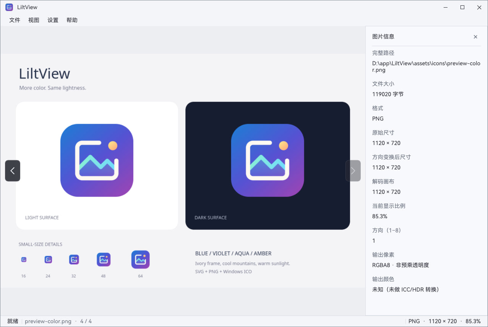
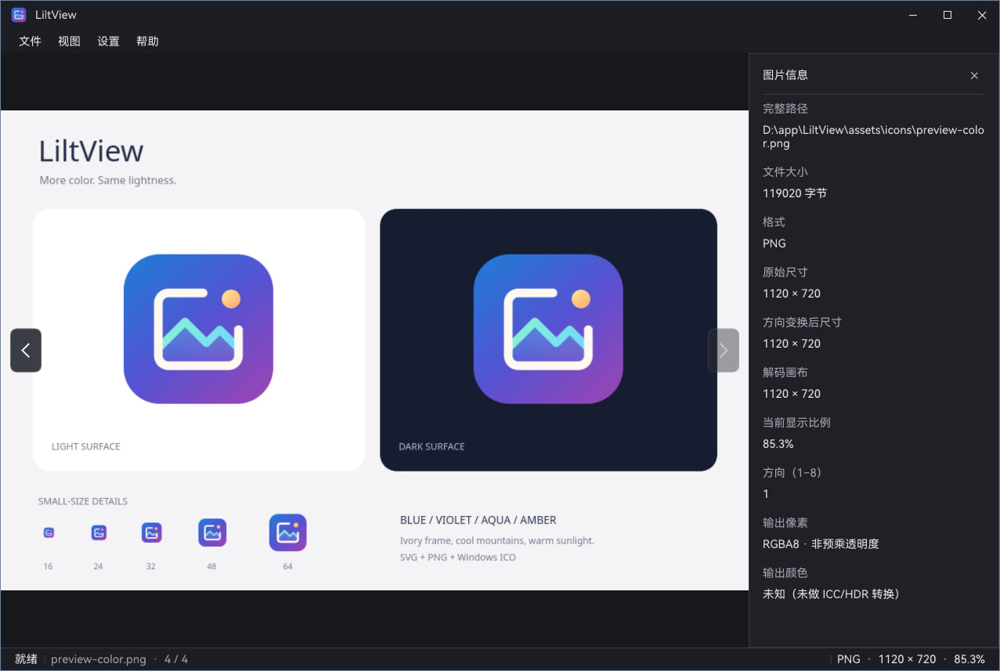

# LiltView

[English](README.md) | **简体中文**


轻量桌面图片浏览器，专注本地图片浏览、原始细节查看、普通 GIF 播放和静态大图查看。

支持 Windows 10、Arch Linux Wayland 桌面，以及 Windows 10 上的 WSL2 Arch Linux；提供中英文界面和深浅主题，让图片始终是画面的主角。

## 界面预览

图片信息面板、状态栏与深浅主题。两张截图查看的是同一张 PNG，切换主题只改变界面配色。

| 浅色主题 | 深色主题 |
| --- | --- |
|  |  |

## 主要功能

- **多种打开方式**：文件菜单、`Ctrl+O`、拖入单个文件，或从命令行打开图片。
- **连续浏览**：同目录图片按文件名自然排序，通过 `←` / `→`、菜单或画面边缘按钮切换；到达首尾时禁用对应方向，不循环跳转。
- **细节查看**：适应窗口、100% 原始像素显示、滚轮缩放、鼠标拖动、键盘缩放与视口移动、全屏浏览。
- **静态大图浏览**：支持分块显示与细节恢复；静态图片加载完成后，缩放和平移不重新解码源文件。可打开的尺寸取决于图片格式和可用资源，并非无限制。
- **GIF 自动播放**：按源帧时长与循环信息播放普通尺寸 GIF，支持透明与帧合成；窗口隐藏或最小化时暂停播放调度。
- **清晰的图片信息**：底部显示文件名、目录序号、原始格式、尺寸和缩放比例；按 `I` 查看详细信息。
- **明确的加载反馈**：状态栏区分就绪、加载和恢复状态；失败时在中央显示失败图示，并在下方说明具体原因，不用旧图冒充加载成功。
- **画布右键菜单**：图片成功加载后，在中间展示区右键即可使用与“视图”菜单一致的操作。
- **外观可选**：中文 / English、浅色 / 深色 / 跟随系统主题、系统 / 自绘标题栏、圆角开关，并保存相关设置。

## 图片格式与支持范围

| 格式 | 当前支持范围 | 使用边界 |
| --- | --- | --- |
| JPEG（`.jpg` / `.jpeg`） | 常见 8 位 RGB / 灰度图片，含 progressive JPEG，支持 EXIF 方向 | 不支持 CMYK / YCCK、12 位 JPEG；不提供逐扫描预览 |
| PNG（`.png`） | 彩色、灰度、索引色、透明及 Adam7 交错图片 | 16 位输入转为 8 位显示；不支持 APNG |
| WebP（`.webp`） | 静态有损 / 无损及透明图片 | 不支持动画 WebP |
| BMP（`.bmp`） | 调色板、常见真彩色、位域及 RLE4 / RLE8 | 不支持内嵌 JPEG / PNG 及部分扩展压缩变体 |
| SVG（`.svg`） | 基础静态路径、几何、渐变、变换和透明度 | 不支持复杂 SVG；放大复用已栅格化像素，不保证无限矢量清晰 |
| GIF（`.gif`） | 普通尺寸 GIF 自动播放，支持透明、帧合成与循环 | 不支持超大动图；没有手动暂停、逐帧或进度跳转操作 |
| TIFF（`.tif` / `.tiff`） | Classic / BigTIFF 首页，常见压缩、方向及透明图片 | 仅显示首页，不支持多页选择及浮点 / CMYK 图片 |

**支持某种格式不代表支持其所有编码变体。** 文件按实际内容识别；同目录浏览按上述后缀筛选。完整的位深、透明、方向和资源限制见[格式兼容表](docs/图片格式兼容表.md)。

- **SVG 范围**：文字 / 字体、CSS stylesheet / class、裁剪、遮罩、滤镜、`use` / `symbol` 和嵌入图片不在支持范围内；不执行脚本、不加载外部资源。复杂文件可先导出 PNG 后查看，详见 [SVG 兼容说明](docs/图片格式兼容表.md#4-svg-静态-profile)。
- **色彩范围**：当前以 8 位 RGBA 显示，不提供完整 ICC 色彩管理或 HDR 输出；读取高位深图片不等于保留高精度显示。
- **文件范围**：面向本地图片，不读取 CAD、PSD / PSB、AI、CDR、Sketch 等专用设计源文件；从这些工具导出的通用图片按实际格式处理。
- **产品范围**：以浏览为主，不提供图片编辑、图库数据库、标签管理或批量处理。

## 开始使用

1. 启动 LiltView，通过文件菜单或 `Ctrl+O` 选择图片，也可以直接把单个文件拖入窗口。
2. 使用 `←` / `→` 浏览同目录图片，或点击画面左右边缘出现的切换按钮。
3. 滚轮缩放、左键拖动查看静态图片细节；按 `F` 回到适应窗口，按 `Ctrl+1` 查看原始像素。
4. 按 `I` 查看图片信息，按 `F11` 进入或退出全屏；成功加载后也可右键打开视图菜单。

也可以从命令行直接打开：

```bash
liltview "path/to/photo.png"
```

状态栏只显示文件名，不显示完整路径；需要查看完整路径时，主动打开图片信息面板即可。

加载及画面恢复期间，应用快捷键暂时无效，完成后恢复；窗口系统关闭按钮仍可使用。无图、加载中或加载失败时，画布右键菜单不会打开。加载失败后仍可打开或切换到其他图片。

## 常用操作

| 操作 | 快捷键 / 鼠标 |
| --- | --- |
| 打开图片 | `Ctrl+O` / 拖入单个文件 |
| 上一张 / 下一张 | `←` / `→` |
| 适应窗口 | `F` |
| 100% 原始像素 | `Ctrl+1`，可用时启用 |
| 缩放静态图片 | 鼠标滚轮 |
| 放大 / 缩小 | `Ctrl+↑` / `Ctrl+↓` |
| 向左 / 向右旋转 90° | `Ctrl+←` / `Ctrl+→` |
| 平移静态图片 | 按住鼠标左键拖动 |
| 移动视口 | `Shift+↑` / `Shift+↓` / `Shift+←` / `Shift+→` |
| 显示 / 隐藏图片信息 | `I` |
| 切换全屏 | `F11` |
| 关闭信息面板 / 退出全屏 | `Esc`，优先关闭信息面板 |
| 视图菜单 | 图片成功加载后，在中间展示区右键 |
| 退出 | `Ctrl+Q` / 窗口关闭按钮 |

移动视口时，图片向相反方向移动；图片未超出画布时不能继续平移。GIF 按适应窗口的帧播放，不提供与静态图相同的自由缩放、拖动体验。

## 外观与语言

在“设置”菜单中选择：

- **语言**：跟随系统、中文或 English。
- **主题**：跟随系统、浅色或深色；切换界面配色不会改变图片像素。
- **窗口外观**：使用系统标题栏或自绘标题栏；自绘模式可选择圆角或直角。

语言、主题、窗口尺寸和外观选项会保存，下次启动继续使用。图片信息面板开关仅保留在本次会话中。

## 已验证平台与安装

以下环境已确认可运行：

| 环境 | 已验证范围 |
| --- | --- |
| Windows 10 | 专业版 22H2（64 位）原生桌面运行 |
| Arch Linux | KDE Plasma Wayland 桌面运行 |
| Windows 10 + WSL2 | Arch Linux，通过 WSLg 运行图形应用 |

以上是已验证环境，不代表所有 Windows 版本、Linux 发行版、桌面或 WSL 图形显示方式均已验证；其他环境的兼容性不作同等保证。

具体版本与硬件快照集中维护在[运行环境记录](docs/产品与设计.md#6-支持边界与运行环境)，不作为最低配置要求或完整平台验收。

### 安装方式

- **Arch Linux**：安装与桌面入口见 [Arch Linux 安装说明](packaging/arch/README.md)。
- **Windows 10**：当前没有安装器，程序与资源的目录布局见[安装与部署说明](packaging/README.md)。
- **WSL2 Arch Linux**：已验证环境为 Windows 10 上的 WSL2 Arch Linux + WSLg，不扩展为对所有 WSL 发行版或图形环境的保证。

## 文档

- 使用：[界面与交互](docs/产品与设计.md)、[图片格式](docs/图片格式兼容表.md)、[命令行与设置](docs/命令行与设置.md)。
- 开发：[构建、验证与文档导航](docs/构建与验证.md)、[架构](docs/开发架构.md)、[核心契约](docs/核心接口与生命周期契约.md)、[渲染](docs/渲染与大图实现.md)。
- **待实施**：[开发计划与未实现设计](docs/开发计划与未实现设计.md)、[首次加载流畅度与完整首屏显示设计](docs/首次加载流畅度与完整首屏显示设计.md)。

## 许可证

Copyright 2026 LiltView contributors. 项目采用 [Apache License 2.0](LICENSE)，第三方组件遵循各自许可证，署名见 [NOTICE](NOTICE)。

JPEG 使用 libjpeg-turbo。This software is based in part on the work of the Independent JPEG Group.

随包 HarmonyOS Sans SC 字体版权归 Huawei Device Co., Ltd.，适用[字体原始许可](assets/fonts/LICENSE.HarmonyOS-Sans.txt)。
