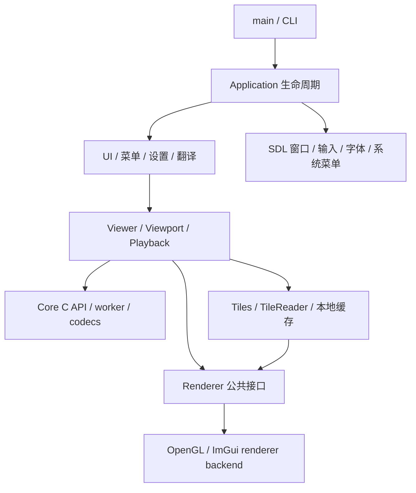

# 开发架构

状态基线：2026-11-10。本文说明当前模块、运行链路与开发入口；本轮验证与分次提交记录见[开发计划](DEVELOPMENT_PLAN.md)。

## 1. 技术边界

| 层次 | 当前实现 | 边界 |
| --- | --- | --- |
| 核心 | C23（MSVC 使用 C17 私有兼容层）、公共 C ABI 2、单解码 worker | 本地常规文件；无窗口、GPU、翻译或网络依赖 |
| 应用 | C++23，显式 C++20 兼容模式 | SDL3 窗口与事件、Dear ImGui 界面 |
| 渲染 | 独立 C++ renderer、OpenGL 3.3 | RGBA8 单平面纹理；图片和 UI 通过 ImGui 绘制 |
| 平台 | Linux 与初步 Windows 支持 | Linux X11 / Wayland；Windows Win32 文件 / C11 线程 / SDL3 + OpenGL3，D3D11 与完整桌面实机验收待完成 |
| 工程 | CMake 3.30+、Ninja、Catch2 / CTest | 自有源码显式列入构建，关闭 GNU 扩展 |

Core、SDL3、codec 以静态库组成应用；Linux OpenGL、Fontconfig、窗口运行库及可选全局菜单依赖使用系统组件。依赖源码固定在 `third_party/`，CMake 使用本地源码，不自动下载。

## 2. 模块与依赖方向



| 目录 / 目标 | 职责 |
| --- | --- |
| `app/main.cpp`、`app/cli/` | 参数、帮助、版本、启动配置；CLI 可独立于图形栈校验 |
| `app/application.cpp` | 窗口、平台后端、ImGui、事件循环、资源创建及退出编排 |
| `app/ui/`、`app/menu/` | 画布、窗口装饰、信息面板与弹窗；系统菜单与窗口菜单共用模型 |
| `app/settings/`、`app/i18n/`、`app/logging/` | YAML 持久化、中英翻译、spdlog 与 C 回调适配 |
| `app/platform/` | SDL render host、字体、全局菜单、Wayland / X11 窗口形状 |
| `app/viewer/viewer.*`、`animation.cpp`、`navigation.*` | Core 请求/事件所有者、切图、错误恢复、动画帧上传、后台目录枚举与自然排序 |
| `app/viewer/prefetch.*` | 两邻居低优先级调度、取消后退休 ID、忙闲边沿有界重试、后台事件隔离 |
| `app/viewer/animation_warmup.*`、`neighbors.cpp`、`animation_prepared.cpp` | 邻居静态 / GIF 调度、首帧与会话保留、前景版本验证、完整候选上传与接管 |
| `app/viewer/viewport.*`、`playback.*` | 坐标与 EXIF 变换、缩放平移、单调时钟播放策略 |
| `app/viewer/tiles.*`、`tile_reader.*` | 原始场景、一次生成 LOD、匿名压缩缓存、RAM/GPU 驻留与恢复 |
| `app/renderer/` / `LiltView::renderer` | 后端无关纹理句柄、上传、能力/预算、帧提交与 present |
| `core/src/api/` / `LiltView::core` | 配置校验、请求/动画会话入口、取消、事件及生命周期 API |
| `core/src/engine/` | worker 调度、资源预算、不可变对象和源版本记录 |
| `core/src/codecs/`、`platform/` | 内容探测、各格式解码/栅格化、文件版本与单调时钟 |

Renderer 不依赖 Core、Viewer、设置或菜单；Core 不包含应用层和图形库类型。Viewer 负责把 Core 像素转换为 renderer 上传描述。公共声明分别以 [core.h](../core/include/liltview/core.h) 和 [renderer.hpp](../app/renderer/renderer.hpp) 为准。

`Viewer::image_details()` 返回与可见场景同源的 owned 值快照，不做文件 I/O。请求目标与已显示路径分别保存，原始行带揭示、失败回退、已呈现相机和 GIF END 元数据都按对应身份更新。`image_information` 只格式化 / 绘制，未知颜色和 KNOWN 标记不被猜测补齐。输入由 `ShortcutContext` 统一屏蔽文本、popup 和原生文件选择，Esc 先关闭面板再退出全屏。

`core/src/engine/cache.c` 提供完整静态结果的可选内存 LRU，按文件版本和 target 匹配，复用不可变像素引用。缓存命中仍核验已打开文件 / 路径，取消与成功提交共用终结锁；未完成捕获不入缓存。PREFETCH 在同一个 worker 低优先级真实解码，只发布 INFO 和终结；前景受理后协作取消活动预读。缓存预算不足时 DISPLAY 旁路，预读明确失败，详见 [Core 契约](CORE_CONTRACTS.md)。

## 3. 静态图片与大图数据流

```text
CLI / 打开 / 拖放 → Viewer.open → generation 更新、取消旧请求
  → 尝试 GIF 动画会话；非动画回退静态 DISPLAY / NATIVE
  → Core worker：打开与内容探测 → 工作集准入 → IMAGE_INFO
  → codec 生成原始像素 → REGION_READY → COMPLETE / ERROR / CANCELLED
  → UI poll：核对 request_id / user_tag → Tiles.upload → 释放事件
  → 小场景 GPU 常驻；大场景生成一次 tile / LOD 缓存与 FIT atlas
  → 缩放 / 平移：查已有缓存 → 后台读取解压 → UI 上传 → 绘制
```

当前应用静态路径采用一次 `LV_TARGET_NATIVE`，相机操作不再提交源图 REGION 解码，也不按视口重新生成 LOD。Core 的 FIT / REGION API 仍可独立使用；JPEG / PNG 的 REGION 能力不等于源文件随机访问。

JPEG、非交错 PNG、未压缩 BMP、TIFF 可逐原始行带交付并提前显示。progressive JPEG / Adam7 PNG 仍受系数或合并工作集限制；WebP、SVG、RLE BMP 等保留各自有界路径，不能由 NATIVE 枚举推导出所有格式均可流式大图显示。

大场景由 `Tiles` 在首次接收像素时生成各级 LOD，压缩到打开后立即 unlink 的本地临时文件；场景关闭时释放。当前每场景缓存上限 16 GiB，tile 描述表另有限额。它是应用场景缓存，不是 Core 的跨请求/跨进程缓存。

`TileReader` 使用独立 fd / `pread` 和 CPU worker 读取、解压已生成结果；默认 RAM LRU 为 32 MiB，排队上限 64，最新视口替换过期排队项。UI 的 `find` 不执行磁盘 I/O 或等待；完成后投递唤醒。

FIT 通过共享 atlas 减少 draw 数；细节按可见网格查询，GPU LRU 按驻留集合淘汰，预热邻居及 FIT 中心区域。默认 covered-motion 策略只在已有足够清晰且完整覆盖的纹理范围内推进相机，目标恢复后准确到达；冷跳转仍可能暂留最近完整画面。

**当前性能缺口：首次 LOD 生成、压缩与缓存追加仍在 UI 线程。** 后台恢复与 PBO 已落地，但不代表真实大图加载/缩放卡顿已经解决。实现与复现边界见 [渲染与大图](RENDERING.md)。

## 4. 动画数据流

GIF 通过 Core ABI 2 会话顺序请求 `NEXT` / `RESET`。Core 保存合成画布、disposal 状态和源版本，产出一帧不可变 RGBA8；UI 使用当前/候选两张纹理。

```text
open_animation → ANIMATION_INFO / COMPLETE → NEXT → ANIMATION_FRAME_INFO / 帧块 / COMPLETE
  → 候选纹理完整上传 → Playback deadline 到达 → 交换显示与候选
  → 请求 NEXT；循环时 RESET 并校验 epoch；结束/失败/切图关闭会话
```

帧块不直接修改正在显示的纹理；动画不采用静态行带揭示，避免混帧。两张纹理均计 GPU 图片预算，准入失败保留当前完整帧并报告错误。隐藏/最小化暂停与循环时钟由应用管理，Core 不驱动播放时钟。当前没有 seek、用户播放控制或超大动图支持。

相邻 GIF 在前景空闲时通过 Core `OPEN → NEXT` 预热；格式由内容识别，预读 INFO 只是提示。首帧覆盖完整且终结事件归还后才进入 READY，后台只保留 CPU 引用与会话。切入时先用前景 NEXT 重验源版本，得到同 epoch 的真实 frame 1 或单帧 END，再移交 frame 0 与会话；不 RESET、不重标帧身份。两张局部候选纹理均上传成功后才提交首帧并开始时钟，该次 pump 保留首帧供 UI 绘制。版本 / 尺寸 / 上传失败回退普通打开，暂停时延后呈现。

应用最多三个会话（前景与两邻居）；静态预读和 GIF 预热合计最多两个未终结后台 ID，已取消退休任务仍占名额。每次普通前景 OPEN / NEXT / RESET 前中断未完成预热，切图保留被接管者并退休其他 READY。静态缓存与 GIF 预热是两条独立路径，不构成 Core 通用完整动画内容缓存。

## 5. 线程、所有权与关闭

| 执行者 | 当前职责 | 约束 |
| --- | --- | --- |
| UI / render thread | 控制 Core、poll、场景管理、GL 上传与绘制 | 同一控制线程串行调用；所有图形 API 留在此线程 |
| Core worker | 探测、解码、动画合成、队列发布 | 当前只有一个解码 worker；取消为协作式 |
| TileReader worker | 已生成 tile/LOD 的读取、解压与 RAM LRU | 不访问源 codec、GL 或 Viewer 状态 |
| DirectoryNavigation worker | 枚举目录、自然排序、解析真实父目录 | 最新扫描替换旧任务；最多 100000 条 / 32 MiB 路径，不在 UI 做目录 I/O |
| 日志/唤醒回调 | 日志适配、投递 SDL 通知 | 可由后台调用，不重入 Core 或直接修改 UI；C++ 异常不得越过 C 边界 |

关键契约：

- create / submit 成功前复制必要配置和路径；输入内存仍由调用者持有。提交不执行文件探测/解码，拒绝提交不产生事件。
- poll 转移一个事件的唯一所有权；即使事件过期也须 release。`event_view` 与 `pixel_view` 是借用，复制描述符不产生像素引用。
- 事件拥有不可变 `lv_pixels` 引用；需要延后访问时先 retain。借出像素不会因取消、终结或 shutdown 失效，最后引用释放后才允许复用。
- 最终输出到事件/UI 通过引用移交或共享 backing 视图交付；Core 不为发布深拷贝最终像素。codec 合成、LOD、压缩和上传暂存各有实际工作缓冲，不能宣称全流程零拷贝。
- 每个成功接受的请求正常运行时恰有一个终结。`COMPLETE` 表示生产结束，不等于屏幕已呈现；UI 在约 4 ms 消费窗口后主动安排续帧，持续归还队列额度。
- cancel 与终结提交竞争：取消先胜出则禁止新像素并丢弃尚未 poll 的像素；终结先提交则保留已排队结果。UI 始终再核对请求/generation。
- `source_revision` 是同一 Core 内受生命周期约束的版本记录，不是文件内容哈希或快照。保留 INFO 可维持版本锚点；源变化不得混合到同一场景。

关闭顺序为 `begin_shutdown → join → 归还事件/像素并结束所有外部访问 → destroy`。Viewer 先归还 GIF Prepared / 预热引用并关闭其会话，再关闭 / join Core，最后销毁 helper 与 Core；helper 的 pending 状态不能代替 join。join 超时不强杀线程；不可中断 codec 调用可延迟退出。应用保持 SDL 通知目标有效直至后台结束，清理 TileReader/场景和图片资源后关闭 renderer，再销毁 ImGui/窗口。完整边界见 [Core 契约](CORE_CONTRACTS.md)。

## 6. 渲染与资源账本

Renderer 公共接口只接受单平面 RGBA8、straight alpha、局部左上原点和显式 stride；没有 RGB/YUV 多平面、高精度或完整色彩管理。EXIF 和视口变换由 Viewer 计算。

图片句柄使用 owner / slot / generation 校验；设备能力来自实际查询。上传返回（含失败）后不保留调用方指针，调用者可归还 Core 引用。当前默认有界 PBO 暂存，返回前已经复制调用方字节，GPU 后续使用 renderer 自有缓冲；fence 完成后才复用槽。

缓存恢复先查询 `upload_ready()`，槽满延后；通用上传及超大跨度保留 direct fallback，仍可能出现单次驱动调用阻塞。当前无自定义图片 shader、后台 GL context 或新增调用方异步指针寿命。

| 资源域 | 当前应用默认 / 限额 | 含义与缺口 |
| --- | --- | --- |
| Core CPU | 384 MiB | 像素、请求、事件、可追踪工作集；第三方 allowance 不构成 RSS 硬限制 |
| Core 内容缓存 | 64 MiB，包含在 CPU 总额内 | 按源版本 / target 保存完整静态结果；过大旁路，不与场景磁盘缓存混淆 |
| GIF 预热保留 | 64 MiB reservation，实际像素计 Core CPU | 保守覆盖共享 backing 的最多 25% 池超配及描述符；不是精确分配 / RSS，采用后的当前帧由 Viewer 持有 |
| Core 像素队列 | 4 MiB，包含在 CPU 总额内 | poll 归还队列额度；外部保留引用继续占实际分配 |
| Core tile | 应用 512px；公共默认 256px | 按设备最大纹理边长向下收缩 |
| Renderer images | 128 MiB | 包含场景/动画图片纹理；不等于系统显存硬上限 |
| Renderer PBO | 8 槽 × 每槽最多 4 MiB | 独立 staging 统计，不包含在 images 预算中 |
| 应用缓存 | 每 reader RAM 32 MiB；每场景磁盘 16 GiB | 场景与 Core 独立；旧/新场景、元数据、暂存尚缺统一 app 总账 |

Core 在解码前预约可推进工作集，队列/外部引用形成背压。预算不足区分暂时 BUSY、固有超限及实际分配失败；CPU 预算、逻辑队列、pinned、GPU images 和 staging 不能简单相加解释 RSS/显存。

## 7. 构建、运行与验证入口

首次初始化依赖后，主程序开发构建：

```bash
git submodule update --init --recursive
cmake --preset dev
cmake --build --preset dev
ctest --preset dev
./build/dev/app/liltview /path/to/image.png
```

`debug` / `compat20` 默认构建 Core 与语言/ABI 契约检查；`release` 默认仅构建优化 Core。应用发布使用 `app-release`，`dev` 同时开启应用组件与单元测试。x86 安装 NASM 可启用 libjpeg-turbo SIMD；构建不覆盖系统 JPEG / SDL 库。

Windows 使用 `msvc-dev` / `msvc-release`，在 VS 2022 或 VS 2026 的 x64 Developer Shell 中执行相同的 configure / build / test 预设命令，具体用法见 [README](../README.md#windows--msvc--ninja-预设)。两套 VS 的构建目录应分开。MSVC 使用 C17 与私有 C23 写法兼容头、C11 原子/线程特性检查；不改变第三方源文件的语言标准，也不将 C 源文件改作 C++ 编译。两项 POSIX 符号链接 + `..` 专项测试在 Windows 跳过。

可选桌面与大图回归默认关闭，显式开启后构建并执行：

```bash
cmake --preset dev -DLILTVIEW_BUILD_DESKTOP_TESTS=ON -DLILTVIEW_BUILD_LARGE_IMAGE_TESTS=ON
cmake --build --preset dev
ctest --preset dev -LE large
ctest --preset dev -L large
```

桌面集成依赖 Linux、全局菜单及可用的 offscreen EGL/OpenGL；大图测试会生成 16K/32K 输入并消耗较多时间/磁盘。C++20 应用可另建目录并显式开启应用与单元测试，不能将默认 `compat20` 等同于完整应用验收。

| 测试位置 | 主要覆盖 |
| --- | --- |
| `tests/contract/` | C23 / C++20 / C++23 调用、公共结构布局及初始化器 |
| `tests/core/` | 格式边界、预算、版本、取消、区域、动画与像素所有权 |
| `tests/app/` | 设置/CLI、菜单、Viewport/Playback、Viewer 与 TileReader |
| `tests/integration/` | 真实 OpenGL 回读、stride/PBO、清晰度、相机推进、源文件删除后恢复与应用回归 |
| 大图可选测试 | 16K/32K、受限单纹理/GPU 预算与边界像素 |

测试定义以 [tests/CMakeLists.txt](../tests/CMakeLists.txt) 为准。正确性测试不代替真实驱动性能测量；性能采样条件与指标见 [测试计划](../benchmarks/TEST_PLAN.md)。安装与 Arch 部署见 [打包说明](../packaging/README.md)。

## 8. 实现状态与后续工作

| 能力 | 状态 | 尚缺内容 |
| --- | --- | --- |
| C ABI 2、单 worker、有界事件/引用、取消/关闭 | 已实现 | 多 worker 与更细公平调度 |
| 七类格式、四类静态区域 codec、NATIVE 行带 | 已实现（格式子集） | 扫描中 refinement、更多格式与高位深输出 |
| GIF 会话、双纹理与时钟播放 | 已实现（普通尺寸） | APNG / 动画 WebP、seek 及播放控制 |
| 后台目录导航、边缘按钮、序号 | 已实现 | 仅当前支持后缀及显式目标；首尾不循环，重新打开刷新目录 |
| 图片信息面板、可见场景值快照 | 已实现 | 尚无相机 EXIF / ICC 元数据解析；已提供文件 / 输出 / 方向 / 动画与实时缩放信息 |
| 应用 tile/LOD、后台缓存恢复、GPU LRU/PBO | 已实现 | 首次生成后台化、冷 LOD 批处理、统一资源总账 |
| Core 内容缓存、PREFETCH 与相邻图片预读 | 已实现（静态完整结果、应用 GIF 首帧 / 会话预热） | Core 磁盘内容缓存、通用完整动画内容缓存未实现 |
| 诊断与真实图基准 | 部分实现 | 全链路统一分段、可重复冷/热基线、持续回归 |
| 原始 RGB/YUV/Bayer、高精度/HDR、多图选择 | 待实现 | 输入/输出/颜色/身份契约及预算扩展 |
| Windows / D3D11 | 初步 MSVC / Win32 文件与 SDL3 + OpenGL3 支持 | D3D11 后端、完整桌面与大图实机验收 |

建议先补首次缓存生成后台化、真实图分段测量和总预算，再推进格式扩展。新增输入布局、选择器、颜色及诊断先确定兼容契约，随后接 codec 和 UI；避免由既有枚举或草案推导支持状态。具体排期与验收维护于 [开发计划](DEVELOPMENT_PLAN.md)，格式细节维护于 [格式兼容表](IMAGE_FORMATS.md)，CLI/YAML 维护于 [配置说明](CONFIGURATION.md)。
