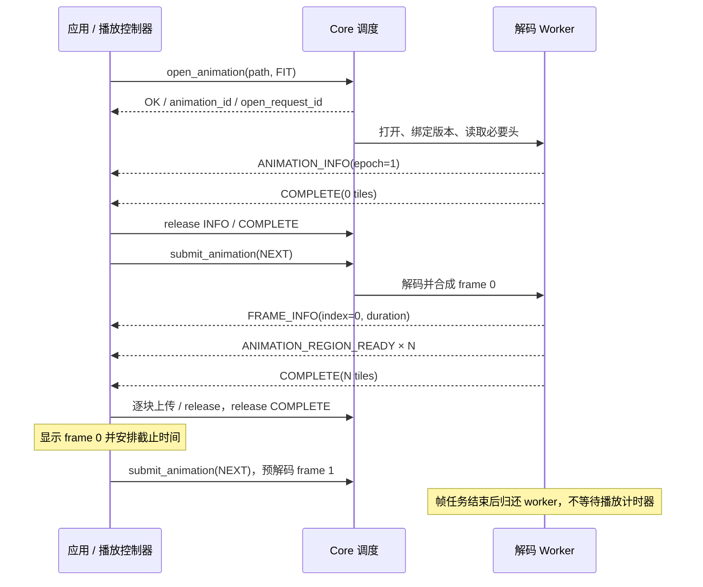

# Core 动画接口与 GIF 播放 v0.2

- 日期：2026-11-08。
- 状态：ABI 2 已实现普通 GIF 会话、逐帧合成和 UI 自动播放；动画 WebP / APNG 与超大图显示尚未实现。
- 正式声明：[core.h](../core/include/liltview/core.h)。原 docs/api 草案入口仅转发到正式头文件，不再包含独立替换布局。
- 相关契约：[静态 API](CORE_API-v0.1.md)、[生命周期与预算](CORE_RUNTIME-v0.1.md)、[实际格式范围](IMAGE_FORMATS.md)。

## 1. 边界与分工

动画采用**持久解码会话 + 按需异步请求一帧**。会话保存文件版本、decoder、合成画布和顺序游标；请求是短期工作，至多交付一帧。
应用自行决定何时请求、何时呈现、是否循环。worker 不等待帧的展示时间，也不在一个请求内无限解码动画。

| 模块 | 职责 |
| --- | --- |
| C core | 内容探测、时间 / 循环元数据、逐帧解码、blend / disposal 合成、FIT、受限缓存 / 内存、取消和像素所有权 |
| 应用层播放控制器 | 单调时钟、播放 / 暂停、循环计数、下一帧预解码、前后台策略、恢复时间基准与视口版本 |
| ImGui / 平台层 | 调用播放控制器；窗口事件等待时计入下一次呈现截止时间 |
| Renderer | 按帧上传纹理并在边界切换，继续复用 OpenGL / 后续 DX11 的统一接口 |

动画帧不是渐进扫描的 tile revision。`frame_index` 表达时间顺序，`revision` 表达同一画面同一区域的更新。
TIFF 多页也不是动画：不把页面伪造成具有任意帧时长的动画；多页接口另行设计。
本阶段已实现 GIF；动画 WebP、APNG 后续复用本契约。暂停按钮、进度条和拖动定位不在本次范围。

### 1.1 已确定的开发范围

2026-11-08 确认：**不考虑超大动图**。普通尺寸动图与静态超大图分别开发：

| 场景 | 设计范围 |
| --- | --- |
| 普通尺寸动图 | 本文的会话、NEXT / RESET、完整帧合成和 FIT 显示；保持当前帧与一帧预解码 |
| 静态超大图 | 沿用静态 API 的 FIT 预览 / REGION 局部显示方向，后续实现低内存解码和区域纹理管理 |
| 超大动图 | 明确不纳入开发范围；不增加动画 REGION、外存合成、跨帧区域随机访问或虚拟纹理接口 |

普通尺寸按逻辑源画布和实际工作集判定，不按 FIT 缩小后的像素判定。
动画源尺寸、文件大小和预算继续遵守 §7 的现有上限；缩小输出不能绕过原始合成画布及 disposal 备份的准入检查。
尺寸超限返回 DIMENSION_LIMIT，无法在预算内完成则返回 MEMORY_BUDGET；不为绕过限制而自动转入静态超大图路径或退化为首帧成功。
帧数多或播放时间长本身不等于超大动图；内存按同时存活的合成 / 备份 / 输出缓冲计算，不累加全部帧的 RGBA 大小。
这些范围约束适用于 ABI 2 动画会话；静态 submit 仍允许只读取 GIF 首帧，UI 打开 GIF 时使用动画会话。

## 2. 对象与接口

| 对象 / API | 契约 |
| --- | --- |
| `lv_animation_id` | core 内非零会话 ID，单调分配、不复用；数值本身不是指针，不单独引用计数 |
| `lv_core_open_animation()` | 同步复制路径、目标和 user_tag，分配会话槽及 OPEN 请求，返回两个 ID；文件 I/O 全部异步 |
| `lv_core_submit_animation()` + `NEXT` | 从当前位置顺序生成一帧；到结尾则生成 END，不自动循环 |
| 同上 + `RESET` | 重建 decoder / 初始合成状态，成功后 epoch 加一、游标回零；不解码首帧 |
| `lv_core_close_animation()` | 非阻塞关闭会话，拒绝新工作；协作取消未终结任务，安全点清理解码资源 |
| `lv_core_cancel()` | 取消一个 OPEN / NEXT / RESET 请求，沿用现有全局请求 ID、竞争判定与终结规则 |
| `lv_core_poll_event()` | ABI 2 实现后用同一个队列取得静态 / 动画事件，不引入第二个轮询队列 |

`open` 返回 OK 只代表受理。首次版本不保证立即得到帧数或总时长，不为了统计在 open 扫描整个动画。
即使最终只有一帧，GIF 动画会话也可返回一帧再 END。普通 JPEG / BMP / SVG / TIFF 等不适用此会话，异步 FORMAT_UNSUPPORTED。
当前 PNG / WebP 动画会话返回不支持，直到相应后端实现；不得仅新增能力枚举就报告可播放。

所有控制函数仍在创建 core 的线程串行调用，不允许从 wakeup / log 回调重入。
同一会话同时只允许一个 OPEN / NEXT / RESET 请求，**包括已经终结但终结事件尚未 release 的请求**。
应用无需为两帧并行创建多个 decoder；一个下一帧任务就足以在显示当前帧时预解码。
会话空闲时不占请求槽；未 close 的会话仍占会话槽和驻留预算。

初始化器的设计默认值：open priority=CURRENT、target.kind=FIT，fit_bounds 留给调用方填写；frame action=NEXT、priority=VISIBLE_DETAIL。
`user_tag` 属于本次请求，原样回显在该请求所有事件中；会话不解释它。
目标 FIT 在会话内不可变。resize 时可先缩放已有 GPU 帧；需要重新生成清晰输出则关闭旧会话、用新目标打开，首版从头播放。
不提供 seek、任意 frame_index 请求、变速或自动追赶参数；RESET 表达从头重放，不暗示随机访问能力。

### 2.1 同步校验与失败输出

descriptor 的 struct_size 不匹配返回 ABI_MISMATCH；零会话 ID、无效 action / priority、非零 reserved 或零 FIT 边界返回 INVALID_ARGUMENT。
路径与编码校验沿用静态 API：复制绝对路径，禁止内嵌零，未接入的平台编码 / REGION 返回 UNSUPPORTED。
max_sessions=0 时 open 返回 UNSUPPORTED；初期 max_sessions 的有效配置范围为 0..64，显式驻留子预算不得超过 CPU 总预算。
同步失败时所有有效输出都清零、不产生事件；open 的两个输出必须分别指向有效且不重叠的存储，输出参数本身为 NULL 属于 INVALID_ARGUMENT。
FAILED / INVALID_SOURCE 会话提交操作返回 INVALID_STATE；核心 CLOSING 的检查优先于会话状态。

以下是当前 ABI 2 的调用形态：

```c
lv_animation_open_desc open;
lv_animation_open_desc_init(&open);
open.path = path;
open.target.as.fit_bounds = bounds;
open.user_tag = view_generation;
lv_core_open_animation(core, &open, &animation_id, &open_request_id);

// 处理成功 OPEN 的 ANIMATION_INFO，归还 COMPLETE 后，才提交 NEXT。
lv_animation_request_desc next;
lv_animation_request_desc_init(&next);
next.animation_id = animation_id;
next.user_tag = view_generation;
lv_core_submit_animation(core, &next, &frame_request_id);
// 所有返回值均须检查；BUSY 时继续消费 / release 后再重试，不忙等。
```

## 3. 事件与调用时序



| 请求 | 成功事件顺序 | COMPLETE 的含义 |
| --- | --- | --- |
| OPEN | ANIMATION_INFO → COMPLETE | 会话已就绪，无像素，`final_tile_count=0` |
| NEXT，得到帧 | ANIMATION_FRAME_INFO → ANIMATION_REGION_READY × N → COMPLETE | 本帧完整覆盖已入队，`final_tile_count=N` |
| NEXT，到有效结尾 | ANIMATION_END → COMPLETE | 本轮结束、无新帧，`final_tile_count=0` |
| RESET | ANIMATION_INFO(new epoch) → COMPLETE | 游标回零，下一个 NEXT 为 frame 0，无像素 |

正常运行期间每个受理请求仍只有一个 COMPLETE / ERROR / CANCELLED。早期失败可以没有 INFO；INFO 不是成功终结。
同请求事件 `sequence` 严格递增。终结提交与下一状态的生效在同一锁保护的判定点完成；release 终结才允许本会话提交下一任务。
OPEN / RESET / END 的成功元数据与 COMPLETE 一次性提交，取消不能插在两者之间；帧 FRAME_INFO 可在解码完成前出现，但只在成功 COMPLETE 后可呈现其候选像素。
若 NEXT 后解码损坏尾帧，返回 ERROR 而不是 END；结尾只在验证正常流结束后成立。
第一版允许额外一个 NEXT 才发现 END，不在每帧前向扫描以标记“最后一帧”。应用在探测 END 时继续显示已完成的最后一帧。
END 成功时 frame_count 必须已知且至少为 1；空序列为 CORRUPT_DATA。duration 仅在全部帧时长已知且累计可表示时标记 KNOWN，total_plays 在有效结尾完成归一。

成功读完一帧即 COMPLETE；它不表示动画结束，也不表示 GPU 已显示。
NEXT 每次只交付一帧，没有隐藏的后台帧生产。取消 / 关闭不会要求应用继续提交 NEXT 来释放 decoder。

### 3.1 帧身份与呈现原子性

每帧的身份是 `(core, animation_id, epoch, frame_index)`，每个 REGION 都携带该 key。
epoch 在 OPEN 为 1，每次成功 RESET 加一，失败 / 取消不增加，不允许整数回绕。
旧 epoch 或旧 user_tag 的结果由应用过滤；若未来有帧缓存，其键还需包括 source_revision、FIT 目标和像素选项。

帧像素继续用 `lv_pixels` 引用计数交付，tile 格网、rect、stride 和 RGBA8 straight alpha 规则不变。
每个帧请求从新的 tile revision 1 开始；初期只发送 FINAL、AT_COMPLETE，不发部分动画帧预览。
`final_tile_count` 必须准确覆盖会话 INFO 的 region；不能通过合并不同帧的同 tile_id 丢失覆盖。

应用把本帧全部 tile 上传到候选纹理，再同时满足下列条件时切换：已收到成功 COMPLETE、上传成功、本帧呈现时间到达。
不能将这些 tile 直接逐块覆盖正在展示的上一帧，不能用静态图的 100 ms 渐进超时提前展示动画半帧。
单块可以超过静态常见队列大小的“完整一帧事件”不采用；沿用逐块消费，才能保持 4 MiB 队列等小预算配置可工作。

## 4. 帧时长、循环和播放时钟

`source_duration_ns` 是本帧在替换为下一帧前的源显示时长，不是“收到后先等这么久才显示本帧”。
它保留源值，包括合法零；用 DURATION_KNOWN 区分未知与已知零。
`source_pts_ns` 是同一轮内此前帧的原始时长之和，不含 UI 最小时长修正，不是墙上时钟，也不是 poll 时刻。
若未知或无法表示，清除相应 KNOWN 位，值置零；不得溢出后产生倒退时间。

建议应用默认策略为：未知 / 零时长按 100 ms；正值小于 10 ms 提升到 10 ms；其余按原值。
这是 LiltView 初始播放策略，不是 GIF / WebP / APNG 格式标准要求；保持在应用层，后续可按兼容样本调整。
帧时间在 core 中不用浮点数；后续 APNG 先按规范将 delay_den=0 归一成 100，再将有理数转换到整数 ns，使用受检运算并向最近整数舍入。无法表示时清除该时长及后续 PTS 的 KNOWN 位。
GIF 的 UserInputFlag 交互等待不在自动播放首期范围；遇到它应返回 FORMAT_UNSUPPORTED，不能无声忽略成普通定时帧。

`total_plays` 统一表示**总播放轮数，包含首次**：KNOWN + 0 表示无限，KNOWN + 1 表示仅一次，KNOWN + N 表示共 N 次。
来源格式计数由 adapter 转换：GIF Netscape 非零 repeat=N 转为 N+1 总轮数，零为无限；WebP / APNG 非零值本身就是总轮数。转换采用 uint64_t 受检运算。
缺少循环扩展的 GIF 在确认完整流后归一为一次；仅头部还未确认时可报告未知。
已知循环 / 帧数信息必须在同源版本内保持一致；冲突元数据报 CORRUPT_DATA，不能播放到结尾悄悄改成另一种循环策略。
没有必要为此额外扫描：OPEN 可不声明 count / duration / play count；ANIMATION_END 携带本轮得到的最终已知元数据。

播放流程：

1. 首帧上传成功后立即展示，并以展示时刻建立单调时钟基准。
2. 显示当前帧时预解码一帧；提前准备好则等当前 deadline 再切换，不以解码完成时间控制帧率。
3. 下一帧迟到时保留当前完整帧，拿到后再切换；首版不跳帧追赶，将新 deadline 重基到实际切换时间。
4. 正常准时播放从计划 deadline 累加 effective_duration，避免每帧都把解码时间额外加进间隔。
5. 暂停保留当前帧及剩余时长，停止提交 NEXT；允许已在途的一帧完成并上传，最多保留一帧候选。
6. 收到 END 时，最后一帧仍显示满它的时长；次数未用完则 RESET → NEXT，必要时提前开始准备。循环重置也不改变显示中的最后一帧。
7. 窗口隐藏 / 长时间挂起默认暂停；恢复时重建 deadline，不突发解码补齐错过的全部时间。

core 不替应用执行循环，也不因 total_plays=0 占用一个永不终结的请求。
SDL_WaitEventTimeout 的超时须取平台需求与下一动画 deadline 的最小值；DX11 / Win32 后端同理，不能只依赖 core 唤醒定时换帧。

## 5. 合成与格式边界

交付的是**应用全部历史依赖后、可独立显示的完整逻辑画布**，再缩至 FIT。
首版不向 UI 暴露原始 frame rect、disposal、blend 来让 UI 拼图；这部分放 core，保持渲染后端一致。

GIF 下一帧的顺序是：先应用上一帧 disposal，再按本帧偏移 / 调色板 / 透明规则绘入画布，再生成输出。
恢复背景和恢复前一画面必须正确处理；必要的备份区域只保存受影响范围，但最坏情况仍是全画布，计入预算。
不透明背景沿用逻辑背景；浏览模式下带透明标记的初始画布采用透明底，该兼容策略需与现有首帧结果一致并测试。
WebP / APNG 后端实现时分别归一 blend、清背景、恢复前态等语义，不能只将各编码小矩形当完整帧轮播。
APNG 的默认 PNG 图不一定属于动画序列，应依据其控制块选择实际 frame 0。

会话绑定 worker 首次打开的文件及可观测版本、source_revision；open 受理不是提交时快照。
每个帧、END 和 RESET 成功提交前检查可检测的源变化。发现变化则 SOURCE_CHANGED，进入 INVALID_SOURCE，只能 close 后重新 open。
RESET 允许回读同一版本，但不能悄悄跟随新文件；符号链接改指向也属于版本检查范围。
旧已借出像素和旧 GPU 帧仍可读取 / 显示，但不能与新版本的帧混合作为成功动画。

初期仅 FIT、顺序 NEXT 和 RESET，不承诺随机访问、缩放瞬时重解、全部格式支持、HDR / ICC 或硬实时取消。
超大动图属于明确排除项，不作为本接口的后续验收要求；静态超大图的 REGION 开发独立进行。
帧数 / 时长未知不等于无限，解码结束只能由有效流结尾确认。

## 6. 会话状态、取消与关闭

```text
受理 OPEN → OPENING ─成功→ READY(next_index=0)
                   └失败 / 取消→ FAILED

READY → NEXT → 成功帧 → READY(next_index+1)
             ├有效结尾→ AT_END
             └失败 / 取消→ NEEDS_RESET 或 INVALID_SOURCE

READY / AT_END / NEEDS_RESET → RESET → 成功→ READY(epoch+1, next_index=0)
                                      └失败 / 取消→ NEEDS_RESET 或 INVALID_SOURCE

任意未关闭状态 → close / core shutdown → CLOSING → 资源回收
```

表中的 READY / AT_END 表示终结已提交后的逻辑状态；释放原终结之前提交仍返回 BUSY。
OPEN 不产出帧，因此不会出现首帧解码失败却把 open 请求终结改写两次。

| 场景 | 结果 |
| --- | --- |
| 同会话仍有 OPEN / NEXT / RESET 或未释放终结 | submit 返回 BUSY，输出请求 ID 清零，不产生新事件 |
| OPEN 失败或取消 | FAILED，调用方 close；不能对同 ID 重试 OPEN / NEXT / RESET |
| NEXT 在结尾之后再调用 | INVALID_STATE；需 RESET 才能再次 NEXT |
| NEEDS_RESET 时继续 NEXT | INVALID_STATE；只能 RESET 或 close |
| 活动 NEXT 被取消 | CANCELLED；进入 NEEDS_RESET，即便尚未实际解码也采用同一保守规则 |
| NEXT 解码 / I/O / 内存失败 | ERROR；默认 NEEDS_RESET，避免依赖已被部分推进的 decoder 游标 |
| 有效 RESET 成功 | epoch+1、生效时游标回零；原始文件版本不变 |
| RESET 失败 / 取消 | 保持 NEEDS_RESET；可重试 RESET 或 close |
| 源文件改变 | ERROR/SOURCE_CHANGED，INVALID_SOURCE；只允许 close |
| 终结已经提交再 cancel | 沿用静态规则：无操作，保留 COMPLETE 及所依赖的全部像素；不毒化会话 |
| 未知会话 ID | NOT_FOUND；ID 仅在所属 core 内解释，不复用 |

不尝试以无限追加历史帧保证 NEXT 取消后的游标回滚。应用若只是暂停，首选停止新请求，允许在途结果完成；cancel 用于切图、错误或重置播放。
把一个 core 的有效 ID 传给另一 core 属于调用方违约；不同 core 的数值可能相同，不能承诺此时一定返回 NOT_FOUND。
当需求是丢弃迟到的显示帧时仍要保持解码合成依赖；首版不提供 skip API，不能随意跳读编码帧。

close 立即使会话不可再提交，后台才销毁 FILE / decoder / 合成画布。
活动请求协作取消并按正常运行规则产生一次 CANCELLED；已提交终结保持原终结及关联像素，不因 close 删除它们。
应用先使旧 animation_id / user_tag 不可呈现，再 close，再继续消费并释放旧请求事件。
关闭中的重复 close 返回 OK；彻底回收后同一 ID 返回 NOT_FOUND。没有已接受请求时不另发“关闭完成”事件。

会话槽直到内部资源安全清理、请求终结 release 后才归还；因此 close 立即返回并不保证紧接着 open 有空槽，可能暂时 BUSY。
资源可用性改变会请求一次合并 wakeup，包括会话槽、请求槽、控制记录和像素预算释放；此时允许 poll 得到 EMPTY。worker 在锁外执行通知，调用方先尝试提交再进入事件等待，避免 BUSY 后永远没有新事件可重试。关闭期间不再要求资源通知，join 后不再发生回调。
单 worker 必须在尝试新解码准入前优先执行关闭清理，不能让新任务等着自己尚未释放的旧会话。
close 后已借出的 INFO / FRAME_INFO / 像素事件保有独立有效存储；不能依靠会话对象存活来维持 view。
INFO 的 source_revision 锚点延续已有契约，保留 INFO 会占有界控制池，但不必因此保留 decoder 或会话槽。

core begin_shutdown 自动逻辑关闭所有会话、丢弃未 poll 事件并解除等待；join 后零核心回调，归还借出对象后才能 destroy。
进入 core CLOSING 后，动画 open / submit / close 都返回 CLOSING；关闭由 shutdown 自动处理，无需再手工逐个 close。
不要求调用方先 close 每一个会话才能 shutdown；未 close 的纯 ID 不是外部内存引用，不阻止最终 destroy。
join TIMEOUT 仍不允许提前释放 userdata、core 或唤醒目标；文件系统 / 第三方单次调用不能强制中断。

## 7. 预算与调度进度

`max_sessions` 默认 2，允许切图时旧会话清理与新会话打开短暂并存，0 禁用动画。
`resident_budget_bytes` 是 CPU 总预算内子预算，默认 0 在 create 时解析为 `min(cpu_budget_bytes/2, 128 MiB)`；显式值不得超过 CPU 总预算。
它覆盖**所有会话**空闲也要保留的文件缓冲、decoder allowance、逻辑合成画布、disposal 备份及必要状态，不能把每会话上限分别乘开而不计总和。

输出 FIT 图、全部潜在 tile 和事件、下一帧暂存、第三方临时工作区继续计总 CPU 预算；既有 queue_pixel_bytes 只限制未 poll 的像素 payload。
应用保留的像素同时计总预算 / pinned，不自动算进驻留子预算；GPU 当前 / 候选纹理受 renderer 独立预算约束。
source / frame count、尺寸、index、epoch、时间换算和累计均须受检，不允许 32 / 64 位回绕。
GIF 首期仍限制源文件 64 MiB、逻辑原始 RGBA 不超过 min(large_pixel_bytes, 256 MiB)；SVG 的特殊限制与此无关。

NEXT 开始前至少预约原始合成、disposal 最坏备份、FIT 和输出 tile 的可推进峰值；不能等需要 restore-previous 时才发现没有空间。
不得在已交付的 lv_pixels 上继续绘制下一帧。内部画布与输出独立，外部引用只读，事件 release 后额外 retain 仍有效。
单帧完整输出仍走 tile 队列；应用逐块上传并立即 release，不要为了等 COMPLETE 留住整帧 CPU tile。
默认只预解码一帧，已上传候选由 GPU 保存；不按 frame_count 一次分配所有帧。

### 7.1 单 worker 必须避免的等待

空闲会话的合成内存不能像跨请求缓存那样直接淘汰，因为它决定下一帧状态。
如果新任务的计划即使在无外部引用时也被其他空闲会话永久占住，不得等待这个唯一 worker 自己释放不了的驻留状态：报告 MEMORY_BUDGET，应用关闭无用会话后再试。
被 close 的资源清理、取消和终结必须优先推进；状态互斥锁不跨第三方解码和队列等待持有。
已受理帧可因消费 / release 解决的队列或 pinned 内存背压而等待；cancel / shutdown 必须唤醒它。
每帧完成释放临时工作区，保留必要会话状态，归还 worker 给调度器；应用不应靠连续 NEXT 的优先级饿死当前静态图请求。
真实解码器内部不能拦截的分配仍按保守 allowance 预约，账本不承诺 RSS 硬上限。

### 7.2 控制记录

OPEN、RESET、帧 NEXT 和 EOF NEXT 都最多需要一个元数据控制事件和一个终结，因此保留已有每请求两个控制记录预留模式。
新增会话表在 create 时按 max_sessions 有界分配，算基础开销；open 受理前一次取得会话槽、请求槽、控制记录和路径副本。
控制池按受检公式 `2 × max_requests + 2 × max_sessions + 1` 预分配：额外空间容纳会话 INFO 和旧帧 INFO 的独立寿命。长期持有更多控制事件仍会使提交 BUSY，不无限扩池。
所有同步拒绝原子回滚，清空有效输出；没有事件，也不能留下半受理会话 ID。
达到绝对配置 / ID 上限返回 LIMIT_REACHED；会话槽被占用或控制池 / 路径空间暂时不足为 BUSY；分配器实际失败为 OUT_OF_MEMORY。
失败 OPEN 的会话 ID 保留到 close / shutdown，调用方收到异步失败后仍须关闭；不能自动回收成一个可能被复用的 ID。

## 8. ABI 与实现边界

正式 lv_core_config 已增加 animation 预算配置，lv_event_view 已包含动画元数据 / 帧 / 区域 / END；LV_CORE_ABI_VERSION 已提升到 2。
全部应用消费者、初始化器、C / C++ 布局检查一起迁移。ABI 1 配置返回 ABI_MISMATCH，不兼容 cast 或只替换动态库。
docs/api/core_animation_v0_2.h 仅转发正式头文件；不再发布 lv_core_config_v2 / lv_event_view_v2 并行模型。
动作 / open descriptor 仍有 struct_size；公共接口没有 SDL / ImGui / OpenGL / DX11 类型。

实现位置：

| 文件 | 内容 |
| --- | --- |
| core/src/api/animation.c | OPEN / NEXT / RESET / CLOSE 受理、状态检查、请求槽 |
| core/src/engine/animation.c | 会话驻留预算、事件提交和异步清理 |
| core/src/engine/worker.c | 静态与动画单 worker 调度、终结竞争、资源唤醒 |
| core/src/codecs/gif_animation.c | 持久 GIF decoder、循环信息、disposal 0..3、源版本检查、FIT 输出 |
| app/viewer/playback.cpp | 可注入时间的纯播放时序，零 / 短时长、迟到、暂停 / 恢复 |
| app/viewer/animation.cpp | 候选帧上传、两张纹理轮换、循环 / RESET、失败处理 |
| app/application.cpp | 平台等待合并下一帧 deadline，隐藏 / 最小化暂停 |

UI 先以动画 OPEN 做有界内容探测；非 GIF 返回 FORMAT_UNSUPPORTED 后关闭该会话，再使用静态 submit。GIF 的 NEXT 失败不退化为首帧成功。
静态 submit 的 GIF 首帧路径保留供静态调用方使用。文件扩展名不决定动画识别。
每帧完整后才展示；下一帧尚未准备时继续显示当前帧。一次最多保留一帧候选，循环 RESET 后仍复用原两张 GPU 纹理。
窗口隐藏 / 最小化时暂停；恢复保持剩余时长。没有新增播放按钮或进度条。
Renderer 公共方法不变；纹理轮换、deadline 与循环控制属于 Viewer，详见[渲染模块](RENDERER-v0.1.md#33-动画帧上传与呈现)。

当前仍不支持动画 WebP、APNG、任意帧 seek、TIFF 翻页、超大动图、静态超大图 REGION 和 Windows / DX11 的实际后端。
GIF 每次帧任务内的第三方解码无法保证硬实时抢占；预算是受限工作集与保守 allowance，不承诺 RSS 硬上限。

## 9. 实现验收矩阵

下表是完整验收目标。当前已运行 GIF 会话 / 合成 / 取消 / 借用寿命 / 预算 / 源版本测试、纯播放时序测试、真实 Viewer 恢复测试，以及 OpenGL 回读从红色首帧切到蓝色第二帧；WebP / APNG 项仍待实现。最新构建记录见 [项目目录](PROJECT_STRUCTURE.md)。

| 组别 | 必须验证 |
| --- | --- |
| 时序 | OPEN 不含像素；帧 INFO 先于 REGION；每 NEXT 至多一帧；终结 release 前 BUSY；END→COMPLETE(0) |
| 合成 | GIF 局部帧 / 透明 / 全局和局部调色板 / 交错 / disposal 0..3；WebP / APNG 的 blend 与清背景 |
| 时间 | 已知零 / 未知 / 超短 / 长时长；整数溢出；不把解码耗时加进正常播放间隔；迟到 / 挂起不突发补帧 |
| 循环 | 无循环信息、有限次数、无限、单帧、空序列、结束后 NEXT、RESET epoch、循环元数据冲突 |
| 所有权 | 旧帧 retained pixels 在 NEXT / RESET / close / join 后仍可读，候选上传不修改旧显示帧 |
| 竞争 | cancel 在终结提交前 / 后；取消 RESET；close 在 opening / decode / backpressure / terminal 后；shutdown 不需排空 |
| 预算 | 单 tile 队列、一帧候选、restore-previous 最坏峰值、长期 pinned、两个驻留会话占满、关闭清理优先、无内部死锁 |
| 源版本 | 下一帧前替换 / 修改文件、符号链接变化、RESET 不跟随新版本、损坏后续帧不能伪造 END |
| 渲染 | deadline 前不显示候选，COMPLETE 前无半帧，GPU 上传失败释放引用并 close，无额外平台类型泄露 |
| ABI | C23 / C++20 / C++23 布局、所有结构与 union 大小、ABI 1 配置明确拒绝、控制线程与回调边界 |

## 10. 格式语义核对来源

这些资料用于归一源格式语义；当前只有 GIF 动画后端已实现：

- 仓库 `third_party/giflib/gif_lib.h` 的 GraphicsControlBlock；`third_party/libwebp/src/webp/demux.h` 的帧时长、位置、blend / dispose 及 loop 元数据。
- [libwebp gif2webp 的 GIF→WebP 循环次数转换](https://chromium.googlesource.com/webm/libwebp/+/refs/heads/main/examples/gif2webp.c)。
- [Mozilla APNG 规范](https://wiki.mozilla.org/APNG_Specification)：默认图与 frame 0、分数帧时长、delay_den=0、num_plays 和合成操作。
