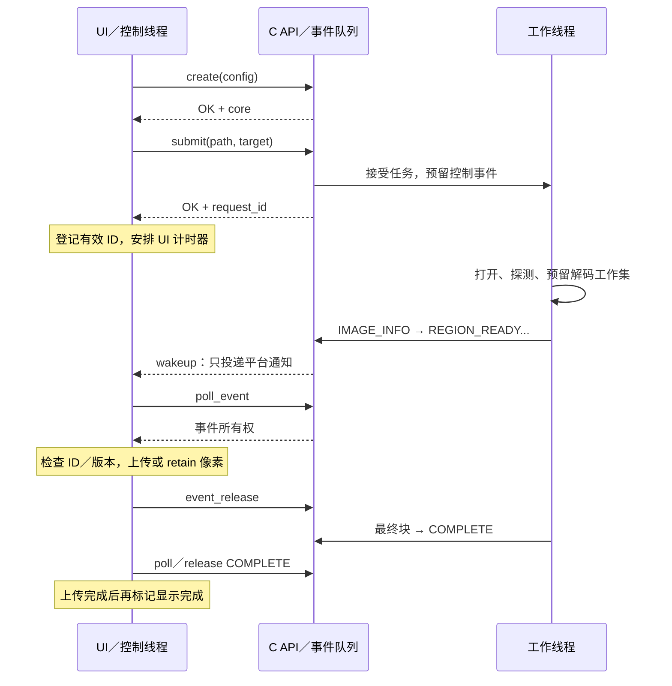
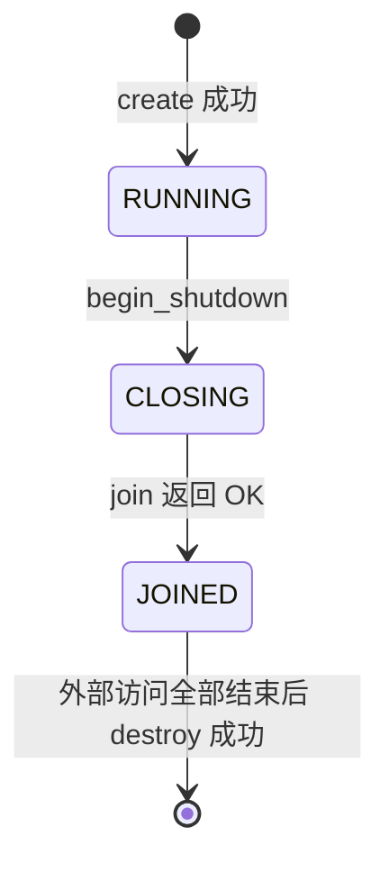

# LiltView Core 调用时序、内存与生命周期契约 v0.1

- 日期：2026-11-07。
- 状态：运行契约；Linux JPEG / PNG / SVG / WebP / BMP / GIF / TIFF DISPLAY / FIT 已实现。预读、REGION、缓存、多 worker 和扩展格式仍为后续约束，当前返回不支持；各格式内存、取消与兼容限制见[图片格式说明](IMAGE_FORMATS.md)，具体范围见 [Core API §1.2](CORE_API-v0.1.md#12-当前实现范围)。
- 接口入口：[Core API](CORE_API-v0.1.md) · [公共头文件](../core/include/liltview/core.h)。
- 本文约束现有静态运行时；GIF 动画会话、帧事件、取消和预算扩展已按 [v0.2](CORE_ANIMATION-v0.2.md) 实施，普通静态路径保持下述契约。

当前普通图片路径在准入时保留完整 FIT CPU 图及最终 tile 的峰值，再通过有界队列交付。它遵循下述所有权、终结竞争和三阶段关闭规则，但尚未实现一般性的低内存扫描 / 预读抢占。第三方内部内存仅按保守 allowance 预约，不能据此宣称硬 RSS 限制。

## 1. 本轮确定的规则

| 项目 | 首版约定 |
| --- | --- |
| 控制调用 | 同一个控制线程串行调用，通常为 UI 主线程；不支持回调重入 |
| 输入数据 | create / submit 返回成功前复制所需配置和路径；调用方继续拥有原内存 |
| 异步结果 | poll 转移事件所有权；事件持有像素引用，调用方可额外 retain |
| 请求完成 | 终结提交、终结被 poll、终结被 release、GPU 上传完成分别处理 |
| 取消竞争 | 活动请求可取消；终结已提交后 cancel 为无操作，保留已排队的全部事件 |
| 预算 | 先预留可推进的工作集再启动解码；队列消费与归还引用持续进行 |
| 渐进超时 | UI 自己安排单调时钟计时器，允许展示已经上传的有效块，无需等待新像素事件 |
| 源版本 | 保留 FIT 的 INFO 作为版本锚点，REGION 通过 source_revision 检查再组合；首版不提供快照句柄 |
| 关闭 | begin_shutdown → join → 确认外部对象及访问全部结束 → destroy |

## 2. 调用时序

### 2.1 创建和提交

1. 初始化日志适配器、平台唤醒目标，保证它们可被并发回调。
2. `lv_core_config_init()` 后填写 CPU / 队列预算及可选缓存、回调；调用 `lv_core_create()`。
3. create 成功后引擎处于 RUNNING。配置结构和磁盘目录路径的输入内存即可复用；回调 userdata 继续存活。
4. `lv_request_desc_init()` 后填写绝对路径、FIT 或 REGION 目标；调用 submit 前记录 UI 单调时间。
5. submit 只验证内存中的参数、复制路径、预留请求及控制事件容量，不打开文件、等待队列或等待解码。它不是硬实时调用，复制与分配仍有成本。
6. 成功返回非零 request_id 后，UI 登记有效请求和 user_tag，并安排显示超时；失败则不产生事件，输入仍归调用方。
7. 工作线程打开文件、探测源、制定预算内的解码计划，再发布事件。入队及唤醒可能早于 submit 返回；回调只投递通知，控制线程在 submit 返回后才 poll，因此可先登记 ID 再消费。

create 失败须回滚已创建的线程、句柄与内存，返回时不存在仍访问配置或 userdata 的工作。正常请求错误通过事件报告，不把异步文件错误挪到 submit。



图中的应答顺序仅为一个执行示例；worker 可以在 submit 返回前发布。事件回调不会直接交付结果，也不能调用 poll。

### 2.2 消费、显示与切图

- 每次唤醒后 poll 到 EMPTY，或达到每帧预算后主动安排下一帧继续消费。不能在队列仍非空时只等待下次边沿唤醒。
- 所有事件先核对 request_id / user_tag。过期事件也必须 release，不能只忽略指针。
- IMAGE_INFO 决定画布、方向和源版本。通过检查后才接受该请求的像素；拒绝版本时使请求不可展示并 cancel。用作 FIT 底图版本锚点的 INFO 保留到该底图不再用于细节组合，其他 INFO 可处理后立即 release。
- REGION_READY 的像素可以同步复制 / 上传后立刻释放事件；延后访问原数据则先 retain pixels，再释放事件。
- COMPLETE 表示核心生产结束。UI 记录它，但仍完成此前已提交的上传；终结事件可立即 release，不必保留到 GPU 完成。
- 小图的 AT_COMPLETE 只控制呈现，不阻止提前上传和归还 CPU 内存。UI 不得等 COMPLETE 后才开始消费所有像素。
- 切图时先将旧请求移出可展示集合，再 cancel，再尝试 submit 新请求。若返回 BUSY，继续消费并归还旧事件，后续帧重试，不忙等。
- 窗口缩放 / 平移只提交最新需求，合并同一帧内的变化；保留已上传的有效 FIT 底图，不为每次鼠标移动堆积新任务。

### 2.3 渐进显示的时序

UI 在 submit 前记录的时间仅用于自身显示策略，成功后才启用计时器。核心 elapsed_ns 仍从核心接受请求时计算，两者不要求时点完全一致。

小图初始隐藏已上传块；发生以下任一条件后允许展示当前有效覆盖：收到 IMMEDIATE 块、UI 计时器达到 progressive_after_ms、或收到 COMPLETE 且所需上传完成。进入渐进呈现后不再退回隐藏状态。值为 0 时允许立即呈现。

计时器到期但尚无有效像素时只保持加载状态；已有有效块时无需等待下一个 REGION_READY。排队和探测也计入 UI 等待时间。33 ms 是中间结果合并建议，不延迟 INFO、终结或必要唤醒，也不是首帧或完成时间保证。

### 2.4 预览与细节的源版本

`source_revision` 在同一 core 内非零。活动请求、未 release 的 INFO 或缓存保留相应源身份记录时，相同可观测源身份及版本使用相同值；发现变化则使用新值。身份记录全部释放后可以淘汰，重新探测可分配新值，但旧值不复用。身份记录也计 CPU 预算，不建立无限增长的历史路径表。它不是内容哈希，不保证完整探测所有并发修改。

首版使用现有字段：UI 保留 FIT 的 IMAGE_INFO 事件作为预览版本锚点，直到这张底图不再参与细节组合；不必保留 FIT 的终结事件或 CPU 像素。REGION 的 IMAGE_INFO 版本一致才允许叠加，源尺寸、方向等信息也必须一致。不一致时取消细节并重新建立预览，不把两版文件拼接。不同 core 的值不能比较。

只复制 INFO 的值并 release 事件不会保留源身份记录；随后缓存也被淘汰时，不再保证下次请求返回相同 revision。首版把源身份的最小生命周期绑定到 INFO，避免新增独立 source API；需要彻底解耦时再引入 source handle。保留 INFO 会占用有界控制池，调用方须及时归还废弃底图的版本锚点。

后续需要“提交时绑定某版本并自动拒绝变化”时，再设计 expected revision 或 source handle；当前请求不持有文件快照，完成后也不监控路径变化。UI 主动刷新时提交新请求。

## 3. 引擎和请求的状态

### 3.1 引擎生命周期



| 调用 | RUNNING | CLOSING | JOINED |
| --- | --- | --- | --- |
| submit / cancel / query_format | 正常处理 | CLOSING | CLOSING |
| poll_event | OK 或 EMPTY | CLOSING，输出空 | CLOSING，输出空 |
| get_stats | OK | OK | OK |
| begin_shutdown | 进入 CLOSING | OK，幂等 | OK，幂等 |
| join | INVALID_STATE | OK 或 TIMEOUT | OK，幂等 |
| destroy（有效非空 core） | BUSY | BUSY | 有外部对象则 BUSY，否则销毁 |
| 已持有对象的 view / release、pixels retain | 按所有权规则 | 仍有效 | 仍有效，直至归还 |

状态表以参数有效为前提；NULL 或失效指针的规则见边界表。join 的超时是等待上限，不是线程强杀或“到点即已关闭”的承诺。

### 3.2 请求生命周期

```text
ACCEPTED → QUEUED → PROBING／WAITING_FOR_BUDGET → DECODING
    │          │                  │                 │
    └──────────┴──────────────────┴─────────────────┤
                                                   ↓
                         COMPLETE／ERROR／CANCELLED 终结提交
                                                   ↓
                                       终结被 poll：调用方持有
                                                   ↓
                                       终结被 release：归还请求槽
```

QUEUED 等名称是内部设计状态，不新增公开查询 API。预算等待可发生在探测前及解码计划准入阶段；发布时另有队列 / 外部引用背压。

- 接受失败：没有请求对象、ID 或终结事件。
- 正常运行中，每个接受的请求只提交一个终结事件；同请求的 poll 顺序按 sequence 递增，终结总在保留的非终结事件之后。
- INFO 最多一次，任何像素之前先有 INFO；早期 ERROR / CANCELLED 可以没有 INFO。预读成功先 INFO 再 COMPLETE，不交付像素。
- 终结提交是请求生产结束的判定点，此后不能再发布该请求的事件。它与 cancel 的判定在同一同步机制下完成。
- COMPLETE 前所有必要最终块已发布：可能已被 poll，也可能仍在队列；其 final_tile_count 必须与请求格网覆盖一致。
- ERROR 保留此前已入队的有效结果，has_partial_output 表示曾发布过像素，不表示 UI 已显示。UI 可标为部分结果；SOURCE_CHANGED 的结果不能作为同一版本继续拼接。
- 终结事件 release 后 ID 不再接受 cancel，返回 NOT_FOUND；该 ID 在实例内不复用。
- 归还请求槽不代表之前借出的 INFO、像素或 GPU 纹理已经失效。它们不依赖可复用的请求槽存储。

终结交付需要调用方持续消费 / 释放、I/O 与解码调用最终返回，并且任务有调度机会。关闭开始后不再保证逐请求交付；持续更高优先级工作或不可中断 I/O 不作完成时限承诺。

### 3.3 取消的精确语义

cancel 与终结提交互斥地作出一次决定：

| 请求在判定点的状态 | cancel 的行为 |
| --- | --- |
| 排队、探测、预算等待或解码中 | 标记取消，禁止新非终结事件发布，丢弃尚未 poll 的像素，保留已排队 INFO，唤醒资源等待；安全退出后提交 CANCELLED |
| 已标记取消，尚未提交终结 | OK，不重复提交或新建事件 |
| COMPLETE / ERROR / CANCELLED 已提交，槽仍存在 | OK，无操作；保留 INFO、像素和原终结的全部排队顺序 |
| 终结已 release，或 ID 从未存在 | NOT_FOUND |

取消已经胜出后，即使解码刚好算完，也只能提交 CANCELLED。终结已经胜出后，UI 用有效请求集合过滤旧结果；取消不删除 COMPLETE 依赖的最终块。已借出事件和像素在两种情况下都有效。

取消不强杀线程。与其他请求共享工作时，只取消本请求的订阅和发布，不破坏其他请求；仅剩被取消的订阅时才协作停止内部工作。

## 4. 内存所有权

### 4.1 谁分配、谁释放

| 对象 | 内存归属与有效期 | 调用方动作 |
| --- | --- | --- |
| config / request 结构 | 调用方；仅在 create / submit 调用期间读取 | 可放栈上，返回后复用 |
| 输入路径 | 调用方；成功返回前核心复制，不保留原指针 | 返回后释放或修改原数据 |
| 回调 userdata / 回调代码 | 调用方；create 期间起至 join 成功 | join 成功后才撤销适配器和通知目标；create 失败则返回后可撤销 |
| lv_core | 核心创建 | 只经 destroy 释放 |
| 未 poll 的 lv_event | 核心队列 | 不得直接接触 |
| 已 poll 的 lv_event | 所有权转给调用方，不可变 | 恰好一次 event_release，可跨线程移交但不能重复释放 |
| event_view / diagnostic 指针 | 借用事件内存；INFO 还保留对应源身份记录 | 事件 release 前读取；复制值 / 文本不会保留源身份 |
| region.pixels | 事件拥有一份引用，返回的是借用指针 | 事件存活时读取；脱离事件前先 pixels_retain |
| retained lv_pixels | 调用方持有独立引用，内容不变 | 每次 retain 配对一次 pixels_release |
| pixel_view / data | 借用仍有效的像素引用 | 不得 free、写入或在最后引用释放后读取 |
| 已上传 GPU 纹理 | UI / 渲染层 | 用图形后端自身的销毁时序；不受终结事件 release 影响 |

核心分配的内存一律用核心的配对 API 归还，不能由应用直接 free / delete。复制 event_view 只复制指针，不产生新引用；event 没有 retain，同一个 event 只有一个所有者。

### 4.2 同步与延迟上传

```text
同步消费：poll → view → 复制到渲染层自有内存或完成对源数据的读取 → event_release

延迟消费：poll → pixels_retain → event_release
                          ↓
                 上传队列持有像素引用
                          ↓
                 后端不再读取该源缓冲
                          ↓
                    pixels_release
```

释放依据是“后端不再读取这块 CPU 源数据”，不是一律等到显示完成。渲染层已经复制到自有 staging 内存后可释放核心引用；直接延后读取核心指针则必须继续持有。具体同步点由渲染后端负责。

每块 pixels 的 size 等于 region.rect 的宽高，data 对应该矩形的局部左上角；不能按完整 canvas 的坐标偏移再次访问它。RGBA8 的 stride 至少为 width × 4，byte_count 至少覆盖 `(height - 1) × stride + width × 4`，所有运算受检且可在当前地址空间表示。行可有填充，不能假定紧密排列。

### 4.3 跨线程释放

- 控制 API 固定在创建 core 的线程执行。像素 retain / release、事件 release 以及持有期间的只读 view 可由其他线程执行。
- 跨线程交付由调用方通过队列等同步设施完成。另一线程接手事件后，原线程不再使用同一所有权；并发读数据时每个使用方必须有有效引用或明确的所有者同步保护。
- 不能让同一引用的最后 release 与 get_view / retain 竞争；引用计数线程安全并不能修复调用方的悬空指针。
- join 只结束核心 worker 和回调，不等待应用的上传线程。最终 destroy 前，应用须同步确认所有外部 view / retain / release 调用已经返回，且不会再启动新的访问。
- JOINED 后的归还只做内存回收，不再调用应用日志 / 唤醒回调。

## 5. 预算、队列与进度保证

### 5.1 预算口径

CPU 总预算内追踪引擎 / 请求 / 事件开销、路径副本、可追踪的 codec / I/O 临时内存，以及缓存和像素实际分配；共享分配只计一次。线程栈、系统对象和无法拦截的第三方分配不能靠此接口承诺 RSS 硬上限，须另做峰值测量与格式限制。

- cache_budget_bytes：总预算内缓存上限，0 禁用跨请求留存。
- queue_pixel_bytes：尚未 poll 的像素事件的逻辑 payload 上限，按每个事件 pixel_view.byte_count 计；共享像素多次入队会占多份逻辑队列额度，但不重复计实际分配。
- 像素 poll 后释放队列额度，仍占总预算，直到其实际分配的最后引用消失。保留缓冲的事件与独立 retain 都算 pinned；只保留无像素的 INFO 也仍占事件内存。
- accounted_cpu_bytes 是当前实际追踪分配，不包含未使用的预约额度；排队、缓存、pinned 统计可能重叠，不能相加作为 RSS。

### 5.2 请求和控制事件预留

创建时计算基础开销并建立有界控制事件池，ABI 2 容量为 `2 × max_requests + 2 × animation.max_sessions + 1` 个记录，使用受检运算。每个活动请求预留至多一次 INFO 和一次终结；额外一个记录允许 max_requests=1 时，保留已经结束的 FIT 的 INFO 后仍能提交 REGION。submit 成功前取得一个请求槽、两个控制记录以及路径存储；不依赖后续成功分配才能发终结。

不需要 INFO 的失败 / 取消释放闲置预留；借出的 INFO 自有存储，不能随终结 release 或请求槽复用而被覆盖。即使请求槽已经归还，仍被外部持有的 INFO 也占池记录；记录不足时新 submit 返回 BUSY。不能为规避外部长期保留而无限扩容控制池。

路径副本因当前内存占用而暂时容纳不进预算时 submit 返回 BUSY；副本本身即超过扣除基础开销后的总可用预算则 LIMIT_REACHED。预算足够但底层分配失败返回 OUT_OF_MEMORY。终结诊断文本使用有界的预留存储，空间不足可省略，错误码必须仍能交付。像素事件的记录开销也计总预算，但不占这两个控制记录。

### 5.3 解码计划准入

submit 接受不代表已获准分配完整解码工作集。worker 先为有界探测步骤做预算准入，以有界缓冲确定尺寸和后端能力，再生成包含输入暂存、codec、缩放 / 滤波、输出块及事件记录峰值的计划。等待解码准入时不能让各任务持有探测临时缓冲互相等待；必要时释放并重做探测，只保留有界元数据。

计划启动前，预留其可推进工作集和至少一个最大输出块 / 事件的空间；工作集必须覆盖阶段切换时的同时存活分配。实际分配消耗预约额度，不能让同一空间同时被别的任务或缓存占用。内部维持“实际分配 + 尚未使用的预约 ≤ 总预算”，共享内存去重。

| 不足来源 | 行为 |
| --- | --- |
| 无借用、无其他任务、淘汰可回收缓存后，本计划仍放不下 | 异步 MEMORY_BUDGET，填写已知 required_bytes / limit_bytes |
| 其他活动计划已占工作集 | 本任务在准入前排队；允许降低并发到一个任务 |
| UI 尚未消费的队列或尚未归还的像素 | 背压等待消费 / release，允许 cancel / shutdown 打断 |
| 可淘汰缓存或预读工作 | 先回收；预读在安全点让出工作集，可内部重排 / 重启，不伪造用户取消事件 |
| 运行中发现此前未知的更高峰值 | 在分配前重新规划；无法安全缩减 / 重启则 MEMORY_BUDGET，不能持有不完整预约互相等待 |
| 底层分配器真实失败 | OUT_OF_MEMORY 事件，使用已预留终结记录 |

前台任务到来后不再准入新的低优先级计划，回收无用缓存并让预读在安全点让出。正在第三方不可中断阶段的任务可能延迟让出，不承诺即时抢占。不能仅把前台和预读放到两个线程就宣称预算隔离或优先级已实现。

### 5.4 发布背压

- 输出块必须能单独装入队列限额；后端的全图跨度不能使一个小 rect 隐性携带整张图。必要时复制成局部块，复制峰值计入计划。
- 队列满时等待，释放相关队列锁后再等待；不得持有阻止 poll / release / cancel 的锁。
- 可替换尚未 poll 的同 tile 中间版本，不修改借出内存；每个必要最终块不得被合并掉。revision / sequence 允许因合并跳号。
- 已发布数据占用预约产生的内存后，后续发布可因队列或外部持有而等待；消费和归还会唤醒内部资源等待。
- UI 持续上传并归还临时像素，不为等 COMPLETE 而永久 retain 所有块。已上传内容的长期驻留交给 GPU 预算，CPU 缓存按配置管理。

## 6. 关闭与回收时序

1. UI 停止提交新请求，使所有请求不可展示，调用 begin_shutdown。该调用不等 worker，丢弃全部未 poll 事件，唤醒所有队列 / 预算等待；尚未释放的终结槽在关闭清理中统一回收。
2. 渲染 / 上传线程停止取新工作，完成、复制或丢弃在途上传，并归还其事件 / pixels。该步骤可与核心 join 的非阻塞检查并行进行，不要求先等 join 才 release。
3. UI 用 join(0) 或短超时继续处理事件循环。TIMEOUT 保持 CLOSING，core、userdata、通知目标仍必须有效；不能超时后强行 free 或退出资源所有者。
4. join 返回 OK 后确认不会再发生核心回调，此时可撤销日志适配器和平台唤醒目标。此前已投递的平台通知可能仍在应用事件队列中，通知处理器须识别退出状态，不能再用失效 core 指针。
5. 确认应用所有引用与并发访问均已结束，再 destroy。成功时 *core 置空；BUSY 保留指针，继续归还 / 等待，稍后重试。

仅清空 C++ 成员指针不会归还引用；RAII 包装必须调用相应核心释放函数。core 在全部事件和像素之后销毁，平台 / GPU 的最终销毁则遵循自身线程和引用约束。

## 7. 边界场景与结果

### 7.1 参数与状态

| 场景 | 规定结果 |
| --- | --- |
| 初始化函数输出 NULL | 无操作 |
| release(NULL)、pixels_retain(NULL) | 无操作；get_view(NULL) 返回 NULL |
| create / submit / poll 的输出参数本身为 NULL | INVALID_ARGUMENT |
| create / submit / poll 同步失败或 poll 无结果 | 输出 core / ID / event 清空；调用方不传入尚未释放的旧所有权来承接输出 |
| destroy 的二级指针为 NULL | INVALID_ARGUMENT；*core 已为 NULL 则 OK |
| 其他需要 core 的调用传 NULL | INVALID_ARGUMENT |
| struct_size / abi_version 不匹配 | ABI_MISMATCH，只读可读的 ABI 前缀，不继续读取完整结构字段 |
| 无效 enum、空路径、NULL 路径数据、相对路径、零目标、越界 REGION | INVALID_ARGUMENT，不接受请求 |
| 配置预算关系非法或基础预留 / 最小输出块放不下 | INVALID_ARGUMENT；底层分配失败为 OUT_OF_MEMORY |
| 路径副本长度计算溢出 / 永久超预算、请求 ID 耗尽或实现计数上限达到 | LIMIT_REACHED，不回绕 |
| 缓存或预读线程禁用时提交 PREFETCH | UNSUPPORTED；类型 / 优先级 / target 组合不合法为 INVALID_ARGUMENT |
| 不支持的平台路径编码或启用未构建的磁盘缓存 | UNSUPPORTED |
| 非控制线程或回调内调用控制 API | 调用方违约；不承诺运行时识别或安全串行化 |
| 悬空指针、重复释放、不可读输入缓冲、输入与输出重叠 | 调用方违约；不能靠错误码恢复 |

多项参数同时非法时不承诺具体检查优先级；有效输出参数仍须按清空规则处理。get_stats / query_format 失败时将其有效输出结构清零，避免使用上次查询结果。调用方至少提供可读的 ABI 前缀（config 的 abi_version / struct_size、request 的 struct_size）；声明匹配大小后须提供完整可读结构，不能用 struct_size 代替真实内存有效性。

### 7.2 文件、格式与目标

| 场景 | 规定结果 |
| --- | --- |
| 文件不存在、权限不足、底层读取失败 | 异步 IO，带可用系统错误 |
| 空文件 / 不足以识别格式的截断头 | CORRUPT_DATA；非空而无法识别的内容为 FORMAT_UNSUPPORTED |
| 路径指向目录、FIFO、socket 或设备 | 首版只接受常规文件；worker 拒绝为 IO，不对特殊文件启动可能无限等待的读取 |
| 符号链接 | 允许解析到常规文件；不在 submit 同步解析，worker 使用实际打开的文件对象并检查可检测的变化 |
| 常规文件所在文件系统阻塞 | 取消协作生效，join 可 TIMEOUT；本地路径不等于 I/O 有固定上限 |
| 扩展名错误或没有扩展名 | 按内容探测；已识别但未构建支持为 FORMAT_UNSUPPORTED |
| 数据截断、非法头、损坏压缩流 | CORRUPT_DATA；底层读失败为 IO |
| 源尺寸 / 输出计算超出可表示或后端安全范围 | DIMENSION_LIMIT；不能发生整数回绕或超预算分配 |
| canvas 极大但 REGION 很小 | 按实际局部工作集判定；不能因完整 canvas 缓冲放不下就拒绝可实现的区域，也不能先分配完整 canvas |
| 仅为加载分档估算的完整像素字节数溢出 | 可用受检比较直接判定超大图；不因不需要分配的完整缓冲无法表示而否决有界局部计划 |
| 读取中检测到源变化 | SOURCE_CHANGED；失效相关缓存，部分输出不作为完整成功 |
| FIT 与 REGION 的源版本不同 | UI 在细节 INFO 阶段拒绝叠加并刷新；核心不保证跨请求快照 |
| 无法按请求 REGION 比例 / 目标实现 | TARGET_UNSUPPORTED；预算无法满足为 MEMORY_BUDGET，不静默缩小 |
| 只支持顺序解码的源请求 REGION | 可扫描到目标区域；不能承诺随机读取延迟 |
| 不支持增量的合法文件 | 后台完整解码后发布，保持 UI 可交互，不承诺提前有像素 |
| SVG 无自然尺寸 / 比例 | FIT 依据后端有效 viewport 规则；无法确定目标则 TARGET_UNSUPPORTED，不除零 |
| SVG 引用外部文件 / 网络资源 | 首版不访问外部资源；不能正确独立栅格化的文件报 FORMAT_UNSUPPORTED，内嵌资源也计解析 / 解码预算 |
| 动画 WebP / APNG 等多帧内容 | 不提供播放 API；仅在后端可正确生成首个显示帧时按静态图支持，否则 FORMAT_UNSUPPORTED |
| 存在未知颜色配置 | 输出报告 UNKNOWN，不宣称已经准确转换 sRGB |

UTF-8 / POSIX 路径禁止内嵌零字节；Windows 原生 UTF-16 路径禁止内嵌零代码单元，而不是禁止所有零字节。UTF-16 字节数须为偶数且满足对齐，原生路径语义交给平台适配，不先做有损 UTF-8 往返。

### 7.3 事件、资源与竞争

| 场景 | 规定结果 |
| --- | --- |
| 队列只能容纳一块，目标有很多块 | UI 边 poll / 上传 / release，核心边产出；不能要求整个目标同时留在 CPU |
| INFO 被保留，终结已 release | INFO 仍有效，占控制池和 CPU 预算；新提交可能 BUSY |
| max_requests=1，FIT 已终结并 release，保留一份 FIT INFO | 有空请求槽和两个控制记录时可继续提交 REGION；不能因保留唯一底图锚点永久 BUSY |
| pixels 被 retain，事件与终结已 release | pixels 仍有效，占 CPU 预算，destroy 仍 BUSY |
| cancel 与最终输出 / 终结同时发生 | 以第 3.3 节的判定点为准，不出现 COMPLETE 缺最终块 |
| cancel 发生在预算 / 队列等待 | 唤醒等待，退出后 CANCELLED，不要求先消费被取消的像素 |
| ERROR 发生在部分发布后 | 保留已有事件顺序，只有一个终结；不把部分覆盖标成成功 |
| shutdown 时像素队列满 / UI 不再消费 | 丢弃未 poll 数据并解除背压，关闭不依赖 UI 继续排空 |
| join 成功但仍有外部像素 | view / release 仍有效，destroy BUSY，归还不会再触发应用回调 |
| 多余 / 延迟的平台唤醒 | RUNNING 时允许 poll 得到 EMPTY；关闭时不消费新事件，处理器检查应用退出状态 |
| GPU 上传失败或显存不足 | UI 释放 CPU 引用并取消后续需求；属于渲染错误，不能改写已提交的核心终结 |
| 全部最终块已收到，但上传尚未完成 | 可 release COMPLETE 并归还请求槽；UI 保持“上传中”至后端完成 |

## 8. 实现验收

后续测试使用可控数据源、可控分配失败和同步屏障构造时序，不以真实解码恰好足够慢或线程 sleep 作为竞态测试依据。测试辅助实现不进入发布库，也不以假成功函数替代未实现 API。

| 组别 | 必须覆盖的断言 |
| --- | --- |
| 调用时序 | 同步拒绝无事件且清空输出；INFO 先于像素；终结最后；不同请求交错不串 ID |
| 终结竞争 | 精确停在终结提交前 / 后分别 cancel；原终结及最终覆盖符合判定规则 |
| 引用寿命 | event release 后 retained pixels 可读；终结 release 后旧 INFO 可读；槽复用不覆盖旧对象 |
| 池与预算 | 累积保留 INFO 造成 BUSY；max_requests=1 可从已结束 FIT 接 REGION；最小队列多块流式完成；前台 / 预读预算挤占无内部死锁 |
| 外部背压 | 留住引用时等待，归还后推进；队列满时 cancel / shutdown 都可退出 |
| 渐进呈现 | 没有新 REGION 时 UI 计时器仍能展示先前有效块；无像素时不伪造内容 |
| 关闭 | join TIMEOUT 不破坏对象；join 后零回调；最终外部释放后才可 destroy |
| 源与目标 | 文件替换、版本不符、方向、tile 边界、超大尺寸溢出及不支持目标 |
| 失败回滚 | create / submit 分配失败无泄漏；终结错误路径不依赖新分配；输出及配额恢复 |

实现顺序：参数与几何校验 → 引擎生命周期与独立引用对象 → 有界队列 / 请求终结 → 预算准入与调度 → 文件探测及实际解码后端。每一步以本契约的相关断言为验收条件。
