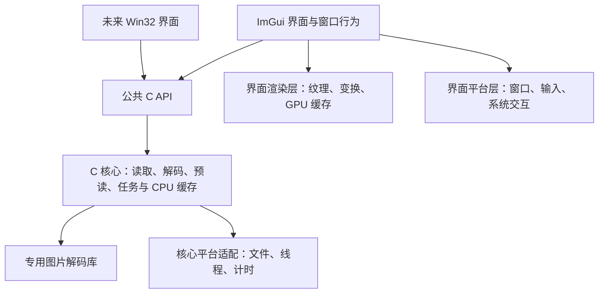

# LiltView 首版设计文档

- 正式项目名：LiltView
- 文档版本：v0.1
- 日期：2026-11-06
- 状态：独立 renderer 和 JPEG / PNG / 基础 SVG / 静态 WebP / BMP 显示已实现；预读、超大图与扩展格式待实现
- 首发平台：Arch Linux
- 后续方向：复用 C 核心，增加 Windows / Win32 界面

本文整理已讨论的产品目标、模块分工和加载策略。标为“已明确”的内容作为当前设计约束；标为“建议”“候选”“初始参数”的内容仍需验证，不代表技术选型或性能指标已经最终确定。

CMake 目标、依赖边界、日志、更新检测、Catch2 测试及中英双语的详细方案见 [工程落地与中英双语方案](IMPLEMENTATION-v0.1.md)。

公共接口已形成 [Core API v0.1 草案](CORE_API-v0.1.md)及 [C 头文件](../core/include/liltview/core.h)。七类格式与普通 GIF 播放已接入，当前兼容子集以[格式兼容表](IMAGE_FORMATS.md)及 API §1.2 为准；当前目录与构建入口见 [项目目录与 CMake 构建](PROJECT_STRUCTURE.md)。

## 1. 目标与当前决策

### 1.1 产品目标

做一个小而美的本地图片浏览器，优先保证：

1. 打开图片和连续翻页响应快。
2. 加载期间窗口、缩放、拖动和切图仍可响应。
3. 超大图片尽早显示可用内容，控制内存与显存占用。
4. 应用体积和依赖规模可控。
5. 解码与预读核心可复用于未来的 Win32 界面。

“体积小”分别统计发布包、应用自身安装体积、首次安装新增依赖，不能仅用可执行文件大小评价。

### 1.2 决策记录

| 项目 | 当前结论 | 状态 |
| --- | --- | --- |
| 项目名称 | LiltView | 已明确 |
| 核心语言 | 核心实现使用 C | 已明确 |
| 界面 | Dear ImGui，由薄 C++ 界面层集成 | 当前暂定方案 |
| 职责划分 | C 核心负责解码、数据预读；界面层负责 UI 和窗口行为 | 已明确 |
| Qt | 不使用 | 已明确 |
| 应用图标 | 选用彩色版本 `assets/icons/liltview-color.ico`，保留对应 SVG / PNG | 已明确 |
| 超大图片 | 必须在架构中考虑 | 已明确 |
| 显示方式 | 完整后显示、渐进更新、超大图模式 | 当前设计方案 |
| Linux 窗口后端 | SDL3，固定 submodule 提交，裁剪后静态链接 | 已用于主窗口；不分发裁剪版动态库 |
| 渲染后端 | OpenGL 3.3 + ImGui 官方后端 | 已用于主窗口 |
| 渲染模块 | 跨平台统一接口，后端构建时可选；Linux 首版 OpenGL 3.3，Windows 后续 D3D11 | 设计已明确 |
| 解码库 | libjpeg-turbo、libpng + zlib、libwebp、PlutoSVG + PlutoVG、C BMP | 已接入，兼容范围见 IMAGE_FORMATS |
| OpenCV | 不列为基础依赖；有明确处理需求时再评估 | 建议 |
| C 语言标准 | 核心使用 C23，不降级到更早标准 | 已明确 |
| C++ 语言标准 | 界面优先 C++23；目标工具链不具备所需能力时，最低 C++20 | 已明确；当前环境采用 C++23 |
| 构建系统 | CMake | 已明确 |
| 第三方源码 | 编译库用 Git submodule，纯头文件库直接保存，统一位于 `third_party/` | ImGui、spdlog、SDL3、Catch2 已接入 |
| 日志 | spdlog，通过 C++ 适配层连接核心日志回调 | 依赖已明确，适配方式为建议 |
| 测试 | Catch2 + CTest | 按用户输入理解为 Catch2，具体版本待锁定 |
| 更新检测 | 优先 cpp-httplib；模块暂不实现，优先级后调，不引入网络依赖 | 已明确，后续单独排期 |
| 界面语言 | 中文与英文；建议首版使用 `zh-CN` / `en-US` | 双语要求已明确 |
| 菜单位置 | 优先 KDE 系统顶栏全局菜单；其他环境回退到窗口内菜单，不移动到窗口标题栏 | 已接入并验证菜单动作 |
| 桌面身份 | `io.github.hui_livio.LiltView`，统一 app_id、WM_CLASS、desktop 与 icon 名 | 已接入用户启动器和安装规则 |
| 界面主题 | 跟随系统 / 深色 / 浅色，默认跟随系统并响应变化，显式选择优先 | 已实现；保留旧配置选择 |
| 默认字体 | HarmonyOS Sans SC Regular 原始字体随包分发，附原许可；系统字体兜底 | 已明确并接入 |
| 首版必需格式 | JPEG（`.jpg` / `.jpeg`）、PNG、SVG、WebP、BMP | 已明确 |
| 排除格式 | CAD、PSD 等专用设计软件格式 | 已明确 |
| Windows | 可继续使用 ImGui，也可另写原生 Win32 界面 | 后续阶段 |

Dear ImGui 的平台后端与渲染后端是不同职责；使用 ImGui 不等于已选定窗口系统或图形 API。[R1] 本项目通过独立 renderer 模块隐藏图形 API 差异，设计详见[渲染模块](RENDERER-v0.1.md)。

### 1.3 语言标准与工具链约束

- 核心按 C23 编译，界面默认按 C++23 编译，不采用实验性后续标准模式。
- C++23 可用性同时检查编译器、标准库和项目实际使用的特性，不能仅凭版本号或接受 `-std=c++23` 就认定全部能力可用。
- 只有目标工具链缺少所需 C++23 能力时，才考虑显式选择 C++20 兼容配置；构建输出必须说明所选标准，禁止静默降到 C++17 或更早版本。
- 如果宣称支持 C++20 兼容构建，使用 C++23 专有特性的地方必须有经过验证的兼容实现；不能只修改标准开关。
- 公共 C API 头文件须同时能由 C23 和 C++20 / C++23 解析，以 C ABI 连接；C23 专有语法不直接暴露给 C++ 解析路径。
- 使用 CMake 设置核心目标 `C_STANDARD=23`，界面目标默认 `CXX_STANDARD=23`，对应 `*_STANDARD_REQUIRED=ON`，项目自身目标的 `*_EXTENSIONS=OFF`；标准开关之外另做所需特性的编译检查。CMake 文档明确存在标准降级行为，需要显式禁用。[R5][R6]
- Windows 工具链另行验证 C23、所需 C++ 标准及依赖的兼容性，不以更换 UI 为由自动降低核心标准。

2026-11-06 的当前开发环境验证：GCC/G++ 16.2.1，CMake 4.4.5。独立的临时程序通过了 C23 标准宏、`constexpr`、`nullptr`、`<stdckdint.h>` 的乘法溢出检查，以及 C++23 的 `std::expected` 与 C ABI 链接；同一个 C23 对象文件也成功链接并运行 C++20 测试程序。测试覆盖 6000 × 4000 RGBA8 的大小计算、溢出拒绝和空指针处理。

该结果支持当前采用 C23 + C++23，不代表已验证标准的全部特性、完整应用或 Windows 工具链。测试文件位于临时目录，验证完成后已清理，未创建应用实现骨架。

## 2. 首版功能范围

以下是建议的首版范围，用于控制开发量。

### 2.1 基础看图

- 从命令行、打开操作或拖放进入图片。
- 浏览同目录的上一张、下一张；目录枚举不阻塞打开当前图片。
- 适应窗口、原尺寸查看、鼠标定位缩放、拖动平移。
- 全屏、窗口大小调整、基本高 DPI 适配。
- 显示文件名、尺寸、缩放比例、目录位置与加载状态。
- 处理透明背景与图片方向信息。
- 文件损坏、不支持或资源不足时给出明确状态，并允许继续切图。
- 中英双语界面，建议支持跟随系统、手动选择及运行时切换。

### 2.2 明确要求的格式

下列五类格式均列为首版必需项。支持状态需要实现和样本验证后才能标记为完成，BMP 不得推迟为可选扩展。

| 格式 | 扩展名 | 首版要求与验证范围 |
| --- | --- | --- |
| JPEG | `.jpg`、`.jpeg` | 同一格式的扩展名别名；验证普通 / 渐进编码、常见方向信息 |
| PNG | `.png` | 验证透明通道、普通 / 交错编码、索引色及常见位深 |
| SVG | `.svg` | 静态矢量图像显示，按目标尺寸栅格化；具体特性覆盖见下一节 |
| WebP | `.webp` | 验证静态有损 / 无损编码及透明通道；动画能力单独规划 |
| BMP | `.bmp` | 必须支持；验证常见真彩、索引色、行对齐、上下行序、位域及兼容范围内的压缩变体 |

扩展名匹配不区分大小写，文件内容与格式探测结果用于实际解码，不能只凭扩展名决定后端。

BMP 需要建立兼容样本表：24 / 32 位真彩、1 / 4 / 8 位调色板、16 / 32 位通道位域及 RLE4 / RLE8。首版验收逐项记录已覆盖情况，并明确较少见变体的限制。按头信息正确处理行跨度、上下行序和通道掩码；不能将所有 32 位文件的第四字节一律当作有效透明度。[R8]

### 2.3 SVG 处理边界

SVG 描述矢量图形，也可能含位图和动态内容，不能直接等同于按扫描行解码的位图格式。[R7] 本项目建议以静态图片浏览为首版基线：

- 由 C 核心统一接收请求，通过 C 接口的解析 / 栅格化适配层输出像素；使用 PlutoSVG / PlutoVG，具体兼容范围见[格式说明](IMAGE_FORMATS.md)。
- 当前覆盖基本形状、路径、变换、填充 / 描边、渐变与透明度。常用裁剪、文本、字体、滤镜、蒙版和内嵌位图未实现，作为后续扩展明确拒绝。
- 脚本执行、交互文档和 SVG 动画不列入首版静态显示范围；不能宣称等同于浏览器的完整 SVG 实现。
- 明确外部图片和字体引用的解析策略，默认不自动访问网络；不支持或缺失的资源需向用户反馈。
- 栅格化目标取决于视口、缩放和 DPI。先显示合适分辨率，再按需请求更清晰结果；不直接分配无上限的“原尺寸 SVG 位图”。
- 对不能增量解析 / 绘制的实现，不保证读取尚未完成时就能显示中间结果；仍须后台处理并保持窗口响应。

### 2.4 其他主流格式与排除项

用户要求覆盖其他主流图片格式。2026-11-08 已确认以下新增支持均列为待开发；具体实现顺序、后端、兼容子集和排期另行确定，不代表当前已支持。详细清单见 [FORMAT_ROADMAP.md](FORMAT_ROADMAP.md)，已实现状态仍以 [IMAGE_FORMATS.md](IMAGE_FORMATS.md) 为准。

| 格式 | 支持计划 |
| --- | --- |
| GIF | 已有普通尺寸动画会话与播放；静态画面与动画播放分别验收 |
| TIFF / BigTIFF | 已有普通尺寸首页显示；超大图、条带 / 瓦片及多页按实际实现分别验收 |
| AVIF、JPEG XL | 待开发：有损 / 无损、透明、高位深；渐进及普通动画分项验收 |
| HEIF / HEIC | 待开发：主图及声明兼容的实际编码、方向和高位深；集合 / 序列另列子项 |
| ICO / CUR | 待开发：多尺寸图像条目、透明 / 掩码、CUR 热点元数据 |
| APNG、动画 WebP | 待开发：完整动画播放、透明合成、时长与循环，不能以首帧显示冒充完整动画支持 |
| QOI、JPEG 2000 | 待开发：各自声明的静态编码子集、透明 / 位深及适用的超大图能力 |
| OpenEXR、相机 RAW / DNG | 待开发：高精度 / 多通道显示和相机文件显影；明确格式子集与颜色处理范围 |
| 原始 RGB / 灰度、YUV、Bayer | 待开发：可配置宽高、像素格式、位深、存储布局等必要参数；YUV 颜色转换、Bayer 去马赛克分项验收 |

原始像素文件与相机 RAW 不混为同一格式。YUV 包括 4:4:4 / 4:2:2 / 4:2:0 及 YUYV、UYVY 等具体布局；Bayer 包括四种 CFA、位深及打包。参数与输入校验见 [RAW_PIXEL_INPUT.md](RAW_PIXEL_INPUT.md)。高位深读取、HDR 映射和原生 HDR 输出分别规划，不能一概宣称已支持。

明确不计划支持 CAD 文件、PSD / PSB、AI、CDR、Sketch 等专用设计源文件。由这些软件导出的 JPEG、PNG、SVG 等已支持格式，仍按通用图片格式处理。

首版优先建立静态图片链路。图片编辑、图库数据库、标签管理和批量处理不列入本轮实现范围。

## 3. UI 设计

### 3.1 基本布局

图片占据主要空间，使用中性画布背景；工具集中在窄工具栏，信息面板按需打开。文件、视图、设置和帮助优先显示在 KDE 桌面系统顶栏，窗口不重复显示菜单；不支持全局菜单时显示在窗口内部。窗口标题栏保持系统管理。默认不常驻目录树和大型侧栏。

```text
┌──────────────────────────────────────────────────────────────┐
│ 打开  上一张  下一张   文件名    适应窗口  100%  信息  全屏   │
├──────────────────────────────────────────────────────────────┤
│                                                              │
│                       图片显示区域                           │
│                                                              │
│              已完成区域 / 预览 / 当前可见瓦片                 │
│                                                              │
├──────────────────────────────────────────────────────────────┤
│ 12 / 84     6000 × 4000      50%                正在加载…     │
└──────────────────────────────────────────────────────────────┘
```

这是布局示意，不是已经完成的视觉稿。缩略图条可作为后续可折叠组件，不能在启动时触发整个目录的全尺寸解码。

### 3.2 交互建议

| 操作 | 默认行为 |
| --- | --- |
| 左右方向键 | 上一张 / 下一张 |
| 滚轮 | 围绕鼠标位置缩放 |
| 左键拖动 | 在图片区域平移 |
| 双击图片 | 切换适应窗口与原尺寸 |
| F11 | 切换全屏 |
| Esc | 退出全屏或关闭当前临时面板 |
| Ctrl+O | 打开图片 |
| I | 显示 / 隐藏图片信息 |

输入先由当前控件处理；控件编辑、菜单和弹窗占用输入时，不触发看图快捷键。

### 3.3 加载状态

- 空状态：提供打开入口，说明可以拖入文件。
- 等待状态：及时更新目标文件名和加载提示；可短暂保留旧图，但明确其不是目标图片。
- 部分可见：显示已到达区域，其余区域使用中性背景；预览存在时优先保留预览作为底图。
- 细化状态：以相同位置、方向和缩放补充细节，不因每批数据到达而重新适应窗口。
- 完成状态：最后一批像素上传完成后移除加载提示。
- 失败状态：说明原因；保留的部分结果标注为未完成，不当作成功加载。

未知解码工作量时显示不确定进度。读取字节比例、解码比例和显示完成度分开处理，不用已读文件字节数伪装整体完成百分比。

## 4. 模块分工与依赖方向



### 4.1 C 核心

- 读取文件头、识别格式和解码能力。
- 分批读取源数据，执行完整、增量或按区域解码；SVG 走解析与按需栅格化路径。
- 管理解码任务、请求取消、优先级、预读和 CPU 侧缓存。
- 输出尺寸、方向等元数据以及可显示的像素数据。
- 执行尺寸溢出检查、预算判断和错误收敛。

核心不知道 ImGui、窗口句柄或 GPU 纹理，不执行窗口操作，也不直接调用图形 API。

### 4.2 界面层

- 管理目录列表、当前图片、导航行为、缩放和平移状态。
- 根据浏览方向向核心提供预读候选；核心不自行假定文件浏览顺序。
- 向核心提交目标分辨率、可见区域和渲染资源限制。
- 接收结果、上传纹理并组织 ImGui 绘制。
- 管理窗口、全屏、输入、文件选择与拖放。

纹理上传和图片绘制由界面侧渲染模块负责。ImGui 组织界面和绘制命令，不承担图片解码。

### 4.3 跨平台约束

- 公共头文件仅暴露 C 类型、固定宽度数值和不透明句柄。
- 不暴露 C++ 容器、ImGui 对象或平台文件句柄。
- 文件、线程和单调时钟的系统差异集中在平台适配层。
- 文件输入需保留原生文件名能力；不能假定所有 Linux 文件名字节都可无损转为 UTF-8。显示文本与实际文件访问标识分开设计。
- 磁盘缓存文件偏移使用可容纳大文件的类型，跨平台实现验证其范围。
- Windows 移植验收应包含“核心可不链接 ImGui 独立构建”。

## 5. 加载模式与切换边界

### 5.1 参数定义

- `F`：压缩文件大小，未知时不据此认定为小图。
- `D`：位图原尺寸目标像素格式所需缓冲区大小，按 `stride × height` 计算；SVG 以当前请求的栅格化输出尺寸估算，并另外计入文档解析与绘制资源。
- `P`：当前方案预计峰值 CPU 内存，包括解码器中间数据和应用持有的数据。
- `T`：从用户请求当前图片开始的单调时钟耗时，包含排队、探测和读取。
- MiB 按 `1024 × 1024` 字节计算。

先读取必要头信息确定尺寸和输出格式；所有乘法、跨度和偏移计算必须检查溢出。FIT 输出还受 renderer 查询到的设备纹理能力限制。头信息不足时仍维持后台探测，不等待探测完成才响应窗口操作。

### 5.2 初始分档

下表是首轮实验参数，不是固定行业边界或速度保证。先判断资源限制，再判断大小分档。

| 模式 | 判断条件 | 策略 |
| --- | --- | --- |
| 超大图模式 | `D > 256 MiB`，或峰值预算不足，或原尺寸不能放入单张纹理 | 选择缩小预览、分块显示或磁盘缓存路径 |
| 完整后显示 | 资源检查通过，且 `F ≤ 16 MiB`、`D ≤ 64 MiB` | 后台完成解码和必要上传后，一次呈现完整图片 |
| 渐进更新 | 资源检查通过、`D ≤ 256 MiB`，且不满足小图条件 | 按解码器能力发布已完成区域或清晰度更新 |

补充规则：

1. 恰好等于 16、64、256 MiB 时按表中包含等号的条件判断。
2. 资源限制始终优先；小文件也可能被判定为超大图。
3. 文件长度未知但尺寸已知时，优先考虑渐进策略，再执行预算检查。
4. 解码能力决定可执行路径；“判定应渐进”不等于该格式一定能产生中间像素。
5. 命中有效缓存时优先复用，但仍检查 GPU 上传和展示预算。
6. “完整后显示”不意味着将整个压缩文件一次性读入内存，也不意味着在 UI 线程解码。

RGBA8 且无额外行填充时的示例：

| 分辨率 | 原尺寸像素数据 | 按像素大小判断 |
| --- | --- | --- |
| 3840 × 2160 | 约 31.6 MiB | 可进入小图路径，还需检查文件大小和预算 |
| 6000 × 4000 | 约 91.6 MiB | 渐进更新 |
| 12000 × 8000 | 约 366.2 MiB | 超大图模式 |

上述估算不包含解码器内部缓冲、GPU 纹理或其他临时分配。高位深或其他输出格式按实际跨度计算。

SVG 另外考虑文档复杂度、解析时间和绘制中间缓冲，不能只凭源文件大小或输出像素判断成本；已选中的高分辨率请求也必须遵守预算。

### 5.3 时间触发

- 小图在 100 ms 内准备好：一次呈现。
- 超过 100 ms 仍未准备好：允许展示当前已有的有效区域。UI 安排自己的单调时钟计时器，使此前已上传的有效块无需等下一次像素事件即可呈现。
- 当前请求如果已在排队或探测阶段耗尽该时间，后续有中间结果时即可发布。
- 对支持增量输出的解码器，从开始就进入可分段处理路径；时间阈值控制发布行为，不要求重新开始解码。
- 不支持增量输出时，继续后台处理并保持 UI 响应；不能承诺 100 ms 内出现图片内容。

渐进 JPEG 必须提前使用合适的 buffered-image 路径；默认完整解码接口可能在提供最终像素前消费全部扫描数据。[R2]

### 5.4 更新节奏

- 首批可显示内容尽早提交。
- 后续中间结果建议合并到约 33 ms 一批；这是初始合并间隔，不是窗口帧率限制。
- 完成时立即通知最后一批已就绪，前端仍按每帧上传预算消费。
- 同一画面区域的新质量结果替代旧质量结果，不重复堆积无价值更新。
- 小图也可分批上传到尚未呈现的纹理，全部准备好后再切换，避免一次大上传卡住 UI。

## 6. 增量显示与超大图

### 6.1 数据通路

```text
核心工作线程：分批读取 → 解码 → 形成不可变像素块
                                      ↓
                                有界结果队列
                                      ↓
界面主线程：消费结果 → 按预算更新纹理 → 绘制已就绪内容
```

支持增量的格式能力不同：

| 编码情况 | 可利用的能力 | 设计限制 |
| --- | --- | --- |
| 普通顺序 JPEG | 按扫描行读取 [R2] | 不假定可以任意跳到中间区域 |
| 渐进 JPEG | 分扫描逐步细化 [R2] | 系数缓冲可能较大；不是每次扫描都值得显示 |
| PNG | 分批输入、行回调，交错图可分轮更新 [R3] | 全图缩略预览也可能需要遍历图像压缩数据 |
| WebP | 解码库可提供增量输入及已解码区域查询 [R9] | 按实际编码与 API 验证可发布时机，不承诺任意区域随机访问 |
| BMP | 根据实际像素布局按行或分块处理 | 未压缩像素和压缩变体分开实现；正确处理行序和填充 |
| SVG | 按目标尺寸栅格化，按需重新生成清晰结果 | 不是扫描行压缩解码；中间结果取决于解析 / 栅格化实现 |
| 瓦片 TIFF | 读取指定瓦片 [R4] | 只对相应文件布局成立，不泛化到所有 TIFF |

### 6.2 超大图处理路径

按格式能力选择路径，不为所有格式宣称相同的随机访问性能：

1. 有可用缩略图或低分辨率层：优先显示，随后补充可见区域。
2. 支持按区域读取：优先请求当前视口及少量周边瓦片。
3. 只能顺序解码：边解码边生成显示尺寸预览；必要时将原尺寸块写入有配额的临时缓存。
4. 任意区域只有在已生成缓存或格式支持随机读取时，才可直接请求；首次扫描尚未到达的区域继续显示预览或等待状态。
5. 解码器自身需要超出预算的中间缓冲、且没有可用缩小或外存路径时，返回明确限制，不通过无限分配“支持”该图片。

磁盘缓存需要容量上限、清理规则、文件变更失效机制，以及磁盘不足时的退化处理。关闭磁盘缓存后，可退化为预览显示并明确原尺寸访问限制。

渐进显示、低内存解码和随机区域访问是三个不同能力；实现时分别探测、记录和测试。

### 6.3 内存与显存

- CPU 预算覆盖当前图片、预读、像素块、输出缓存，以及可追踪的解码器缓冲；共享缓冲按实际分配去重统计。
- GPU 预算由渲染层管理，包含当前预览、原尺寸瓦片和切图时暂留的纹理。
- 结果队列以字节数限流，不只限制消息数量；单块输出也要有上限。
- 队列满时，工作线程等待消费或取消；不持有 UI 所需的锁。
- 先淘汰远处预读和不可见缓存，再降低请求分辨率；不能释放仍被使用的缓冲。
- 解码器无法提供可靠内存约束时，使用保守尺寸限制并测量实际峰值；不将应用侧预算宣传为进程 RSS 硬上限。
- 超过硬件单纹理尺寸时，选择多个显示瓦片或缩小预览，不尝试创建超限纹理。

CPU/GPU 总预算、像素块大小、磁盘缓存配额暂不锁定，需在选定解码库和后端后实测确定。256 MiB 是加载模式分档参数，不是进程内存总上限。

## 7. 任务调度、预读与取消

### 7.1 任务优先级

建议顺序：当前图片首个可见结果 → 当前视口细节 → 浏览方向的相邻图片预览 → 其他预读。

- 初始只预读少量相邻图片，候选为前后各一张。
- 大图预读优先生成显示尺寸预览，不无条件解码邻图全尺寸。
- 当前任务到来后暂停新增低优先级任务，并在安全点取消无价值任务。
- 不在启动时扫描解码整个目录；目录排序结果到达后保持当前图片身份不变。
- 并发数需要有界；首轮评估一个前台任务槽和一个低优先级任务槽，避免预读占满工作资源。

### 7.2 请求身份与生命周期

每次切图或改变输出视口 / 分辨率都提交不可变请求，由核心产生新的 `request_id`。`user_tag` 可携带 UI 视图版本；FIT 预览和 REGION 细节可以并存，由 UI 管理有效请求集合。

```text
QUEUED → PROBING → DECODING → COMPLETE
                         ↘ ERROR
QUEUED / PROBING / DECODING → CANCELLED
```

- UI 只接受当前请求及有效视图版本的结果。
- 旧请求的已完成结果即使晚到，也只能被释放或按有效性规则缓存，不能覆盖当前图。
- 取消先使请求失效，再通知工作任务；不强行终止执行中的解码线程。
- 不支持中途取消的调用可能继续运行一段时间；限制此类在途任务数量，不无限创建新线程。
- 核心 `COMPLETE` 表示结果生产完成；UI 还需消费全部必要像素块并完成上传，才能标记“显示完成”。
- 终结提交后 cancel 为无操作，保留全部已排队事件；活动取消与终结提交互斥判定。请求槽在终结事件 release 后归还，借出的旧 INFO / pixels 仍有效，详细状态表见 [Core Runtime](CORE_RUNTIME-v0.1.md)。

### 7.3 关闭与资源释放

关闭分为 begin_shutdown、join 和 destroy。begin_shutdown 拒绝新请求、取消任务并丢弃未取出的事件，以解除队列背压；此时不再保证逐请求终结事件交付。join 等待工作线程和回调退出，外部持有的事件 / 像素块仍有效，须在 destroy 前归还。解码器不能安全中断的阶段可能延迟退出，需纳入验证。

## 8. 公共 C API 契约草案

本节是接口摘要。完整声明见 [Core API v0.1](CORE_API-v0.1.md)，调用时序、内存管理、生命周期和边界验收见 [Core Runtime](CORE_RUNTIME-v0.1.md)；七类格式 DISPLAY / FIT 及 GIF 会话已实现，缓存和静态超大图仍是后续约束。

### 8.1 操作

| 操作 | 用途 |
| --- | --- |
| 创建核心 | 注入预算、平台服务和必要配置 |
| 提交加载请求 | 提供文件标识、目标尺寸、优先级和视口信息 |
| 提交 / 更新预读候选 | 用 PREFETCH 请求提交，只填缓存，不发布像素事件；旧候选取消 |
| 更新显示需求 | 取消过期请求并提交新 FIT / REGION 请求，不原地修改请求 |
| 取消请求 | 立即使请求失效，并请求协作取消 |
| 非阻塞取出事件 | UI 从结果队列获取状态和像素块 |
| 释放事件 / 像素块 | 使用核心提供的配对释放入口 |
| 关闭并销毁 | 停止任务、回收资源，满足生命周期约束后销毁 |

核心可提供“有事件可取”的唤醒通知，防止 UI 忙轮询。通知仅唤醒平台事件循环，不在工作线程执行 UI 或图形操作；具体机制留给后端实现。

### 8.2 事件

| 事件 | 内容 |
| --- | --- |
| `IMAGE_INFO` | 尺寸、输出格式、方向、解码能力、选定模式 |
| `REGION_READY` | 请求标识、分辨率层级、质量版本、区域坐标和像素数据 |
| `COMPLETE` | 请求范围内最终像素已全部生产，终止生产状态，不等于上传完成 |
| `ERROR` | 分类错误、结构化参数、可选诊断信息和部分结果是否可保留；用户提示由界面翻译 |
| `CANCELLED` | 请求已结束，不再产生新的有效结果 |

### 8.3 数据与线程约束

- 像素块发布后只读；解码器后续细化不能修改 UI 正在消费的同一缓冲。
- 像素块由核心分配并通过核心释放；前端不得直接使用自己的分配器释放。
- GPU 读取源数据完成前不能释放对应 CPU 缓冲；异步上传需要延长其生命周期。
- 每块必须描述跨度、缓冲长度、像素格式和有效区域；不能假定紧密排列。
- 建议首版显示输出为 RGBA8、非预乘 alpha，渲染端按该约定混合；高精度输出作为后续扩展。
- 块坐标采用指定分辨率层的左上角原点，尚未应用方向变换；UI 统一处理方向、缩放和平移。
- 同一区域细化带递增版本，前端不接受较旧版本覆盖新结果。
- 每个请求的事件保持可判定顺序；完成事件不能让 UI 忽略尚未上传的数据。
- 高位深到显示格式的转换必须明确。专业 ICC / HDR 色彩管理不在本版做准确性承诺，输出颜色语义仍需在格式实现时确定。

## 9. 缓存与渲染策略

### 9.1 缓存身份

缓存键至少覆盖：文件身份与版本、目标尺寸或层级、区域、输出像素格式及影响结果的解码选项。

文件大小和修改时间可参与失效判断，但实现时要考虑读取期间文件被替换或修改。不能仅用路径字符串复用旧内容。

### 9.2 绘制与帧调度

- 图片纹理只在像素内容改变时更新；缩放和平移改变显示变换，不重新读取文件。
- 视口需要更高细节时才请求新的像素内容。
- 纹理上传分批执行并测量耗时，防止大块上传长时间占用界面线程。
- 不在每帧创建或销毁相同纹理。
- 没有输入、加载结果和必要动画时，等待事件或定时唤醒，避免空转持续重绘。
- 文件读取、同步等待解码、长时间持锁不得出现在 UI 帧循环中。

## 10. 建议代码结构

以下展示完整规划结构；实际目录和目标以 [项目目录与构建](PROJECT_STRUCTURE.md)为准。当前已有七类格式解码、GIF 播放、renderer、主窗口、双语、日志和设置；规划目录不等于超大图、缓存和扩展格式已实现。

```text
LiltView/
├── docs/
│   ├── DESIGN-v0.1.md
│   ├── IMPLEMENTATION-v0.1.md
│   └── CORE_API-v0.1.md
├── cmake/                    # 本地依赖与目标配置
├── third_party/              # submodule / 纯头文件源码与来源记录
├── scripts/                  # 首次注册和固定 submodule 提交
├── core/
│   ├── include/liltview/      # core.h：已创建的公共 C API 草案
│   ├── src/
│   │   ├── engine/           # 请求、调度、取消、事件
│   │   ├── io/               # 数据源与分批读取
│   │   ├── codecs/           # 位图解码与 SVG 栅格化适配
│   │   ├── cache/            # CPU 与可选磁盘缓存
│   │   └── platform/         # 文件、线程、时钟适配
│   └── tests/
├── app/
│   ├── ui/                   # ImGui 布局与交互
│   ├── viewer/               # 当前图片、导航、视图变换
│   ├── i18n/                 # 中英翻译与语言切换
│   ├── logging/              # spdlog 及核心日志回调适配
│   ├── update/               # 后续规划，当前不创建：cpp-httplib 更新检测
│   ├── renderer/             # 纹理、分块显示、GPU 预算
│   └── platform/             # 窗口与输入后端
├── benchmarks/               # 样本清单、测量程序与结果
└── packaging/                # 后续 Arch 打包文件
```

建议使用普通模块和清晰的接口，不在首版引入动态解码插件系统或通用消息框架。未来 Win32 界面可以作为独立应用目标链接同一个 C 核心。

## 11. 性能与正确性验收

### 11.1 测量指标

| 指标 | 定义 |
| --- | --- |
| 启动时间 | 进程启动到窗口可交互 |
| 首个有效画面 | 用户请求到首次显示该图片的有效像素或预览 |
| 完整显示时间 | 请求到目标质量的必要像素上传并显示完成 |
| 解码 / 原始处理 | 压缩解码与吞吐量；原始 RGB 重排、YUV 转换、Bayer 解包 / 去马赛克 / 颜色处理分别测量 |
| 渲染速度 | 纹理准备 / 上传 CPU 耗时、CPU 绘制提交、GPU 绘制、呈现等待分别记录 |
| CPU / GPU 占用 | 打开、持续显示 / 播放和重复打开阶段的平均 / 采样峰值及适用的 P95；CPU 累计时间另记 |
| 交互延迟 | 加载期间输入到可见响应的延迟，记录中位数及尾部 |
| 帧耗时 | 缩放、拖动和增量上传时的帧耗时分布 |
| 内存 | 核心分配、进程峰值与 GPU 分配估算分别记录 |
| 静止开销 | 无输入、无任务时的 CPU 使用与唤醒频率 |
| 体积 | 可执行文件、发布包、安装文件、首次新增依赖分别统计 |

100 ms 和 33 ms 是策略参数，不是已实现的性能结果。速度与体积的验收上限应在参考机器和首轮基准确定后补充。

完整方法、分段计时、当前样本及新增格式测试矩阵见 [benchmarks/TEST_PLAN.md](../benchmarks/TEST_PLAN.md)。所有新增待开发格式都纳入测试计划；原始数据无压缩解码时记“不适用”，仍测量解包 / 转换 / 去马赛克和渲染成本，不以零值代替。

### 11.2 样本与测试条件

- 普通 / 渐进 JPEG、普通 / 交错 PNG、透明图和方向信息样本。
- 静态 WebP 的有损 / 无损及透明样本；BMP 的位深、调色板、通道掩码、行序、行填充和压缩兼容样本。
- 新增 AVIF、JPEG XL、HEIF / HEIC、APNG、动画 WebP、ICO / CUR、QOI、JPEG 2000、OpenEXR、相机 RAW / DNG 的兼容子集与性能输入待补充。
- 原始 RGB / 灰度、YUV、Bayer 样本覆盖宽高、具体布局、位深、字节序、stride / offset、颜色参数、CFA 和打包；所有必要参数随性能结果保存。
- SVG 的路径、变换、渐变、裁剪、字体 / 资源缺失、复杂文档及缩放后栅格化样本；可复用仓库内图标作为基础显示样本。
- 必需格式的大小写扩展名、错误扩展名与内容探测行为；未支持的专用设计格式应明确提示。
- 大像素小压缩文件、大文件小像素、超宽或超高图片。
- 在 16 MiB、64 MiB、256 MiB 边界附近验证等号与模式优先级。
- 对源文件大小和解码尺寸分别构造边界，不把它们视为可互换的指标。
- 慢存储或限速输入、连续快速翻页、读取中关闭窗口。
- 损坏、截断、异常尺寸、内存压力及磁盘缓存不足。
- 冷缓存与热缓存分别记录，不混用测量结果。
- 记录 CPU、内存、存储、GPU、驱动、桌面会话、窗口尺寸、构建配置和库版本。

### 11.3 必须通过的正确性检查

1. 旧请求不能覆盖新图片，细化版本不能倒退。
2. 加载任务不占用 UI 线程执行解码或文件读取。
3. 队列有界，背压和取消不产生死锁。
4. 部分区域显示正确，方向、透明度和跨度处理一致。
5. 渐进最终结果与对应完整解码结果一致；有精度转换时明确允许误差。
6. 阈值超时不重启同一解码，不将不支持增量的格式伪装成可增量。
7. 超大图超过单纹理或预算限制时能退化，不发生无限分配。
8. 错误与关闭路径回收事件、像素块、线程及 GPU 资源。
9. 核心可以脱离 ImGui 构建和验证。
10. JPEG、PNG、SVG、WebP、BMP 五类首版必需格式均通过已声明兼容范围的样本验收，BMP 不作为可选项跳过。
11. C23 核心与 C++23 界面满足标准与 ABI 构建检查；若提供 C++20 兼容配置，该配置也必须独立验证。
12. 双语翻译、控件 ID、字体、输入与布局通过工程方案中的验证；切换语言不触发图片重新解码。
13. 关闭更新检测或测试时，不获取、构建或链接该功能专用依赖；网络与日志适配不污染 C 核心的链接边界。

## 12. 分阶段实施建议

| 阶段 | 交付内容 | 退出条件 |
| --- | --- | --- |
| A：验证后端与解码能力 | 最小窗口、C23 / C++23 构建检查、首版五类格式的依赖与能力实验、体积与首图基准 | 选定窗口 / 渲染后端，记录真实能力与限制 |
| B：基础浏览链路 | C API、首版五类格式、后台加载、切图、缩放、错误状态、请求取消 | 必需格式可显示，切图与资源生命周期正确，UI 不同步等待解码 |
| C：渐进与预读 | 分块事件、有界队列、阈值切换、相邻预览缓存 | 能看到中间结果，快速翻页无串图与无限积压 |
| D：超大图 | 预算控制、缩小预览、分块显示、必要的磁盘缓存 | 在约定样本范围内控制资源并明确退化能力 |
| E：首版打包与测量 | Arch 打包、桌面入口、基准报告与使用说明 | 发布范围与实际支持能力一致 |
| 后续：格式与原始像素 | FORMAT_ROADMAP 中所有待开发格式，含 RGB / YUV / Bayer 参数化输入 | 各项兼容验收、分段耗时与资源占用对比完成后再宣称支持 |
| 后续：更新检测 | 主线完成后再排期，优先 cpp-httplib | 当前不实施，不作为首版验收条件 |
| 后续：Windows | Win32 平台服务与界面适配 | 同一核心通过 Windows 构建与功能验证 |

阶段 D 是满足超大图需求的必要工作，不能仅完成普通图片浏览后就宣称超大图已支持。

## 13. 待定事项

- SDL3 / OpenGL 下的跨屏高 DPI、IME 与窗口行为的进一步人工验证；Wayland / X11 基础启动渲染已验证。
- 更新检测已明确优先 cpp-httplib 并延期；其 TLS 后端、更新信息协议和版本锁定留待后续排期，不阻塞当前实现。详见工程落地文档。
- 后续依赖升级与固定提交维护、字体发现与兜底策略，以及双语地区标识的具体映射规则。
- 各格式解码 / 栅格化库、版本、构建选项和发行包依赖；首版 JPEG、PNG、SVG、WebP、BMP 的要求已确定，不属于待选格式。
- 其他主流格式的上线顺序，动画、多页以及 SVG 特性的具体覆盖范围。
- Windows C23 工具链、所需标准库能力及 C++20 兼容配置的持续验证方式。
- 目标参考机器、CPU/GPU 缓存预算、磁盘缓存配额。
- 渐进解码的峰值内存、超大图支持范围及退化策略的实测结果。
- 文件选择器、图片文件名显示和高 DPI 细节；默认鸿蒙字体加载已接入。
- 首版颜色转换规则，以及专业色彩管理的后续范围。
- 预读数量、并发任务数、单块大小和纹理上传预算。
- 初始阈值是否按格式分别调整；先测量，避免过早增加自适应复杂度。

## 14. 技术依据

以下为原始项目文档，用于核对接口能力，不用于证明本项目的性能阈值。正式实现时需记录实际采用的依赖版本。

- [R1] Dear ImGui，Backends：平台与渲染后端职责及已有集成。`https://github.com/ocornut/imgui/blob/master/docs/BACKENDS.md`
- [R2] libjpeg-turbo，libjpeg API 文档：扫描行读取、渐进 JPEG、buffered-image 模式及系数缓冲。`https://github.com/libjpeg-turbo/libjpeg-turbo/blob/main/doc/libjpeg.txt`
- [R3] libpng 1.6 分支手册：渐进读取、行回调及交错处理。`https://github.com/pnggroup/libpng/blob/libpng16/libpng-manual.txt`
- [R4] LibTIFF，TIFFReadEncodedTile：指定瓦片的读取与解码。`https://libtiff.gitlab.io/libtiff/functions/TIFFReadEncodedTile.html`
- [R5] CMake，C_STANDARD：C 标准设置、标准降级与 REQUIRED / EXTENSIONS 属性。`https://cmake.org/cmake/help/latest/prop_tgt/C_STANDARD.html`
- [R6] CMake，CXX_STANDARD：C++ 标准设置及标准降级行为。`https://cmake.org/cmake/help/latest/prop_tgt/CXX_STANDARD.html`
- [R7] W3C，SVG：矢量 / 位图混合内容、显示分辨率、处理模式和绘制模型。`https://www.w3.org/TR/SVG2/`
- [R8] Microsoft，BITMAPINFOHEADER：像素深度、行序、通道掩码和跨度。`https://learn.microsoft.com/en-us/windows/win32/api/wingdi/ns-wingdi-bitmapinfoheader`
- [R9] libwebp，解码 API：静态图片信息、增量解码、缩放及输出缓冲。`https://developers.google.com/speed/webp/docs/api`
