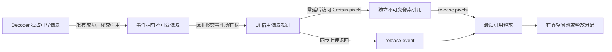

# 大图显示、像素所有权与内存复用

> **2026-11-09 更新**：下方 FIT → REGION 方案及“UI 传递全部零拷贝”范围是历史实现记录，不再代表当前静态 viewer。当前采用单次 NATIVE 原始行带、不可变 tile / LOD 缓存和仅 GPU 变换 / 缓存恢复的相机路径；resident 上传不复制，缓存编码有显式工作缓冲。现状见 [应用说明](../app/README.md)、[本轮 review](RENDERING_REVIEW-2026-11-09.md)。自定义 shader / RGB / YUV 仅列入 [开发计划](RENDERING_PLAN.md)，暂不实现。

历史说明日期：2026-11-08。当前 ABI 2 不变；Linux OpenGL 路径已实现静态 JPEG、PNG、未压缩 BMP、TIFF 的 FIT 预览和 REGION 细节。16K 是验收点，代码没有 16K 源尺寸上限；仍受格式、工作集、输出区域及 GPU 预算约束。普通 GIF 动画保持已有范围，不扩展到超大动图。

## 1. 显示和清晰度

打开后先生成受设备纹理尺寸和预算限制的 FIT 预览。100% 或滚轮放大时，根据相机位置请求可见区域及一圈图块余量；拖动更新请求，取消过期工作，保留上一层完整细节直至候选完成。缩小使用二次幂分辨率级别，达到 100% 时请求原始像素，继续放大不再用缩略图代替原像素。

源图坐标、相机和缩放计算使用 double；减去相机位置后才转换成 GPU float，避免极大坐标下平移抖动。EXIF 1..8 均由 viewer 统一应用。源版本由保留的 FIT INFO 锚定；REGION 的版本、尺寸或方向不一致时拒绝叠加。

每个 core tile 对应一张局部纹理，上传目标为局部 `(0,0)`；逻辑 canvas 可以远大于单纹理上限。预览保持线性采样，原始分辨率细节设置 `ImageDesc::Magnification::nearest`，放大时清晰显示每个源像素；缩小仍使用线性采样。不会为 16K / 32K 源创建同尺寸的单张纹理。

这是像素级清晰度保证，不是超分辨率：有损源本身的失真无法消除。JPEG / PNG 的新区域请求可能需要顺序扫描，细节完成前仍显示已有图层。

## 2. 最终输出不做像素深拷贝

从最终解码输出到 UI 上传，不允许为传递、排队、拆块或适配 stride 再复制图片数据。允许复制小型描述符和增减引用计数。

| 输出方式 | 解码写入 | 发布到事件 | UI 上传 |
| --- | --- | --- | --- |
| JPEG、PNG、未压缩 BMP、TIFF | 直接写入最终 `lv_pixels` tiles；没有完整局部输出中转图 | 移交原像素对象的引用，成功后 decoder 清空自己的指针 | 借用 `lv_pixel_view.data` 和 stride |
| WebP、SVG、静态 GIF、RLE BMP、动画帧的连续最终输出 | 写入拥有引用计数的连续输出 | 创建仅含元数据的 tile 视图，共享原始输出；视图保留 backing owner | 按原 stride 上传，不打包为新的紧密数组 |

不修改第三方解码算法内部的行缓冲、像素转换、重采样和 GIF disposal 合成语义。它们属于生成最终输出的解码工作，不能把这份说明解读为“所有 codec 内部没有任何 memcpy”。例如 GIF 动画当前仍生成不可变帧输出，并保留解码用的画布与 disposal 备份；这些开销仍受原有普通动画预算约束。

OpenGL `update_image` 直接使用传入指针：可用四字节行跨度时通过 `GL_UNPACK_ROW_LENGTH` 上传；其余跨度逐行提交，不创建 CPU staging 副本。GPU 上传本身仍有主存到设备的数据传输，不宣称 GPU 零拷贝。方法返回（包括抛异常）后不再持有源指针。未来 DX11 须满足同一借用契约，利用源 row pitch 完成上传；若引入异步上传，必须先设计显式保留和完成通知，不能悄悄缓存裸指针。

## 3. 所有权、转移和生命周期



- 发布前只有 decoder 写入；发布成功后不得再修改。发布失败不转移引用，由 decoder 清理。发布部分成功后取消：已移交块由事件负责，未移交块由 frame 负责，不能双重释放。
- `poll_event` 把事件所有权交给调用方；`get_view` 只借用，不能 `free(data)`。同步 renderer 上传后释放事件即可。需要延后使用时，必须在释放事件前 `lv_pixels_retain`，并为每次 retain 配对 release。
- 连续输出的视图拥有 backing owner 的引用；最后一个视图释放之前，连续原始分配不会被释放或复用。保留一个小视图也可能保留整个 backing，这属于真实 CPU 占用，不能只按视图面积估算驻留量。
- 终结释放、取消、新请求、动画 close 和 core shutdown 均不能使已借出像素失效。core destroy 仍需等待所有外部对象归还；join 不等待 UI 上传线程。
- 指针地址可能在最后引用释放之后复用。不能通过地址判断源版本、图块身份或是否仍有效；应使用请求 ID、source_revision 和 tile revision。
- UI 的 GPU 纹理由 `Tiles` / Viewer 拥有；core 不持有 GPU 对象。候选完整后才替换当前图层；上传失败保留当前图层，释放失败候选。

## 4. 回收池和预算

最终像素分配在最后引用归零时可进入 core 私有空闲池。池最多保留 128 个分配、总量不超过 `min(cpu_budget_bytes / 16, 8 MiB)`；选择最合适容量，额外容量最多为新请求的 25%。仍被事件、视图或外部 retain 持有的块不会进入池，因而不会被覆盖。

池内分配继续计入 `accounted_cpu_bytes`，不属于解码结果缓存，不把 `cache_budget_bytes=0` 改为启用内容缓存。预算准入和复制小型路径前按需清理空闲池，不能让唯一 worker 等待自己释放空闲内存。shutdown 清空池；关闭期间最后释放的分配直接归还系统。

区域路径峰值包含：请求区域的最终 tiles、tile 描述符、事件以及 codec 工作集；不再同时预约和分配一张区域 RGBA 中转图。连续输出路径只保留一份最终 RGBA，加 tile 视图与事件的元数据。

队列和 pinned 像素按视图有效面积 `width × height × 4` 统计，不把跨行间隙重复计入；实际 backing 分配在 CPU 账本中只计算一次。`byte_count` 是从 data 到最后一行末尾的合法地址跨度，`stride_bytes` 可以大于 `width × 4`，调用方必须尊重它。

当前单次请求区域还须满足 `min(large_pixel_bytes, 256 MiB)` 的输出限制和 CPU 预算；该边界不是完整源图的尺寸上限。UI 初始 CPU / 队列 / GPU 图片预算仍为 384 / 4 / 128 MiB。GPU 预算同时计算预览、当前和候选图层，预算不足时报告错误，不无限保留纹理。

## 5. 格式边界

| 输入 | 大图路径 | 仍有的限制 |
| --- | --- | --- |
| Baseline JPEG | 缩放解码、复用两行 RGBA、直接输出最终 tiles | REGION 可能扫描全文件；JPEG 自身有尺寸限制；不支持 CMYK / YCCK / 12 位 |
| Progressive JPEG | 同一输出接口 | 保守预约完整系数工作集，超预算明确失败；不承诺任意大 progressive JPEG 低内存显示 |
| 非交错 PNG | 顺序行解码、两行缓冲、直接 tiles | 新 REGION 可能重新扫描；16 位仍转 RGBA8；无 APNG |
| Adam7 PNG | 有界原图合并后输出 tiles | 仍需完整合并图，超大输入可返回 MEMORY_BUDGET；不能宣称具备流式大图能力 |
| 未压缩 BMP / bitfields | 有界头、复用 packed / RGBA 行、按需 seek 行 | 极宽单行仍需预算；不支持的编码仍拒绝 |
| RLE BMP | 有界普通尺寸路径，共享最终输出 | 保留文件 / 源图限制，不提供 REGION |
| TIFF / BigTIFF 首页 | 复用局部解码块，采样到最终 tiles；跳过无关源块 | 源尺寸不超过 INT32_MAX；实际 codec 内存受限；缩小预览为最近邻，100% 为源像素；不支持多页切换 |
| 静态 WebP / SVG / GIF、GIF 动画 | 既有有界范围，交付改为共享视图 | 不因此获得超大源或 REGION 能力 |

JPEG、PNG、未压缩 BMP、TIFF 不再受统一的 64 MiB 文件上限限制；其他路径仍保留各自原有边界。REGION 能力表示可以生成所需区域，不等于原生随机访问或固定响应延迟。

## 6. 验证与复现

```sh
cmake --preset dev -DLILTVIEW_BUILD_DESKTOP_TESTS=ON -DLILTVIEW_BUILD_LARGE_IMAGE_TESTS=ON
cmake --build --preset dev
ctest --preset dev -LE large --output-on-failure
ctest --preset dev -L large --output-on-failure
```

大图测试默认关闭。生成器逐行 / 逐块创建原创红白棋盘，不构造完整源 RGBA；文件在 `build/dev/large-images/`，不进入 Git：

```sh
build/dev/tests/liltview_make_checkerboard /tmp/checkerboard-16384.png 16384 16384 1024
build/dev/tests/liltview_make_checkerboard /tmp/checkerboard-32768.tiff 32768 32768 1024
build/dev/app/liltview /tmp/checkerboard-32768.tiff
```

当前验证：105 项常规测试和 5 项大图测试通过（共 110 项）；C++20 兼容构建的 93 项测试通过；ASan / UBSan 含四类大图共 58 项测试通过。Core 在 32 MiB 预算下完成 16384² PNG / JPEG / BMP、32768² TIFF 的预览、原尺寸区域和右下边界。BMP 测试文件大于 64 MiB。真实 OpenGL 用 512² 离屏 framebuffer、限制单纹理最大 128 像素和 GPU 图片预算 16 MiB，验证 32K 源 FIT、100%、放大、平移和缩小；未测试真实 16K 显示器或同尺寸 framebuffer。

`core.pixel_ownership` 直接比较发布前后像素地址，覆盖引用转移、共享连续存储、frame 幂等清理、保留像素期间的隔离、空闲分配复用、预算压力清池和 shutdown 后引用有效性。`desktop.renderer` 在单张 2×2 棋盘纹理内逐像素验证放大边界，防止线性插值回归；`large.render` 在 32K 源上额外检查边界像素，防止只放大 FIT 预览。

截图位于同一目录的 `checkerboard-fit.ppm`、`checkerboard-native.ppm`、`checkerboard-magnified.ppm`、`checkerboard-pan.ppm`、`checkerboard-zoom.ppm`。这些是离屏测试产物，不是桌面实机尺寸承诺。

内存检查另发现并修复动画关闭竞争：shutdown 若发生在 worker 的清理检查与退出检查之间，旧实现可能漏掉会话清理。退出前现于同一互斥锁内再次检查待清理会话，并新增反复关闭测试验证账本回到底座开销。

Release 已安装至临时前缀，并使用安装后的主程序通过真实 SDL / OpenGL smoke 路径打开 16K PNG、32K TIFF 和生成截图。切图失败后保留旧图的 source path 已单独固定，并验证仍能请求旧图的原始区域。

## 7. 后续性能优化

用户反馈当前大图预览与放大响应体感不如 VS Code。已记录为待优化项，本轮先提交功能与内存所有权实现，不追加速度优化。对比基线、分阶段计时、重复扫描 / 上传、纹理复用和交互调度待办见[性能优化记录](PERFORMANCE_TODO.md)；尚无同条件性能对比结论。

后续明确采用按视口 lazy load：放大只生成当前可见范围内缺失的细节，视口外暂不计算；拖动后复用重叠图块，仅补充新进入视口且未缓存的部分，并取消过期任务。该优化方向已记录，尚未完成；顺序编码的必要扫描与最终可见细节的按需生成须分别处理。
