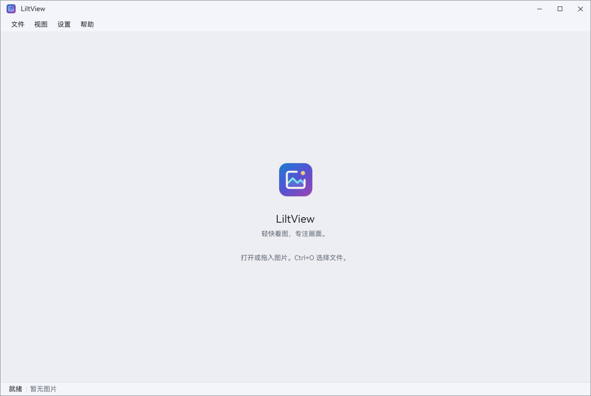
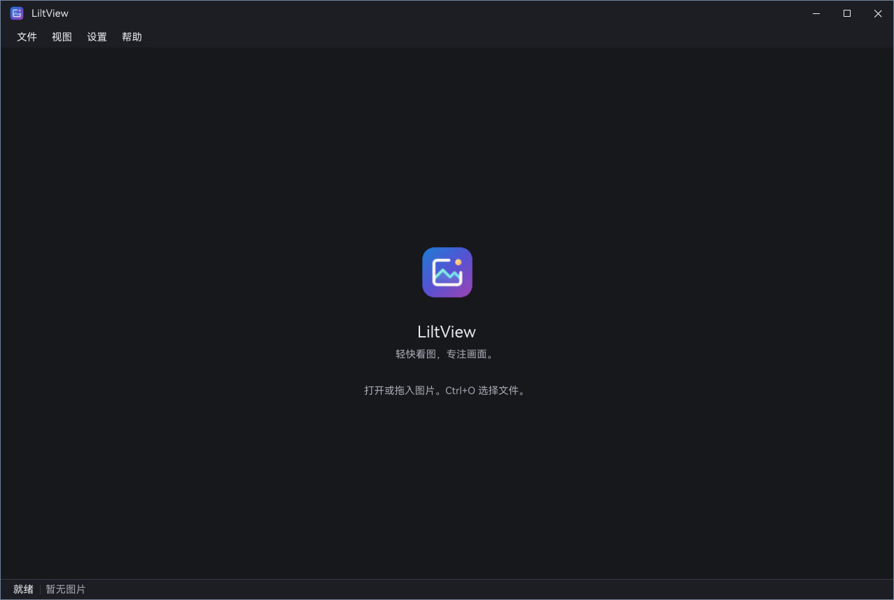
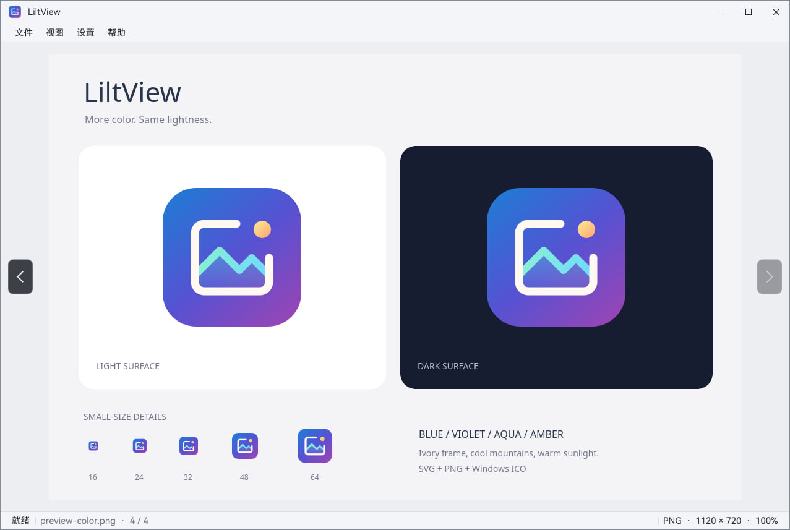
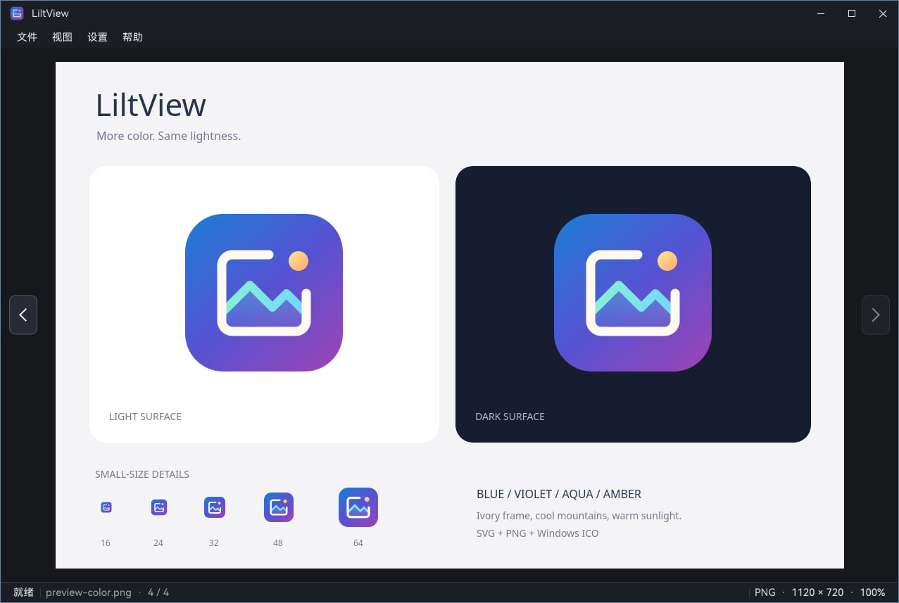
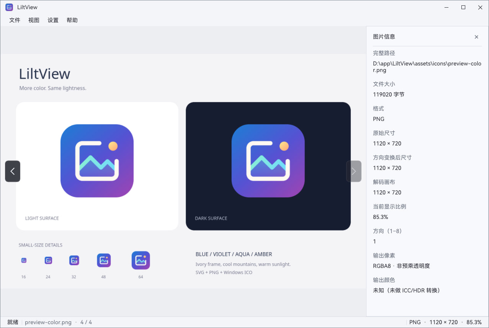
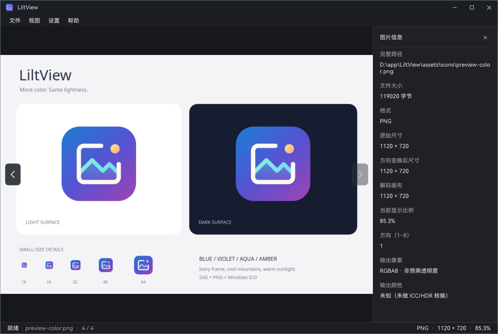

# LiltView 产品与设计

本文维护当前产品范围与交互；编码子集见[格式兼容表](图片格式兼容表.md)，实现见[架构](开发架构.md)，未完成工作统一见[开发计划](开发计划与未实现设计.md)。

## 1. 产品定位

面向本地图片浏览的轻量桌面应用，使用 SDL3 + OpenGL3，支持 Linux 与 Windows。优先满足快速打开、原始细节查看、普通动图播放和静态大图浏览。

产品原则：图片占据主要空间；打开和加载在后台执行；明确显示等待与失败；在预算内保留原始细节；格式支持按具体子能力声明。
“轻量”同时考察发布包、应用安装体积和新增系统依赖，不以单个可执行文件大小评价。

当前范围包括本地静态图片、普通尺寸动画和静态超大图。图片编辑、图库数据库、标签管理、批量处理不纳入当前范围。
CAD、PSD / PSB、AI、CDR、Sketch 等专用设计源文件及超大动图不纳入规划。

## 2. 界面与信息布局

以下复用 `assets/preview/` 中的现有中文界面截图，按场景对照浅色 / 深色主题。截图展示 Windows 窗口内菜单；桌面支持系统顶栏菜单时，菜单位置按平台适配。

**空状态：** 画布中央展示应用图标与打开 / 拖入提示，底部保留就绪状态与“暂无图片”。

| 浅色主题 | 深色主题 |
| --- | --- |
|  |  |

**图片浏览：** 图片占据主体区域，左右边缘为悬浮切图按钮；底部按三段展示状态、文件名 / 序号、格式 / 尺寸 / 缩放。两张截图显示同一张示例图片，主题切换只改变界面颜色，不改变图片内容。

| 浅色主题 | 深色主题 |
| --- | --- |
|  |  |

**图片信息面板：** 按 `I` 或通过视图菜单打开右侧面板，画布相应收窄；面板集中展示完整路径、文件大小、格式、尺寸、缩放与输出信息，状态栏继续保留。

| 浅色主题 | 深色主题 |
| --- | --- |
|  |  |

- 当前界面没有常驻工具栏、目录树或缩略图条；底部 Dock 按需浮现，保留画布边缘切图按钮，右侧图片信息面板可按需打开。
- 系统顶栏与窗口内菜单使用相同动作、可用状态和快捷键，系统菜单可用时不重复显示窗口菜单。
- 空状态显示应用图标、名称和打开 / 拖入提示；通过文件菜单或快捷键打开。
- 状态栏显示就绪 / 加载 / 恢复 / 失败状态、文件名、目录序号，以及原始格式、源尺寸与缩放比例；不显示语言或完整路径，详细信息可在右侧面板查看。
- 默认自绘无边框圆角窗口；最小客户区为 640 × 480。标题栏与状态栏空白可拖窗，边角可调整大小，图片区域拖动用于平移。
- 自绘边框采用 A「雾银 · 静蓝」方案：浅色 `#818994`、深色 `#6F8297`，保持 1 DIP 单线、12 DIP 圆角；不叠加描边、光晕或额外阴影。颜色随最终应用主题即时切换。
- 最大化和全屏使用直角；全屏隐藏自绘标题栏与边框。可在外观菜单切换系统标题栏及关闭圆角。
- Windows 自绘模式不叠加系统边框与圆角裁剪；关闭圆角时四角边框完整闭合，切回系统标题栏时恢复系统装饰。

布局依据：[窗口与画布](../app/ui/shell.cpp)、[菜单模型](../app/menu/menu_model.cpp)、[窗口装饰](../app/ui/window_chrome.cpp)。

### 2.1 深浅主题配色

界面使用共享语义色板，图片像素保持原样；只给悬停、选中与键盘焦点使用蓝紫强调色。

| 区域 | 浅色「雾白」 | 深色「石墨」 |
| --- | --- | --- |
| 图片画布 | `#ECEEF2` | `#17181C` |
| 信息面板 / 普通窗口 | `#F8F9FC` | `#202127` |
| 标题栏 / 菜单栏 / 状态栏 | `#F4F5F8` | `#1D1E23` |
| 弹出菜单 / 提示 | `#FFFFFF` | `#272830` |
| 主文字 | `#242731` | `#E9EAF0` |
| 信息标签 / 状态文字 | `#626A78` | `#A5A7B3` |
| 分隔线 | `#D9DDE5` | `#363842` |
| 强调色 | `#5E57CC` | `#AAA3FF` |

- 信息面板比画布明亮，用细分隔线划分区域，不用厚边框或阴影。
- 信息面板标题靠左，右侧为 28 DIP 的 × 关闭按钮；默认透明，悬停 / 按下使用蓝紫底色，支持键盘焦点与 Enter / 空格激活，提示关闭及 Esc 快捷键。
- 普通按钮使用中性色底；交互状态使用低饱和蓝紫底色。关闭窗口悬停保持红色危险提示。
- 切图悬浮按钮使用高不透明度的炭灰底与浅色箭头，避免亮色图片降低箭头可见性。
- 主文字与信息标签在各自使用的表面保持至少 4.5:1 的对比度；不把被禁用控件算作普通可读文字。
- 配色实现：[共享色板](../app/ui/theme.cpp)；测试覆盖对比度、深浅切换、DPI 和实际面板 / 画布 / 状态栏绘制颜色。

### 2.2 窗口边框实现

- 自绘外轮廓使用边框色填充，内部背景缩进 1 DIP；直线段补在前景，不再对圆角叠加描边，避免圆弧变粗和浅色背景漏入透明边缘。A 方案边框色：浅色 `#818994`、深色 `#6F8297`。
- 该方案强调柔和边界，不沿用旧边框的 4.5:1 测试门槛：浅色普通背景至少 3:1，较暗菜单条至少 2.5:1，深色背景至少 4:1；测试同时固定 RGB，避免仅凭对比度放过错误配色。这不是文字对比度或整套界面的无障碍合规声明。
- 圆弧绘制期间局部提高 ImGui 的曲线采样精度，并依据 framebuffer 密度缩小允许误差；绘制结束恢复共享参数。覆盖四角、100% / 125% / 150% / 200% UI 缩放与 framebuffer 密度的几何及像素测试。
- Windows 透明窗口的 HRGN 是二值视觉裁剪，不能直接复用按像素中心生成的圆角输入区域。视觉区域为圆弧外的抗锯齿带保留 1 个逻辑像素余量，最终覆盖率由 framebuffer alpha 与 DWM 合成，避免半透明像素被硬裁剪成台阶；不改变原有 6 DIP 缩放命中区和原生命中回调。
- 系统标题栏、直角自绘、最大化时仍移除 HRGN；保留自绘非客户区保护及原生 sizing timer 重绘路径，不恢复经典标题栏，不改变拖窗/拉伸机制。GPU 回归同时检查四角半透明像素是否位于真实 HRGN 内，而不只检查 framebuffer。
- Wayland 保留独立输入区域与透明合成；X11 当前仍使用不透明 visual 和二值 ShapeBounding，曲线绘制精度有所提高，但无法承诺其外轮廓具备透明合成级别的平滑效果。没有为此引入框架或更改 X11 visual。

## 3. 核心操作

| 操作 | 已实现行为 |
| --- | --- |
| 打开 | 文件菜单、`Ctrl+O`、命令行文件参数、拖入单个文件 |
| 相邻图片 | 裸 `←` / `→`、视图菜单或画布左右边缘悬浮按钮；首尾不循环，对应操作禁用；Ctrl+左右不切图 |
| 适应窗口 | 菜单或 `F`；画布尺寸改变时保持适应模式 |
| 100% | 菜单或 `Ctrl+1`；一个源像素对应一个物理 framebuffer 像素，可用性由实际原始像素决定 |
| 鼠标缩放 | 静态图围绕指针缩放；滚轮每步倍率为 1.25 / 0.8 |
| 键盘缩放 | `Ctrl+↑` / `Ctrl+↓`，以画布中心为锚点，可长按 |
| 画面旋转 | `Ctrl+←` / `Ctrl+→`，每次向左 / 向右旋转 90°，可长按；菜单栏和画面右键菜单同步提供 |
| 平移 | 静态图左键拖动图片；`Shift+方向键` 沿箭头方向移动视口，每步 64 个逻辑像素（图片内容反向移动），可长按 |
| 全屏 | `F11` 切换；`Esc` 退出全屏，也可关闭关于弹窗 |
| 图片信息 | `I` 或视图菜单切换；`Esc` 优先关闭信息面板，下一次才退出全屏 |
| 退出 | 窗口关闭、文件菜单、`Ctrl+Q` |

图片适应窗口且没有超出画布时不能继续平移；达到边界后停止。
成功加载图片后，可在中央画布（含图片周围空白）右键打开与“视图”菜单一致的菜单，复用条目、快捷键、勾选和禁用状态；无图、加载中和加载失败时不弹出，已打开的右键菜单也会在状态失效时关闭。信息面板、状态栏和标题栏不触发画布右键菜单。
Dock 固定于剩余画布底部中央、距底 16 DIP，不计算图片留白，不占布局或重算 FIT。默认隐藏；鼠标在画布底部 32 DIP 连续停留 200 ms 后淡入 120 ms，离开感应区与 Dock 后立即淡出 120 ms。全屏使用相同规则；状态栏和信息面板不是感应区。按钮按住、键盘焦点有效及更多菜单展开期间保持显示，从图片开始的拖拽不会被接管。更多菜单与右键共用“视图”条目，在 Dock 上方间隔 8 DIP、右对齐吸附，空间不足时滚动，不覆盖更多图标。主题复用雾白 / 石墨语义色板。

Dock 唤出和双击切换须当前图像成功加载并可操作；上一张残留画面不算当前加载成功，换图或加载失败清理未完成计时。相机恢复期间不唤出隐藏 Dock，但已显示的底板保持、动作暂禁用，避免点击缩放 / 旋转后闪烁。

没有可显示图片时禁用适应、100%、缩放和平移；无法提供原尺寸时单独禁用 100%。文本输入和弹窗优先处理按键。图片请求已排队、解码中或画面恢复尚未完成时，所有应用快捷键（包括长按重复、Esc、全屏和打开 / 退出）均不执行；加载完成后恢复，窗口系统关闭仍有效。
目录在后台枚举，按文件名自然排序（2 在 10 前，ASCII 忽略大小写后以原始名称稳定决胜）。仅纳入当前支持格式后缀及显式打开的当前文件；未打开文件时隐藏悬浮按钮，单图、扫描中或目录错误时禁用，首尾仅禁用对应方向。坏图或文件删除不阻止继续切换，显式重新打开会刷新列表。
悬浮按钮不占画布布局，按下后拖出也不会平移底图；文本输入、弹窗与原生文件选择优先。成功加载后左键双击画布（包括空白）与 Dock 共用 FIT / 100% 切换；手动缩放先回 FIT，依据模式而非比例数值判断。双击 UI、弹窗、拖拽或加载中的画布不触发，也不会强制显示 Dock。

信息面板按实际可见图片显示完整路径、文件大小、格式、原始 / 方向变换后尺寸、解码画布、物理像素缩放率、方向和输出像素 / 颜色状态；GIF 另显示当前帧、已知帧数 / 时长 / 总轮数。未知字段明确标注，不伪装成完整 EXIF / ICC 支持。换图尚无新像素时，面板保持旧图信息；加载失败时不再显示旧图信息；窗口缩小可滚动，画布、边缘按钮和状态栏互不覆盖。

### 3.1 底部状态栏

采用“左侧状态 / 中间文件标识 / 右侧图像参数”三段布局，不再显示语言。
- 无图片：左侧就绪，中间无图片，右侧不显示参数。
- 已有图片：中间仅文件名与目录序号，右侧显示实际原始格式、原始尺寸和物理像素缩放比例；不使用扩展名或解码画布尺寸代替原始信息。
- 加载中：显示加载 / 加载原图 / 恢复中状态；若仍展示上一张，明确标记“上一张”，参数归属实际可见图片。
- 加载失败：左侧“加载失败”，中间为失败文件名，隐藏旧图参数；具体原因直接放在中央失败占位图下方，不依赖悬停提示。
- 文件名过长时省略，优先保证参数空间；状态栏及其提示不显示完整路径。完整路径仅保留在主动打开的图片信息面板中。

## 4. 加载与显示体验

| 状态 | 当前行为与产品要求 |
| --- | --- |
| 等待打开 | 显示目标文件名与加载状态；后台探测、解码，过期请求取消 |
| 原始内容到达 | 支持流式路径的静态图按已完成行带呈现；未完成内容仍明确处于加载中 |
| 加载完成 | 当前图形成不可变原始场景；缩放和平移复用已生成像素及 LOD |
| 冷缓存恢复 | 后台读取 / 解压；优先显示已有完整画面，并在高清覆盖充足时推进相机，目标就绪后准确到达 |
| 失败 | 中央展示失败占位图，其下直接显示不支持、损坏、I/O 或预算不足等具体原因；不显示上一张图片，仍可切换文件。终止加载时清理部分呈现的待显示状态，取消事件处理完毕后恢复快捷键；失败不再被视为持续加载 |
| 关闭 | 先隐藏窗口，再取消、等待后台工作并释放资源 |

失败内容在小窗口 / 高 DPI 下优先压缩间距、扩大文字换行宽度，保留非零的失败占位图；仍放不下时独立纵向滚动，原因文字不截断，画布导航按钮仍可操作。

静态图当前使用单次 NATIVE 原始分辨率请求，放大不重新解码源文件。小图直接驻留 GPU；大图使用临时压缩 tile / 预生成 LOD 与有界纹理缓存。
JPEG / PNG / 未压缩 BMP / TIFF 可逐原始行带发布；这不等于 progressive JPEG 扫描预览或 Adam7 逐 pass 细化。
当前 FIT 是原始场景的显示方式，不能把旧版“先 FIT 再随相机请求 REGION”的方案当作现状。

相邻静态图预读到 Core 内存缓存；普通 GIF 额外按内容识别并预热会话 / 首帧，切换前重验文件版本，切入时不重复播放预热首帧，后续帧与循环遵循源时长和轮数。后台不上传 GPU、不改变当前错误或面板信息；当前显示优先，版本、输出尺寸或预算不合适时走普通打开。这不代表整部动画已缓存，也不承诺所有切换都免等待。

高清缓存不足时仍可能保持最近画面等待；首次 LOD / 压缩 / 缓存写入及单次 GL 调用还可能阻塞 UI。
已有后台解码与恢复能力不构成固定响应时间承诺。强缩小质量、真实照片冷缓存延迟和跨屏高 DPI 仍需专项验收。

## 5. 视觉、语言与设置

- 使用中性画布、深浅两套界面；主题默认跟随系统并响应变化，手动选择深色 / 浅色后优先使用个人设置。
- 中文 / 英文可运行时切换，支持跟随系统；随包字体为 HarmonyOS Sans SC Regular，附独立许可。字体损坏或缺失时回退系统字体；无法提供中文字体时使用英文。
- 彩色应用图标采用蓝紫渐变底、暖白画框、薄荷山形和暖色光点，小尺寸使用简化版本。资源见[图标目录](../assets/icons/)。
- 语言、主题、窗口尺寸、标题栏和圆角选项保存在 `settings.yaml`；日志等级从配置读取、重启生效。具体字段与优先级见[配置说明](命令行与设置.md)。
- 关于弹窗提供版本、许可证、字体署名、作者与项目入口。

## 6. 支持边界与运行环境

当前支持七类格式的具体子集、目录导航、静态视口操作、普通 GIF 自动播放、信息面板及界面设置。**大图流畅度、跨屏高 DPI 与 Windows 完整交付仍有缺口**；GIF 手动控制、扩展格式、完整 ICC / HDR、自定义图像 shader、D3D11 和更新检测尚未实现，详细要求只在[开发计划](开发计划与未实现设计.md)维护。

以下是用户于 **2026-11-12** 确认可运行的配置快照，不是最低配置、当前版本重测或完整专项验收；不推导其他平台 / 驱动同样可用。

| 环境 | 配置快照 |
| --- | --- |
| 原生 Windows 10 | 专业版 22H2 x64，内部版本 19045.5965，简体中文；32 GB RAM（可用物理总量约 28.78 GB）；RTX 3060 / 12 GB GDDR（12288 MiB）；NVIDIA 596.36 / Windows 驱动 32.0.15.9636（2026-04-23） |
| 原生 Arch Linux | KDE Plasma Wayland；内核 7.2.15-arch1-1，Plasma 6.8.2，Frameworks / kcoreaddons 6.31.0，Qt 6.12.0，Wayland 1.26.0 |
| Windows 10 + WSL2 Arch Linux | x86_64 滚动发行；内核 6.18.54.1-microsoft-standard-WSL2，WSLg 1.0.79；无常见桌面环境包 / 会话；`DISPLAY=:0`、`WAYLAND_DISPLAY=wayland-0`；Wayland 1.26.0-1、Mesa 1:26.2.6-1、systemd 262.2-1、glibc 2.44+r50+g1848099f063e-1 |

Windows 机器报告的 DirectX 12、最高 `12_1` 功能级别及 WDDM 2.7 不表示应用实现了 D3D 后端。WSLg 与原生 KDE 桌面分开记录；同时存在 X11 / Wayland 显示变量也不等于两个后端均已分别验收。安装与干净环境部署要求见[打包说明](../packaging/README.md)。
