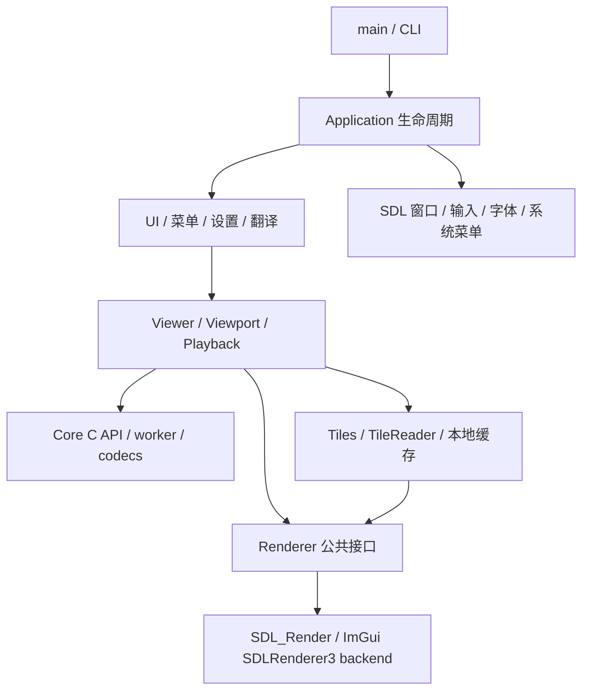

# 开发架构

本文维护当前模块、调度和资源边界。构建命令见[构建与验证](构建与验证.md)，显示细节见[渲染与大图](渲染与大图实现.md)，未完成工作见[开发计划](开发计划与未实现设计.md)。

## 1. 技术边界

| 层次 | 当前实现 | 边界 |
| --- | --- | --- |
| 核心 | C23（MSVC 使用 C17 私有兼容层）、公共 C ABI 2、单解码 worker | 本地常规文件；无窗口、GPU、翻译或网络依赖 |
| 应用 | C++23，显式 C++20 兼容模式 | SDL3 窗口与事件、Dear ImGui 界面 |
| 渲染 | 独立 C++ renderer、SDL_Render | RGBA8 单平面纹理；图片和 UI 通过 ImGui 绘制 |
| 平台 | Linux 与初步 Windows 支持 | Linux X11 / Wayland；Windows Win32 文件 / C11 线程 / SDL3 + SDL_Render，完整桌面实机验收待完成 |
| 工程 | CMake 3.30+、Ninja、Catch2 / CTest | 自有源码显式列入构建，关闭 GNU 扩展 |

Core、SDL3、codec 以静态库组成应用；Linux Fontconfig、SDL 所选驱动及窗口运行库及可选全局菜单依赖使用系统组件。依赖源码固定在 `third_party/`，CMake 使用本地源码，不自动下载。

## 2. 模块与依赖方向



| 目录 / 目标 | 职责 |
| --- | --- |
| `app/main.cpp`、`app/cli/` | 参数、帮助、版本、启动配置；CLI 可独立于图形栈校验 |
| `app/application.cpp` | 窗口、平台后端、ImGui、事件循环、资源创建及退出编排 |
| `app/ui/`、`app/menu/` | 画布、窗口装饰、信息面板与弹窗；系统菜单与窗口菜单共用模型 |
| `app/settings/`、`app/i18n/`、`app/logging/` | YAML 持久化、中英翻译、spdlog 与 C 回调适配 |
| `app/platform/` | SDL render host、字体、全局菜单、Wayland / X11 窗口形状 |
| `app/viewer/viewer.*`、`animation.cpp`、`navigation.*` | Core 请求/事件所有者、切图、错误恢复、动画帧上传、后台目录枚举与自然排序 |
| `app/viewer/prefetch.*` | 两邻居低优先级调度、取消后退休 ID、忙闲边沿有界重试、后台事件隔离 |
| `app/viewer/animation_warmup.*`、`neighbors.cpp`、`animation_prepared.cpp` | 邻居静态 / GIF 调度、首帧与会话保留、前景版本验证、完整候选上传与接管 |
| `app/viewer/viewport.*`、`playback.*` | 坐标、EXIF 与手动旋转变换、缩放平移、单调时钟播放策略 |
| `app/viewer/tiles.*`、`tile_reader.*` | 原始场景、一次生成 LOD、匿名压缩缓存、RAM/GPU 驻留与恢复 |
| `app/renderer/` / `LiltView::renderer` | 后端无关纹理句柄、上传、能力/预算、帧提交与 present |
| `core/src/api/` / `LiltView::core` | 配置校验、请求/动画会话入口、取消、事件及生命周期 API |
| `core/src/engine/` | worker 调度、资源预算、不可变对象和源版本记录 |
| `core/src/codecs/`、`platform/` | 内容探测、各格式解码/栅格化、文件版本与单调时钟 |

Renderer 不依赖 Core、Viewer、设置或菜单；Core 不包含应用层和图形库类型。Viewer 负责把 Core 像素转换为 renderer 上传描述。公共声明分别以 [core.h](../core/include/liltview/core.h) 和 [renderer.hpp](../app/renderer/renderer.hpp) 为准。

`Viewer::image_details()` 返回与可见场景同源的 owned 值快照，不做文件 I/O。请求目标与已显示路径分别保存，原始行带揭示、失败回退、已呈现相机和 GIF END 元数据都按对应身份更新。`image_information` 只格式化 / 绘制，未知颜色和 KNOWN 标记不被猜测补齐。输入由 `ShortcutContext` 统一屏蔽文本、popup 和原生文件选择，Esc 先关闭面板再退出全屏。

`core/src/engine/cache.c` 提供完整静态结果的可选内存 LRU，按文件版本和 target 匹配，复用不可变像素引用。缓存命中仍核验已打开文件 / 路径，取消与成功提交共用终结锁；未完成捕获不入缓存。PREFETCH 在同一个 worker 低优先级真实解码，只发布 INFO 和终结；前景受理后协作取消活动预读。缓存预算不足时 DISPLAY 旁路，预读明确失败，详见 [Core 契约](核心接口与生命周期契约.md)。

## 3. 静态图片与大图数据流

```text
CLI / 打开 / 拖放 → Viewer.open → generation 更新、取消旧请求
  → 尝试 GIF 动画会话；非动画回退静态 DISPLAY / NATIVE
  → Core worker：打开与内容探测 → 工作集准入 → IMAGE_INFO
  → codec 生成原始像素 → REGION_READY → COMPLETE / ERROR / CANCELLED
  → UI poll：核对 request_id / user_tag → Tiles.upload → 释放事件
  → 小场景 GPU 常驻；大场景生成一次 tile / LOD 缓存与 FIT atlas
  → 缩放 / 平移：查已有缓存 → 后台读取解压 → UI 上传 → 绘制
```

当前应用静态路径采用一次 `LV_TARGET_NATIVE`，相机操作不再提交源图 REGION 解码，也不按视口重新生成 LOD。Core 的 FIT / REGION API 仍可独立使用；JPEG / PNG 的 REGION 能力不等于源文件随机访问。

JPEG、非交错 PNG、未压缩 BMP、TIFF 可逐原始行带交付并提前准备 / 上传；静态首屏仍等待完整覆盖后显示。progressive JPEG / Adam7 PNG 仍受系数或合并工作集限制；WebP、SVG、RLE BMP 等保留各自有界路径，不能由 NATIVE 枚举推导出所有格式均可流式大图显示。

小场景 GPU 常驻；首次像素通过 `TilePreparation` 的有界队列交给单个 CPU worker，生成 tile / LOD 与本地临时缓存，主线程只安装结果和提交 SDL 上传。首次首屏齐全后统一显示；加载后的冷交互仍保留最近完整画面。`TileReader` 独立线程只读取 / 解压已有结果，不重新解码源文件。缓存布局、相机提交、上传调度与失败规则统一见[渲染实现](渲染与大图实现.md)。

## 4. 动画数据流

GIF 通过 Core ABI 2 会话顺序请求 `NEXT` / `RESET`。Core 保存合成画布、disposal 状态和源版本，产出一帧不可变 RGBA8；UI 使用当前/候选两张纹理。

```text
open_animation → ANIMATION_INFO / COMPLETE → NEXT → ANIMATION_FRAME_INFO / 帧块 / COMPLETE
  → 候选纹理完整上传 → Playback deadline 到达 → 交换显示与候选
  → 请求 NEXT；循环时 RESET 并校验 epoch；结束/失败/切图关闭会话
```

帧块不直接修改正在显示的纹理；动画不采用静态行带揭示，避免混帧。两张纹理均计 GPU 图片预算，准入失败保留当前完整帧并报告错误。隐藏/最小化暂停与循环时钟由应用管理，Core 不驱动播放时钟。当前没有 seek、用户播放控制或超大动图支持。

相邻 GIF 在前景空闲时通过 Core `OPEN → NEXT` 预热；格式由内容识别，预读 INFO 只是提示。首帧覆盖完整且终结事件归还后才进入 READY，后台只保留 CPU 引用与会话。切入时先用前景 NEXT 重验源版本，得到同 epoch 的真实 frame 1 或单帧 END，再移交 frame 0 与会话；不 RESET、不重标帧身份。两张局部候选纹理均上传成功后才提交首帧并开始时钟，该次 pump 保留首帧供 UI 绘制。版本 / 尺寸 / 上传失败回退普通打开，暂停时延后呈现。

应用最多三个会话（前景与两邻居）；静态预读和 GIF 预热合计最多两个未终结后台 ID，已取消退休任务仍占名额。每次普通前景 OPEN / NEXT / RESET 前中断未完成预热，切图保留被接管者并退休其他 READY。静态缓存与 GIF 预热是两条独立路径，不构成 Core 通用完整动画内容缓存。

## 5. 线程、所有权与关闭

| 执行者 | 当前职责 | 约束 |
| --- | --- | --- |
| UI / render thread | 控制 Core、poll、场景管理、SDL 纹理上传与绘制 | 同一控制线程串行调用；所有图形 API 留在此线程 |
| Core worker | 探测、解码、动画合成、队列发布 | 当前只有一个解码 worker；取消为协作式 |
| TileReader worker | 已生成 tile/LOD 的读取、解压与 RAM LRU | 不访问源 codec、SDL_Render 或 Viewer 状态 |
| DirectoryNavigation worker | 枚举目录、自然排序、解析真实父目录 | 最新扫描替换旧任务；最多 100000 条 / 32 MiB 路径，不在 UI 做目录 I/O |
| 日志/唤醒回调 | 日志适配、投递 SDL 通知 | 可由后台调用，不重入 Core 或直接修改 UI；C++ 异常不得越过 C 边界 |

Core 控制调用在 UI 线程串行执行；事件和像素不可变，过期事件也须 release，延后读取前先 retain。`COMPLETE` 只表示生产结束，不等于用户看见；取消后仍核对请求 / generation。详细规则以[核心契约](核心接口与生命周期契约.md)为准。

关闭时先清理预热 / Prepared 引用并关闭会话，再 `begin_shutdown → join → 归还外部对象 → destroy`；join 超时保留 Core、回调与 SDL 唤醒目标，不强杀线程。应用清理 TileReader、场景和图片后，才关闭 renderer、ImGui 与窗口。

## 6. 渲染与资源账本

Renderer 只接受单平面 RGBA8、straight alpha 和显式 stride；Viewer 计算 EXIF、手动旋转与视口变换。句柄、同步借用、SDL 纹理上传与目标状态恢复契约见[渲染接口](渲染与大图实现.md#4-renderer-接口与所有权)。当前默认账本如下，数值以源码配置为准：

| 资源域 | 当前应用默认 / 限额 | 含义与缺口 |
| --- | --- | --- |
| Core CPU | 384 MiB | 像素、请求、事件、可追踪工作集；第三方 allowance 不构成 RSS 硬限制 |
| Core 内容缓存 | 64 MiB，包含在 CPU 总额内 | 按源版本 / target 保存完整静态结果；过大旁路，不与场景磁盘缓存混淆 |
| GIF 预热保留 | 64 MiB reservation，实际像素计 Core CPU | 保守覆盖共享 backing 的最多 25% 池超配及描述符；不是精确分配 / RSS，采用后的当前帧由 Viewer 持有 |
| Core 像素队列 | 4 MiB，包含在 CPU 总额内 | poll 归还队列额度；外部保留引用继续占实际分配 |
| Core tile | 应用 512px；公共默认 256px | 按设备最大纹理边长向下收缩 |
| Renderer images | 128 MiB | 包含场景/动画图片纹理；不等于系统显存硬上限 |
| Renderer 上传 | SDL 管理同步，异常 pitch 有界条带重排 | 无应用 PBO 暂存；窗口尺寸 RGBA 帧目标独立于 images 预算 |
| 应用缓存 | 每 reader RAM 32 MiB；每场景磁盘 16 GiB | 场景与 Core 独立；旧/新场景、元数据、暂存尚缺统一 app 总账 |

Core 在解码前预约可推进工作集，队列/外部引用形成背压。预算不足区分暂时 BUSY、固有超限及实际分配失败；CPU 预算、逻辑队列、pinned、GPU images 和 staging 不能简单相加解释 RSS/显存。
