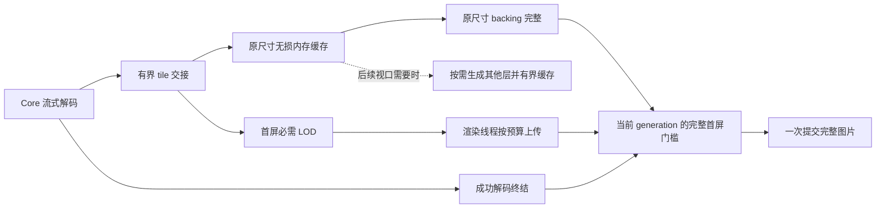

# 打开速度与 CPU / 内存联合优化方案

日期：2026-11-18。状态：设计提案，尚未实施。生产链路源码基线：`6c3cd5f`（另在 `24ccb9d` 工作区核对，后者仅修改导航测试）。历史性能报告用于确定测量缺口，不作为当前 MinSizeRel 构建的性能基线。

用户已确认：必须全内存；保留加载结束后一次显示完整图片的行为。本方案覆盖冷启动打开、应用内打开 / 切图、静态图显示和后续交互。GIF 的播放正确性保持独立验收，后台预热纳入统一资源调度。

## 1. 目标与边界

同时改善打开到完整显示的等待、CPU 短时峰值、进程内存峰值及稳定占用。优先减少实际工作量、复制和重复保留，再限制竞争；单纯减少线程可能降低 CPU 峰值并延长打开时间，不能据此判定成功。

保留以下要求：

- 应用不新增磁盘像素缓存、临时像素文件或磁盘溢出路径；不使用文件映射作为绕过全内存要求的替代方案。操作系统仍可能分页，全内存不等于保证系统不发生磁盘 I/O。
- 当前图片完成成功解码、原尺寸数据保留和首屏质量覆盖后，才一次提交显示；加载期间保留现有提示，不增加先模糊后变清晰的阶段。
- 首屏、方向、透明度、缩小过滤和原图像素保持正确；信息面板不改变图像视口。
- 后续相机操作不重新打开 / 解码源文件，所需像素从保留的内存数据获得。
- Core 读取 / 解码和应用准备 / 上传继续流水重叠；SDL_Render / ImGui 调用仍由 UI 线程执行。

需要显式接受的内部取舍：P2 的稀疏 LOD 会将部分层级改为从内存原尺寸像素首次按需生成，调整当前“所有 LOD 在初次加载时生成、相机操作不再重算 LOD”的实现承诺。它不改变完整画面的提交规则，也不重新解码源文件；冷缩放时延必须单独验收。实施前后文档需区分当前行为和新能力。

## 2. 当前实现与确定的优化位置

| 位置 | 已核对行为 | 设计含义 |
| --- | --- | --- |
| `app/application.cpp` | 创建窗口 / renderer、图标、加载字体后，才创建 Viewer 并接受初始图片 | 现有 Viewer 计时覆盖不了冷启动的全部等待 |
| `core/src/api/engine.c` | 当前仅创建一个 Core worker；`prefetch_workers` 字段不代表额外解码线程 | 不按配置字段臆测解码并发；需要实测各线程 CPU |
| `app/viewer/viewer.cpp` | Core CPU 预算 384 MiB，Core 内容缓存子预算 64 MiB，像素队列 4 MiB | 这些不是进程 RSS 总上限；Core 缓存已包含在 Core CPU 总账内 |
| `app/viewer/tile_preparation.cpp` | 大图最多两个准备 worker；按输入块数准入；缓存每个 tile 的完整 LOD 链 | 有机会减少缓存压缩、分配和持久保留；旧 / 新准备对象还需共享并发额度 |
| `app/viewer/cache_codec.cpp` | 复用压缩 scratch，仅将紧凑压缩结果交给缓存 | 旧报告中的 compressBound 容量滞留已修复，不能重复列为新收益 |
| `app/viewer/memory_tile_cache.*` | 当前 / pending / retiring 共用 2 GiB 缓存准入 | 已有跨场景限制，但没有把 Core、reader、scratch 等纳入同一进程资源策略 |
| `app/viewer/tile_reader.*` | 每个 reader 默认 32 MiB；raw 路径共享原块，压缩路径解压成新块 | 避免把共享引用重复算为实体内存；解压缓存应服从全局额度 |
| `app/viewer/tiles.cpp` | FIT 时可以预读原尺寸中心区域；后续相机存在邻近恢复 / 预热 | 首屏后 CPU / MEM 峰值不能只归到解码器，需要区分后台任务 |
| `app/renderer/backend/sdl/sdl_renderer.cpp` | 上传、纹理创建、透明初始化、mip 生成均有成本；部分创建路径已经直接带初始像素 | 先统计实际调用和重复字节，不笼统假设每条路径都在重复上传 |
| `tests/integration/loading_benchmark.cpp` | 已有阶段、逐帧统计、峰值 RSS 和累计进程 CPU 时间 | 仍缺短窗口 CPU 峰值、当前 RSS 轨迹及真正的冷启动指标 |

历史同源 PNG 报告在 Windows / MSVC Release 下记录过：8K 完整首屏约 878 ms、16K 约 3379 ms；这不含进程启动，输入页缓存已热。不能外推到当前 MinSizeRel、macOS、JPEG 或冷文件缓存。完整方法和边界见[缓存压缩报告](../benchmarks/results/2026-11-13-cache-compression/README.md)。

## 3. 先统一测量口径（P0）

| 维度 | 必测指标 |
| --- | --- |
| 冷启动 | 启动器发起进程 → 首个窗口 present 返回；→ 完整图片 present 返回；应用入口 → settings / SDL / renderer / 字体 / Viewer 各阶段 |
| 应用内打开 | 接受 open → 首块解码、解码终结、必需准备完成、首屏 ready、首个完整图片 present 返回 |
| 响应 | UI 主动工作时间 P50 / P95 / P99 / 最大值，输入处理延迟，帧间隔；present 等待单独记录 |
| CPU | 进程 user + kernel 累计时间；每 100 ms 的 busy core equivalents 峰值 / P95；500 ms 平滑窗口；各自有 worker CPU 时间 |
| 内存 | 当前 RSS / Windows working set 轨迹、进程高水位、macOS footprint；原尺寸缓存、派生 LOD、Core、队列、scratch、reader、旧场景、GPU 资源分项 |
| 隐性成本 | 纹理创建数、初始化上传字节、实际像素上传字节、mip pass 数、主线程分配耗时、唤醒次数 / 合并率、预热 CPU 和取消回收延迟 |

CPU 定义为 `Δ(user_cpu + kernel_cpu) / Δwall`：1.0 表示一个逻辑核持续繁忙，2.0 表示两个。另报除以有效逻辑核数的整机归一化占比，避免把不同任务管理器的 100% 混为一谈。短于采样窗口的小图同时报告总 CPU 时间和持续时长，不用单个峰值排序。

内存同时记录容量和有效长度。Core 的 `cache_bytes`、队列像素和借用像素是相关或子集统计，不能直接全部相加。借用 view 可能固定住更大 backing；按唯一所有者计费，未知 backing 归属保持保守。GPU 图片预算不自动包含 frame target、字体 atlas 和驱动隐藏分配；统一内存设备也不能把 CPU / GPU 数字简单相加视作物理占用。

增加外部采样器，独立于 UI 帧记录资源，避免 UI 卡住时漏测。基础频率 100 ms；另做较高频采样的抽样实验验证窄峰，记录采样器自身开销。分阶段墙钟会重叠，不能相加解释端到端耗时；Core elapsed 包含排队和背压，不能冒充纯解码 CPU。

## 4. 全局调度与资源预算（P1）

### 4.1 CPU 工作统一准入

引入应用级 CPU 调度器，准备、LOD、压缩、解压、预热和退休清理共享执行额度；不再按每个 generation 独立创建最多两个繁忙准备 worker。Core 保留当前工作线程，控制其入队任务优先级和背景准入。

候选起点为一个 Core 解码任务与一个准备任务并行；有余量时再准入第二个准备任务。这个限制覆盖应用自己的重 CPU 工作，不承诺驱动、系统和第三方内部线程也受同一个硬限速控制。候选值需比较 1 / 2 个准备 worker，不按硬件线程数自动全部用满。

任务顺序：阻塞资源回收的取消清理 → 前景首屏必需准备 → 当前视口恢复 → 必需的原尺寸保留 → 可丢弃派生层 / 邻居预热。清理只在确实阻塞资源准入时提升，避免常态抢占前景。

首屏前暂停邻居预读、GIF 预热、中心细节预测和其他推测任务；首屏提交后等到连续空闲窗口再少量恢复，150–300 ms 作为实验参数。缩放、拖动、切图、内存压力或 UI 长帧立即收回背景额度。GIF 当前播放的下一帧有自己的显示期限，不能与推测预热一起饿死。

循环在行带 / tile / LOD 单元间检查取消和配额，用条件变量阻塞无任务 worker。避免忙等；不把任意 sleep 塞进每个像素循环。协作让出无法抢占一次库调用，因此 CPU 峰值以测量窗口验收，不承诺瞬时占用恒定。

### 4.2 内存统一管理

建立 CPU 像素资源预算 `B_host` 与独立 GPU 图片 / 帧目标预算，保留进程 RSS / footprint 的观测指标。`B_host` 是可计费分配上限，不能作为驱动和系统内存的精确 RSS 上限。

首版使用固定 Core 分区与应用分区：创建 Core 时设置其预算，剩余额度分配给应用缓存和工作区。Core 统计用于观测和背景调度，不作为无锁跨组件原子准入依据。以后若需要实时借用 Core 的空闲额度，须专门设计一致的 reservation 接口，不能靠降低轮询到的数字防超分配。

| 预算项 | 候选实验起点 / 策略 |
| --- | --- |
| CPU 像素总预算 | 首轮比较 512 MiB / 1 GiB；结合机器和样本确定默认值，不直接把它们写成进程 RSS 承诺 |
| 工作区和交接队列 | 共享预留 16–32 MiB；同时计入 active、排队输出、压缩 scratch 和所有退休任务 |
| reader 解压数据 | 共享 16–32 MiB，当前可见数据优先；raw 别名不重复计实体内存 |
| 派生 LOD / 邻居缓存 | 弹性使用剩余空间，最先收缩；当前视口必需数据固定 |
| 退休旧场景 | 至多一个有界待回收场景；压力下先回收旧原尺寸 CPU 缓存，保护仍被本帧 draw 引用的纹理直到提交 |
| GPU 图片 | 以当前 128 MiB 为对照；frame target / 字体另计，禁止为了首屏无限预分配 |

所有分项从总额度切分，而不是在总额度之外再叠加。Core 内容缓存与应用原尺寸缓存重叠时，优先减少可重建的 Core 结果缓存；先保留小图 / 相邻图确实可复用的结果，不统一关闭有价值的预读。

资源压力时依次停止推测任务、回收邻居、回收可重建派生层、回收非可见解压块、加速已取消旧场景释放，再决定是否允许新块进入。不能淘汰唯一原尺寸数据后仍承诺无需源文件恢复。

## 5. 减少首屏前工作与长期保留（P2，核心改造）

### 5.1 稀疏 LOD 与原尺寸内存 backing

大图必需保留两类数据：可无损恢复原尺寸像素的内存 backing，以及达到当前首屏质量门槛的概览层。其他缩放层级从这份原尺寸数据按需生成、按视口优先缓存。

处理一个 tile 时：

1. 原尺寸块完成打包 / 无损编码，建立独立于 Core 池的长期所有权。
2. 按现有 alpha-correct 过滤链生成首屏必需层。为保持数值和透明边缘一致，中间层仍需计算，但算完立即释放，不逐层压缩并永久缓存。
3. 发布首屏需要的层与原尺寸缓存位置，首屏所需质量更低的尾部层不再提前生成。
4. 只在成功解码终结、原尺寸 backing 完整且首屏覆盖达到要求后，原子显示新图。

主要省去的是中间层的压缩、存储、分配和长期占用，不能将其表述为完全省掉生成概览所必需的中间降采样计算。小图原有直接上传路径继续保留，不强行为其创建长期 CPU 金字塔。

将 `PreparedTile::levels` / `Tiles::Tile::levels` 从“每个索引必定存在”改为明确的稀疏层状态，至少区分 absent / queued / building / ready / failed。合并相同 tile / level 的请求；生成结果带场景身份与视口版本，过期结果释放资源额度。近邻层级保留滞回，防止缩放边界来回重算。

生成缺失层时保持旧的完整画面；新视口所需数据全部就绪才提交相机。100% 使用原尺寸 backing，不依赖从较低清晰度概览放大。显式测量首次 100%、首次中间倍率及重复往返缩放，防止用更慢的交互换取首屏数字。

内存估算示例：15360×8640 的 RGBA8 原尺寸为 506.25 MiB，完整金字塔有效像素量约 675 MiB。若当前首屏只需 1/8 尺寸层，其像素约 7.91 MiB；保留原尺寸与这一层约为 514 MiB，较完整金字塔少约 24%。这是未压缩有效像素的理论估算，不是压缩后 RSS 或端到端提速承诺；边缘尺寸、工作区、索引和 GPU 另外计算。

### 5.2 自适应无损编码与减少数据遍历

保留已实现的紧凑 LZ4 输出。逐块比较实际压缩收益，压缩长度接近或超过 raw 时保存 raw；利用少量真实 tile 的统计决定后续是否继续尝试，并定期重新探测，避免前几块纯色误判整张照片。阈值如有效压缩比 0.90–0.95 仅作为 A/B 参数。

现有 `static_cache_compression: false` 继续强制 raw，不因内存压力偷偷开启压缩；启用时才允许按块选择有收益的无损编码，并在统计中报告实际编码选择。

raw 与压缩结果使用显式元数据；取消、校验、缓存查找和错误恢复不依赖猜测格式。raw 必须有应用所有权，不能长期 pin 住 Core 的大 backing。压缩尝试和 raw fallback 的同时存活峰值也须预留。

测量纯色检测、打包、哈希、压缩与 LOD 对同一像素的重复遍历。可证明等价时合并遍历 / 复用已知 opaque 属性；保持损坏数据校验。已实现的纯色 tile 去重保留，不重复计作新功能。

### 5.3 SIMD、编译配置与上传

- 对 `tile_pixels::reduce` 建立标量参考后，评估 x86 SIMD / ARM64 NEON；alpha 加权、除法舍入、奇数边缘和透明像素必须一致。先不全局更换过滤算法。
- 现有 libjpeg-turbo SIMD 继续启用。比较 MinSizeRel 基线与仅热点使用 O2 / 对应 MSVC 优化的构建，考察解码、LOD、压缩的耗时、CPU 总量及文件体积；不预设 O3 一定更快，不把 MinSizeRel 本身认定为瓶颈。
- 记录 atlas 相邻块更新，评估按连续区域合并上传；暂存受共享额度限制，不能引入整图 RGBA 副本。所有调用前检查帧预算，一次驱动调用不可抢占，超时后停止继续上传。
- 对仍存在的透明初始化和重复 mip 工作逐项优化；当前已有 `create_uploaded_image` 路径，不能对所有纹理创建再做一次同样的改造。未初始化像素不得进入采样范围，完整首屏提交前必须有覆盖证明。
- 首次上传和视口恢复共用字节、块数、时间预算；考虑吞吐自适应，但以 UI 响应验收，不简单取消每帧限制。

### 5.4 冷启动与稳态空闲

单独优化正常尺寸图片的固定启动成本：字体读取 / CRC / ImGui 字体数据复制、图标准备、renderer 创建和首次字体 atlas 上传。保持原字体与完整性校验；优先减少冗余复制与重复初始化。若启动确为主要瓶颈，再设计有界的初始探测 / 读取与 UI 初始化重叠，明确当前 `open()` 仅登记请求、没有 `pump()` 就不会自动启动完整解码，避免只移动调用顺序却没有收益。

合并 worker 唤醒，静态场景采用 dirty / deadline 驱动渲染：数据变化、输入、tooltip / Dock 动画和播放期限才安排帧。现有 200 ms 超时仍会回到渲染循环，需避免无变化时持续重绘；不能使悬浮提示、主题变化和 GIF 定时停滞。

## 6. 全内存条件下的容量边界

高熵原图的无损缓存不保证有明显压缩率。坚持完整原尺寸信息、无需源文件恢复、全内存和无损画质时，不能再承诺任意大图都能放进固定小内存。

请求开始先估计格式工作区和原尺寸体量，运行中按实际容量准入。估计不是提前拒绝所有可压缩图片的理由，也不能拿平均压缩比承诺一定放得下。额度耗尽后先回收可选数据；仍无法保留唯一原尺寸 backing 时明确报内存预算不足，继续保持 UI 可响应，不静默写盘、丢细节或展示半成品。

progressive JPEG、整幅 WebP / SVG 解码和 GIF 多帧有不同的不可中断区段、临时空间及质量语义。分别建模，不能把大图 PNG 的行带优化效果推给所有格式。JPEG 当前工作区估计较保守，是否可收紧需对比真实分配与库行为，不能只删除预算检查。

如果 P2 后仍无法满足主要样本的容量目标，再评估 opaque 图像的 RGB24 内部缓存。它可能降低未压缩 payload，但需计入打包 / 展开成本和已有 LZ4 对恒定 alpha 的收益；保持公共 RGBA8 像素和 SDL 后端兼容。这是后续选项，不是第一阶段依赖。

## 7. 实施拆分与验收

| 阶段 | 独立交付 | 主要触及位置 | 进入下一阶段条件 |
| --- | --- | --- | --- |
| P0 | 新 MinSizeRel 基线、CPU / MEM 轨迹、冷启动和线程阶段 | benchmark、`application.cpp`、统计接口 | 能区分解码 / 准备 / 上传 / 初始化 / 预热成本 |
| P1a | 前景优先、背景延迟、唤醒合并 | `viewer/neighbors.cpp`、预热控制器、`tiles.cpp` | CPU 峰值有实测下降，首屏无明显回退 |
| P1b | 总预算与准备并发共享、退休资源回收 | preparation / cache / reader / Viewer 生命周期 | 快速切图不叠加失控，预算不足无卡死 |
| P2a | 稀疏 LOD、原尺寸 backing 和缓存所有权 | preparation、Tiles、reader | 首屏像素正确，源文件删除后仍可恢复与缩放 |
| P2b | 编码自适应、SIMD、热点优化与上传合并逐项 A/B | cache codec、tile pixels、renderer、CMake | 每项都有独立收益和回退开关，跨平台一致 |
| P2c | 冷启动固定成本与空闲渲染 | fonts、application、renderer | 小图冷启动和静态空闲 CPU 有单独报告 |

建议的实验目标：代表性大图完整首屏 P50 改善 10% 以上、100 ms CPU busy-core P95 下降 20% 左右、同样本加载峰值 RSS 下降 20% 左右。目标需要 P0 后校准，不是当前已达成数据；逐样本报告，不能只给全组平均值。若三个目标不能同时改善，明确 Pareto 取舍，不将牺牲等待时间得到的低 CPU 作为默认胜出方案。

通用回退门槛候选：普通小图首屏 P95、100% 恢复和重复缩放 P95 不恶化超过 5%；计时较短时同时给绝对差值和置信区间。UI 主动工作 P95 以 4 ms 为起点观察，超过一帧的最大停顿全部保留；present 等待与驱动不可抢占调用另列。

测试矩阵：2K / 4K / 8K / 16K，真实高熵照片、截图 / 文字、透明图与棋盘格；baseline / progressive JPEG、PNG / 交错 PNG、BMP、TIFF、WebP、SVG 和普通 GIF。不支持的子能力按格式表处理。输入生成后通常已经热缓存，冷 / 热文件缓存必须标明；应用缓存冷 / 热与进程冷 / 热分开。

Linux、Windows D3D11、macOS ARM64 / Intel 分别建立驱动基线；记录实际 renderer、DPI、窗口、VSync、硬件与电源状态。每组先 5 次筛选，候选方案再交替 A/B 至少 20 次；基准期间不同时编译，不把 offscreen 结果当作桌面呈现性能。

正确性回归保留完整 UT，并新增对应行为测试：稀疏层和透明边缘 / 奇数尺寸、视口变化与过期任务、raw / LZ4 混合、预算刚好 / 超限、切图取消、最后一个引用释放、慢上传、源文件删除后的恢复、GIF 帧时钟，以及不同后台完成顺序。等待真实状态，不加宽断言或把固定 sleep 当作正确性同步。

优先交付 P0 与 P1；随后以 P2a 的稀疏 LOD 作为主要结构优化。旧报告、线程数下降和逻辑缓存缩小都不能单独作为“打开更快、CPU 峰值更低、实际内存更少”的完成证据。
