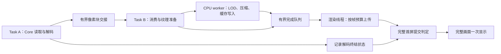

# 首次加载流畅度与完整首屏显示设计

日期：2026-11-12；实施更新：2026-11-13。状态：首次准备流水、完整首屏门槛、配置对照模式与分阶段计时已实现；实测结果见文末实施记录。

渲染基线为 SDL_Render。下文保留设计推导与初始预算候选；实际实施值和验收边界以第 12 节为准。

原始核对基线：LiltView `7936ae0998960cebae486646efd6ee477047b118`；PhotoCraft 参考快照 `bc778cf4afbe72421cac27cad7cefe766f5baca1`。当前实现说明仍以[渲染说明](渲染与大图实现.md)、[架构](开发架构.md)和 [Core 契约](核心接口与生命周期契约.md)为准；本文描述后续目标，不将目标写成已支持行为。

## 1. 决策与约束

本方案的目标是同时改善加载期间的窗口响应、完整首屏等待时间和画面出现方式。默认产品行为改为：读取、解码投递、缓存准备、首屏纹理上传期间显示“正在加载…”，准备齐全后一次呈现完整图片，不逐行露出新图。

必须保留两个独立调度的逻辑 task：

1. 文件读取、解码与像素块投递。
2. 消费已到达数据、准备纹理与上传。

两者持续流水重叠。上传不能等待整张图片解码结束才启动，也不能把完整打开操作包装为一个同步大 task。task 是职责和调度边界，不等同于必须各建一个 OS 线程；SDL_Render 调用仍由界面 / 渲染线程执行。LOD、压缩、磁盘写入可以由第二个 task 内部的 CPU worker 执行。

最终显示必须汇合成功解码和首屏纹理就绪这两个条件。这是画面提交条件，不是两个 task 之间的整任务启动依赖。

“全部纹理就绪”定义为**当前首屏视口所需、达到既定显示质量的全部纹理**。不要求整张超大图的所有原尺寸细节同时进入显存。继续保留单次 NATIVE 解码、分块场景、已有 LOD、有限 RAM / GPU 缓存，以及加载后的相机操作不重新解码源文件。

本方案先在现有 SDL3 + SDL_Render 路径实施；Vulkan、SDL GPU、Rust 重写不构成本方案的前置条件。GIF 的帧身份、预热接管、首帧时钟和播放机制保持独立验收，本轮重点是静态图片首次加载。

## 2. 实施前路径与实际缺口

本方案实施前的静态路径为：

```text
Core worker 读取 / 解码
  → IMAGE_INFO / REGION_READY / COMPLETE
  → Viewer::pump（约 4 ms 消费窗口）
  → Tiles::upload
      小场景：原始块上传
      大场景：复制 / LOD / 压缩 / 追加写盘 / 概览上传
  → draw 可提前选择 pending_scene，出现逐行画面
```

实施前源码核对结果（不是更新后的实现状态）：

| 位置 | 当前行为 | 对本方案的影响 |
| --- | --- | --- |
| [`Viewer::consume`](../app/viewer/viewer.cpp) | 到达区域后立即调用 `pending_scene_.upload`；COMPLETE 时提升场景 | 已有流水基础；异步准备后必须拆开 Core 终结和显示提交 |
| [`Viewer::pump`](../app/viewer/viewer.cpp) | 在事件之间检查 4 ms 截止时间 | 无法打断一次耗时的 `Tiles::upload`，不能据此保证单帧上限 |
| [`Tiles::upload`](../app/viewer/tiles.cpp) | 大图在调用线程生成各级 LOD、压缩并写本地缓存 | 首次加载的 CPU 和文件 I/O 工作仍占界面线程；应优先迁移 |
| [`Viewer::draw`](../app/viewer/viewer.cpp) | 加载中可直接绘制 pending scene，并调用 `prepare` | 隐藏 pending scene 后仍要继续准备，不能让首屏准备依赖可见绘制 |
| [`Tiles::prepare`](../app/viewer/tiles.cpp) | 冷恢复已有约 2 ms / 4 MiB 调度，以及 `upload_ready()` 查询 | 可复用预算思想；首次上传尚未共享同一套完整调度 |
| [`SDLRenderer`](../app/renderer/backend/sdl/sdl_renderer.cpp) | SDL_UpdateTexture 上传，SDL 渲染目标生成 mip；无应用层暂存槽，upload_ready() 默认允许 | 驱动调用可能阻塞；首次加载需共用帧预算、有界队列，并测量单次调用延迟 |
| [`TileReader`](../app/viewer/tile_reader.hpp) | 已生成缓存的后台读取、解压与 RAM LRU | 只解决后续恢复，不等于首次缓存生成已经后台化 |

另外，`Tiles::begin` 中的缓存目录 / 临时文件准备、索引构造，场景清理时的 worker join、大批纹理销毁，都需要计时。只移动压缩循环不能保证所有界面停顿都消失。

瓶颈归因目前是待验证假设：上述同步操作是明确存在的风险点，但各自占比必须通过分阶段基准确认，不能宣称迁移后一定提速多少。

## 3. 借鉴 PhotoCraft 的范围

参考的是已阅读的实现，而不是将其架构文档中的规划全部视为已落地。

| 已核对思路 | PhotoCraft 源码位置 | LiltView 的采用方式 |
| --- | --- | --- |
| 文件读取 / 导入在后台执行，完成结果交回 UI | `crates/ui-egui/src/file_open.rs`、`crates/engine/src/jobs.rs` | 保留已有 Core 后台解码；不复制其完整文档导入后才交给画布的流程 |
| 纹理和内容版本缓存，避免每帧重新合成 | `crates/ui-egui/src/canvas/textures.rs` | 复用场景与驻留纹理；加载提示重绘不触发重复上传 |
| 大文档按可视区域、缩放分辨率调度 | `crates/ui-egui/src/canvas/viewport_pages.rs` | 首屏所需 LOD 优先，后续可见细节优先，离屏预热最后 |
| 限制后台并发和每帧上传量 | 同上 | 建立字节、耗时、块数三重预算；参数按本项目测量，不照搬其 2 页 / 32 MiB |
| 重 CPU 合成在后台分块，完成后逐帧上传 | `crates/ui-egui/src/canvas/background_redraw.rs` | 把首次 LOD / 压缩 / 写盘迁出 UI；可后台分块完成而前台保持隐藏 |
| 过期结果丢弃、预算内保留可复用页面 | `viewport_pages.rs`、`gpu_canvas/residency.rs` | 按 generation 和视口版本过滤，限制旧 / 新场景总资源 |

PhotoCraft 本身也存在逐块补齐路径，并非所有打开都等待全图后一次显示。本文的完整首屏提交规则来自本次产品要求。未运行 PhotoCraft 与 LiltView 的同机对比，不能以 Rust / wgpu 或某个参数解释全部速度差异。

## 4. 目标数据流与职责



CPU worker 是 Task B 的执行资源；允许每个 tile 在自己的数据到达后独立推进。小图可以直接走有界上传队列，避免为不需要磁盘缓存的场景增加 LOD / 压缩开销。大图 worker 按块处理，绝不等待 Task A 整体完成才开始工作。

建议第一版只增加一个首次准备 worker。它持有场景 CPU 状态和写端，不访问 SDL_Render、ImGui 或可变 Viewer 状态；UI 独占 GPU 场景和 Renderer。先测一个 worker 的吞吐及对 Core 的 CPU 竞争，再决定是否需要并行，避免每张图片创建不受控线程。

交接结果使用不可变记录，至少包含：generation、场景身份、tile ID、矩形、像素布局 / stride、LOD 级别、结果类型、缓存可读性、错误，以及所持资源额度。结构名在实现阶段确定，不在本次新增公共 Core ABI。

初次准备与后续 `TileReader` 使用分开的写 / 读职责。worker 完成缓存块写入并建立读取可见性后，才发布其偏移和大小；读取方不能根据“已经生成元数据”推定 stdio 缓冲内容已经可读。采用分批 flush 后发布或显式偏移写，具体适配须同时覆盖 Linux 与 Windows；不要求每块 `fsync`，临时缓存不承担断电持久性。

第一版保留原始 tile 和各级 LOD 一次生成的语义，主要改变执行位置与调度。是否延后非首屏级别的生成 / 压缩，放在测量之后单独评估；不能在源像素已释放后才发现需要重读源文件补 LOD。

## 5. 所有权、背压与资源预算

现有 Core 在 poll 像素事件时归还队列额度；外部继续 retain 的像素仍占 Core CPU 预算。因此“Core 队列只有 4 MiB”不能约束应用新增的外借引用和打包副本。

必须先为下一块申请应用处理额度，再 poll / 转交像素。延期使用时 retain `lv_pixels` 后及时 release 事件；CPU worker 或上传完成后释放像素引用。不得只保存事件 view 或裸指针。终结事件可及时 release，另存请求身份和终结结果；INFO 源身份锚点按现有契约保留。

初始预算候选如下，均为实验起点，不是已验证默认值：

| 资源 | 建议起点 / 原则 |
| --- | --- |
| 首次准备 worker | 前景一个活动 worker；旧任务取消退出期间计入并发 |
| 外借 Core 像素 | 初始至多两个块；同时受 Core 存活 backing 和 CPU 准入约束 |
| 应用打包输入、处理中缓冲、完成输出 | 共享 16 MiB 额度池；先预留单块峰值，再开始处理 |
| UI 首次上传 | 每帧软预算 2 ms、4 MiB、最多 4 个块，任一耗尽即让出 |
| 上传临时资源 | SDL 后端仅为不兼容 stride 使用有界重排缓冲；图片纹理、帧目标与驱动内部不可见资源分开说明 |
| RAM 冷恢复缓存 | 复用现有 32 MiB 默认预算，避免首次阶段另建重复缓存 |
| GPU 图片 | 继续默认 128 MiB；旧场景、pending、details、atlas 一起准入 |
| 磁盘 | 保留现有单场景 16 GiB 上限；新增跨活动 / 退休场景总限额，数值由实际样本确定 |

预算计算必须包含原始块、LOD 链、压缩临时缓冲、排队输出和处理中峰值；LOD 链的近似 4/3 不能代替边界尺寸、压缩上界及实际分配统计。按 512² RGBA8 块，一个原始块约 1 MiB，可用作估算，不假定所有 source backing 都只有该大小。

特别处理共享 backing：几个小 view 可能 pin 住同一大缓冲。引用数量、`byte_count` 和矩形大小都不能直接当作实际持有内存。若现有 API 无法得到 backing 成本，初版采用保守策略：少量外借引用、Core 自身预算约束、worker 尽快打包并释放原始引用；只有打包缓冲进入应用额度池。必须报告 backing 计量限制，不宣称已有精确 RSS 总账。

背压从 GPU 忙向完成队列、CPU worker、输入交接、Core 传播；任何队列都不能无限增长。UI 不等待空槽或 worker；容量不足时停止继续取像素，但仍处理窗口事件。worker 队列满可以等待，取消 / 错误 / 关闭必须唤醒其所有等待点。

终结不能被背压死锁：未释放的 Core 引用不能一直等待“整个解码 COMPLETE”才处理，因为生产者可能正等这些引用释放。先消费已有块；等全部生产和处理自然结束后，才判断最终显示条件。

## 6. 每帧上传调度

首次上传、首屏必要细节恢复与后续恢复共享一个帧预算，不能分别花满多个 2 ms。调度顺序为：当前图片首屏必需数据、当前可见细节、近邻预热；旧 generation 结果直接释放，静态邻居预读 / GIF 预热继续服从前景优先。

每帧在数据已准备且预算允许时上传；当前 SDL 后端的 `upload_ready()` 默认允许，不表示驱动调用无阻塞。达到时间或字节预算后延至下一帧；通过有界准备队列提供背压。后续若实现额外准入条件，必须与实际上传使用同一条渲染线程逻辑。

每次调用前检查预算；一次调用不能抢占，因此软时间预算允许一个块超时，但不能在超时后继续上传下一个块。若驱动调用仍造成长帧，评估更小块、atlas 子更新、纹理预分配或更小上传切片，并记录调用次数增加的代价。纹理分配、初始化、mipmap 生成也计入 UI 时间；不能只统计传输字节。

完成纹理数据上传与 mipmap 生成后再作为可用纹理发布，避免每追加一小块就重建整套 mip。atlas 概览继续使用适用的无 mip 策略；同一内容不因加载提示重绘而再次上传。

数据未到达时由 worker / Core 结果唤醒；已有 ready 数据且被帧预算限制时安排下一帧。通知合并，避免每块都制造一次无意义重绘；不能只在 `draw()` 中推进准备，否则隐藏 pending scene 会导致加载永远不结束。

## 7. 完整首屏提交与加载状态

建议保留以下独立事实，不把它们折叠成一个 `loading` 布尔值：

| 事实 | 含义 |
| --- | --- |
| decode_terminal | Core 对当前请求的 COMPLETE / ERROR / CANCELLED 已记录 |
| preparation_done | 当前块的必需 CPU / 缓存结果已完整交接，初版所有 tile 的必要缓存条目均已发布 |
| first_view_ready | 按当前视口版本计算的全部必需纹理均可用于绘制 |
| frame_submitted | 完整图片 draw 已提交给 Renderer |
| present_returned | 对应 present 调用已返回；不等同于显示器实际扫描完成 |

显示提交条件：当前 generation 仍有效、Core 成功 COMPLETE、必需块数量 / 覆盖与 completion 一致、CPU 准备无失败、首屏纹理完整、视口版本一致。接收到 COMPLETE 不再直接等同于 `accept_completed()`；此时 CPU 准备或上传队列仍可能未清空。

完整指没有缺块、占位块和透明空洞，并达到既定首屏缩放所需 LOD；不新增先模糊后变清晰的产品阶段。初始 FIT 和 100% 等目标分别按其纹理覆盖验收。窗口缩放 / HiDPI / 信息面板布局改变会更新视口版本，旧版本就绪不能提前揭示。

上传、mip 生成和绘制通过同一 SDL_Renderer 顺序提交，依赖 SDL 管理资源同步。首屏就绪按当前场景的上传成功和视口覆盖判定，不以驱动队列清空为条件；API 返回时间不能冒充 GPU 完成时间。不增加应用层图形 API 的 fence 或阻塞等待。

产品行为：

- 从接受打开请求到成功提交前，画布显示“正在加载…”，替换图片时也采用该规则。
- 原图 GPU / CPU 资源可以为失败恢复保留，但加载时不绘制原图，也不提前绘制 pending scene。
- 成功时在同一帧切换图片、源身份、信息面板元数据、缩放状态与加载提示；不出现新文件名配旧画面、旧尺寸配新画面。
- 初次打开的默认相机仍为 FIT。加载期间沿用现有快捷键政策；本方案不顺带改变导航 / 快捷键权限。
- 错误时撤掉加载提示，显示现有错误画面和具体原因；不以残留旧图或部分新图冒充成功。
- 后续缩放 / 平移保留当前完整覆盖和原子相机提交策略；不重新套用首次加载遮罩。

首屏准备使用布局提供的独立视口信息，不能通过调用可见 `draw()` 偷做上传；绘制与准备分离后，原生 resize 的特殊 redraw 回调只画当前状态，不消费结果、不 join worker。

“加载中”保持语义统一。短加载不人为延迟以保证提示可见；长加载可显示已完成 tile / 总 tile 或明确阶段，但没有分母时不得伪造百分比。进度 100% 不能早于首屏提交，解码完成后的上传等待仍属于加载。

## 8. 取消、切图、失败和退出

所有输入、CPU 输出、GPU 句柄和计时都带 generation；可见纹理还绑定场景身份与视口版本。切图先使旧 generation 不可展示，再协作取消。过期结果仍必须释放引用和额度；不能简单忽略指针。

CPU worker 在每个 tile、LOD、压缩 / I/O 单元之间检查取消。已经进入第三方或系统调用的工作不承诺硬实时退出。新请求不得同步等待旧 worker join 才能响应窗口；旧任务放入有界退休集合，退出后回收。退休额度耗尽时，新准备任务等待资源，画布继续显示加载提示，不能无限创建替代 worker。

缓存失败、磁盘满、像素验证失败、纹理失败均阻止显示提交。第一版沿用清晰失败语义；不在缺少完整原始 backing 时临时降级到“只显示概览但声称完整加载”。后续若设计降级模式，须独立规定细节可用性和提示。

已进入 draw list 的纹理必须保留到该帧提交之后；仍适用当前 retired scene 保护。取消不能提前释放本帧正在引用的资源。加载提示帧也不能破坏正在提交的上一帧资源。

退出顺序：先隐藏窗口并停止接受新加载任务，保留后台唤醒目标；通知准备队列取消并唤醒等待；开始 Core shutdown；等待所有 CPU 准备和读取 worker 停止，归还应用持有的事件 / 像素；确认 Core join 完成后归还其余锚点并 destroy；最后在渲染线程、SDL_Renderer 仍有效时释放场景纹理，再销毁 renderer、窗口与 SDL。Core join 不代表应用新增 worker 已停止。SDL 回调目标必须活到最后一个可能发通知的 worker 结束。

## 9. 分阶段实施建议

| 阶段 | 交付 | 完成条件 |
| --- | --- | --- |
| A：建立基线 | 阶段计时、队列高水位、慢调用和帧分布 | 能区分解码、背压、LOD、压缩、写盘、上传、首屏和 present |
| B：首次准备后台化 | 单 worker、有界引用与结果队列、异步缓存提交 | UI 不执行 LOD / 压缩 / 大块文件 I/O；流水和取消契约成立 |
| C：统一上传预算 | 首次 / 恢复共用调度、预算耗尽延后、独立准备入口 | 无重复预算、无隐藏场景停滞，稳定处理慢 GPU |
| D：完整首屏揭示 | generation / 视口就绪判定、统一加载提示 | 每个新图的第一个可见帧完整；失败从未露出半成品 |
| E：按基准继续减少工作 | 批量 atlas 更新、首屏优先、可选延后非必需准备 | 证明更少首屏工作且不破坏一次解码、质量与资源上限 |

B / C / D 在功能发布前一起验收。单独遮住逐行显示属于呈现调整，不能当成加载性能优化完成。批量缓存布局、压缩算法变更、更多 worker、自定义 shader 或 Vulkan 另行评估，避免一次引入过多变量。

## 10. 测量与验收

复用[性能测试计划](../benchmarks/README.md)的现有输入，补真实高熵照片、透明图、窄长图、小图和跨预算边界样本；格式至少覆盖当前实际支持的 JPEG、PNG、BMP、TIFF、静态 WebP、基础 SVG，并单独回归 GIF。不是所有 codec 都可提前发布行带，整图输出格式不能伪造流水能力。

每次记录构建模式、提交、CPU / GPU、驱动、SDL 平台、显示刷新率、VSync、窗口尺寸 / DPI、输入校验值，以及应用缓存和 OS 页缓存条件。Release 同机同图重复至少 10 次，冷应用 / 热应用、冷页缓存 / 热页缓存分别标记；无法控制 OS 缓存就明确标注，不混算收益。

| 指标 | 定义与判定 |
| --- | --- |
| T_loading | 打开请求到首次加载提示提交；不人为保证最少显示时长 |
| T_decode_first / T_decode_done | 首个像素发布、Core 成功终结；另计 poll 延迟和背压等待 |
| T_prepare / T_cache | 每块 LOD、压缩、写盘、发布可读条目耗时；线程总和与墙钟分开 |
| T_upload_first / T_upload_last | 首次提交上传、首屏最后必需上传；CPU 返回不冒充 GPU 时间 |
| T_first_full / T_present | 完整画面首次提交、对应 present 返回；不冒充显示器实际呈现 |
| UI / 帧延迟 | pump、准备、上传、绘制、present 的 P50 / P95 / P99 / 最大值，以及输入事件处理延迟 |
| 资源 | 每队列字节 / 块数高水位、应用缓冲、Core 外借引用、图片纹理 / 上传临时缓冲 / 帧目标、旧新场景总占用、磁盘峰值 |
| 重复工作 | 重复解码、重复上传、源读取、缓存恢复、过期结果丢弃和预热抢占计数 |

首轮调优目标：60 Hz 参考机上，加载处理的 UI CPU 占用 P95 尽量控制在 4 ms 内；记录超过 16.7 ms / 50 ms 的帧和具体调用，VSync 等待另列。完整首屏时间以不回退超过同条件基线 5% 为初始检查线，超出则解释原因并继续调优。这些是待验证目标，不是已达到的承诺；最大单次驱动或磁盘延迟不能靠调度预算保证。

必须新增或调整的行为验收：

1. 慢解码、慢 CPU 准备、慢上传任一成立时，画布持续为加载状态；第一个图片帧完整、无逐行和缺块。
2. 用可控屏障暂停后续解码，证明首块已经进入上传；证明没有等待整张 COMPLETE 才启动第二个 task。
3. Core COMPLETE 先于 CPU / GPU 队列清空时，加载不提前结束；上传先完成但 Core 最终失败时也不能展示。
4. 有界队列满、驱动上传缓慢、共享 backing 大于块大小、极小预算均能恢复或明确失败，不死锁、不无限增内存。
5. 隐藏 pending scene 后，首次 `prepare` 仍被调度；窗口 resize、DPI 和面板变化重新判定首屏。
6. 快速往返切图、取消后迟到结果、文件源变化、上传失败、磁盘满都不串图、不泄漏、不显示过期元数据。
7. 源文件删除后仍能按既有缓存查看细节；透明、方向、HiDPI、奇数尺寸与不规则 stride 的像素结果维持基线。
8. 本帧绘制后导航、退出、最小化恢复、原生 resize 回调不提前释放纹理，不在 UI join 等待通知锁。
9. GIF 预热接管和首帧显示时长、静态邻居 PREFETCH 配额与前景优先不回退。

现有 `viewer_tests.cpp`、`information_shell_tests.cpp`、`navigation_render.cpp` 中依赖“逐行已显示”的测试必须改为验证“加载中的已上传纹理仍隐藏”；保留其取消、帧提交和失败清理覆盖。现有 sharpness、renderer contract 与生命周期测试继续运行，不能仅删除不再匹配的断言。

## 11. 参考实现定位

PhotoCraft 仓库基址：`https://github.com/storytold/photocraft`。

固定源码基址：`https://github.com/storytold/photocraft/blob/bc778cf4afbe72421cac27cad7cefe766f5baca1/`，与第 3 节路径拼接可定位阅读版本。仅借鉴调度、缓存和资源管理思路，不引入其编辑器文档模型或代码依赖。

本设计不证明 PhotoCraft 更快，也不将完整首屏出现等同于总加载时间缩短。实际模式对照、环境和测量限制见第 12 节。


## 12. 实施记录（2026-11-13）

### 12.1 已交付路径与实际预算

- `tile_preparation.hpp/.cpp` 将像素打包、alpha-correct LOD、压缩和缓存写入移至单个后台 worker；`tile_pixels.hpp` 与原有低层上传测试共用算法。worker 不调用 SDL_Render 或 ImGui，不访问可变 Viewer。
- Core 输入最多保留两块，打包后尽早释放 backing；默认 pipeline 完成队列上限 8 MiB，另有有界单块处理 scratch。没有将第 5 节候选“共享 16 MiB 池”原样实施，也不把 8 MiB 称为总进程内存上限。Core backing 仍由 Core 预算约束。
- batch 对照模式的完成队列硬上限 64 MiB，超限明确失败；不会为实现集中上传无限堆积像素。集中的是准备后的基础 / 概览纹理，不是把超大图片全部原尺寸细节常驻 GPU。
- 首次 / 首屏冷恢复上传共用每帧 2 ms、4 MiB、4 块软预算；单次 SDL 调用不可被抢占，驱动调用可能超过预算。batch 集中段有意不使用这一分片限额。
- 图片 GPU 默认预算继续为 128 MiB；tile 索引预算 128 MiB，包含 Level 元数据预估；活动、pending 和退休场景压缩磁盘缓存共用 16 GiB 原子准入总账。
- 取消唤醒阻塞队列，退休任务有界收尾，不在 UI 线程等待工作线程磁盘处理；缓存关闭后才交接读取所有权。退出时完整等待后台任务。

### 12.2 完整首屏与配置

`static_loading.cpp` 分离 Core COMPLETE 与首屏提交。完整 tile 数、worker 成功、缓存完成、当前 viewport / DPI 所需画质全部满足后才提交；加载中已上传的 pending 图像不可见。Shell 每帧提供真实布局，窗口变化会重新判定首屏覆盖。图片与元数据原子切换，GIF 保留独立播放路径。

仅在 `settings.yaml` 配置，不新增 UI 控件：

```yaml
static_upload_mode: pipeline # 默认；batch 用于集中上传对照
log_level: info
```

启动时读取，不热监控文件；缺省或未知模式回退 pipeline。Release 默认 warn，测量时显式启用 info 并重定向标准输出。

### 12.3 计时口径

`static_load_begin / static_load_ready / static_load_present` 记录 generation、模式、首块、Core / worker 结束、首次 / 最后上传、首屏就绪、提交和 present 返回。后台分开累计 pack、LOD、compress、cache write 墙钟时间，同时记录 tile 数、上传字节、缓存大小和队列高水位。

Core elapsed 包含背压，不是纯解码 CPU 时间；后台阶段累计不能与重叠墙钟直接相加。上传是主线程 CPU 调用耗时，不是 GPU 执行计时；present 返回也不等于显示器扫描到画面的时刻。基准另采集每帧 CSV、5 ms 事件探针延迟、进程 CPU 和峰值 RSS。

### 12.4 验证与实测结论

- Windows MSVC 开发构建：355 项 CTest，353 通过、2 项既有 POSIX symlink 场景跳过，0 失败。覆盖流水背压 / 取消、cache 交接、跨场景总账、完整首屏 / HiDPI、元数据切换、导航纹理生命周期、慢读取退出、GIF、Dock、真实 SDL_Render 导航和 renderer contract。Release 构建通过。
- 随机彩色 8K 棋盘格主组每模式 30 次：pipeline 首屏中位数 2319.91 ms，batch 2437.98 ms；各轮最慢 work 帧的中位数 16.34 / 102.20 ms。流水主要收益是减少集中上传长帧，不代表单次调用严格小于 2 ms。
- 不限帧周期诊断组每模式 10 次：pipeline / batch 首屏中位数 1721.40 / 1679.11 ms；集中上传吞吐略快，但仍有约 100 ms 集中长帧。不能声称流水在所有调度条件下吞吐最快。
- 80 次均完整 256 tile、无半成品可见状态、最终 SDL 读回 RGB 校验值一致。另以应用 smoke 路径检查深色 / 浅色主题和 GIF。

环境、完整数据与复现命令见 [8K 实测报告](../benchmarks/results/2026-11-13-first-load-8k/README.md)，原始聚合样本随报告保存。用户本地图片仅保留 `build/` 下的测试报告和截图，不复制到仓库素材。

### 12.5 尚未证明的边界

本轮不是与重构前版本的同条件 A/B，因此尚未验收“相对旧版完整首屏不回退超过 5%”目标；两种新模式互比不能替代旧版本基线。跨平台编译 / 实机、不同显卡、前台实屏输入 / 扫描时刻尚未实测。两模式像素一致不等于独立色准 oracle；磁盘异常和硬件长尾仍需持续补充故障注入与性能样本。
